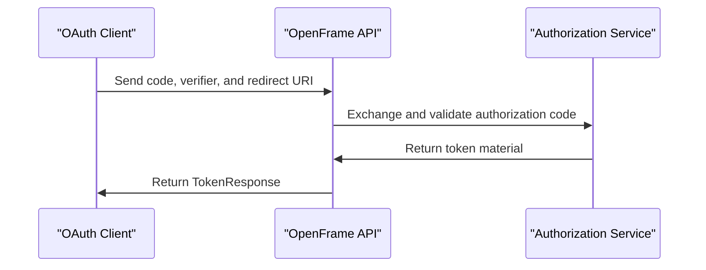

# OAuth Contracts

OAuth Contracts models the authorization-code exchange at the API boundary. It provides inputs carrying an authorization code, PKCE verifier, and redirect URI, plus outputs carrying an authorization result or issued token material.

## Components

| Component | Responsibility |
| --- | --- |
| [`AuthorizationResponse`](https://github.com/flamingo-stack/openframe-oss-lib/blob/7a766f00e4f58b5d89db007b878ac8d6e0c344f4/openframe-api-service-core/src/main/java/com/openframe/api/dto/oauth/AuthorizationResponse.java) | Returns an authorization `code`, `state`, and `redirectUri`. |
| [`GoogleTokenRequest`](https://github.com/flamingo-stack/openframe-oss-lib/blob/7a766f00e4f58b5d89db007b878ac8d6e0c344f4/openframe-api-service-core/src/main/java/com/openframe/api/dto/oauth/GoogleTokenRequest.java) | Represents code, `code_verifier`, and `redirect_uri` using fields named for the provider request. |
| [`SocialAuthRequest`](https://github.com/flamingo-stack/openframe-oss-lib/blob/7a766f00e4f58b5d89db007b878ac8d6e0c344f4/openframe-api-service-core/src/main/java/com/openframe/api/dto/oauth/SocialAuthRequest.java) | Represents the same exchange inputs with Java camel-case fields mapped to snake-case JSON. |
| [`TokenResponse`](https://github.com/flamingo-stack/openframe-oss-lib/blob/7a766f00e4f58b5d89db007b878ac8d6e0c344f4/openframe-api-service-core/src/main/java/com/openframe/api/dto/oauth/TokenResponse.java) | Serializes `access_token`, `refresh_token`, `token_type`, and `expires_in`. |

## Authorization-Code Exchange

## Serialization and Security

`SocialAuthRequest` and `TokenResponse` use Jackson mappings to preserve OAuth wire names while retaining idiomatic Java property names. `GoogleTokenRequest` instead declares snake-case Java fields directly. All of these classes can contain bearer credentials or authorization codes. Avoid logging complete instances, and avoid extending response fields with secrets not required by the client.

This module does not authenticate a client, validate PKCE, verify redirect URIs, or mint tokens. Those responsibilities belong to the authorization and security layers.
