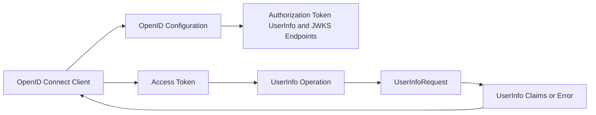

# Openid Connect

Openid Connect provides data shapes for provider discovery and user-info processing. It separates public OpenID Connect metadata, caller-supplied identity data, and the serializable claims or errors returned from a user-info operation.

## Components

| Component | Responsibility |
| --- | --- |
| [`OpenIDConfiguration`](https://github.com/flamingo-stack/openframe-oss-lib/blob/7a766f00e4f58b5d89db007b878ac8d6e0c344f4/openframe-api-service-core/src/main/java/com/openframe/api/dto/oidc/OpenIDConfiguration.java) | Publishes issuer, endpoint URLs, JWKS location, supported response types, subjects, algorithms, scopes, token-authentication methods, and claims. |
| [`UserInfoRequest`](https://github.com/flamingo-stack/openframe-oss-lib/blob/7a766f00e4f58b5d89db007b878ac8d6e0c344f4/openframe-api-service-core/src/main/java/com/openframe/api/dto/oidc/UserInfoRequest.java) | Holds internal identity data: user identifier, email, first name, and last name. |
| [`UserInfo`](https://github.com/flamingo-stack/openframe-oss-lib/blob/7a766f00e4f58b5d89db007b878ac8d6e0c344f4/openframe-api-service-core/src/main/java/com/openframe/api/dto/oidc/UserInfo.java) | Serializes standard claims or an error and error description, omitting null values. |

## Discovery and Claims Flow

## Wire Contract

Jackson maps Java properties to the discovery and claim names defined by OpenID Connect, including `userinfo_endpoint`, `id_token_signing_alg_values_supported`, `given_name`, `family_name`, and `email_verified`. `UserInfo` uses non-null inclusion so a successful claims response does not contain error fields, while an error response need not contain user claims.

The DTOs do not decide which claims a token may receive. Token validation, scope evaluation, and identity lookup must occur before constructing `UserInfo`.
