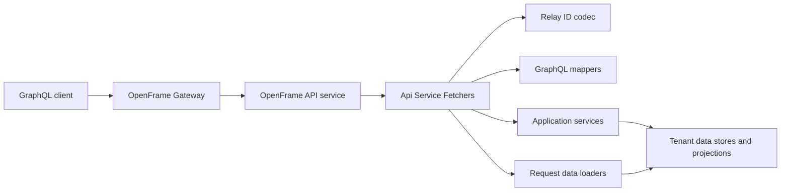
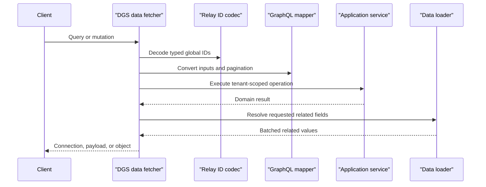

# Api Service Fetchers

Api Service Fetchers is the GraphQL resolver layer assembled into the tenant's `openframe-api` service from the OpenFrame OSS Library artifact `com.openframe.oss:openframe-api-service-core` version `7.0.11`. It turns DGS queries, mutations, and type-field requests into calls to tenant-scoped application services, while preserving the API boundary through validation, Relay global-ID conversion, mapper-owned pagination, and request-scoped data loading.

The implementation lives in the OpenFrame OSS Library. The tenant repository packages and runs it through the OpenFrame API application; its gateway route exposes the service beneath `/api/**`.

## Responsibilities

- Expose GraphQL read operations for organizations, devices, users, invitations, assignments, tags, knowledge-base content, notifications, time entries, package search, logs, and node lookup.
- Handle remote-management operations for commands, scripts, schedules, software inventory, package actions, and vulnerability views.
- Decode typed Relay IDs before passing requests to services, and re-encode applicable filter facets or returned references for clients.
- Build cursor-pagination criteria and map domain results to GraphQL connection types.
- Use DGS data loaders for related objects, avoiding per-row lookups in GraphQL lists.
- Derive the acting user or notification recipient from the authenticated request rather than accepting it from a client input.

## Architecture

Each `@DgsComponent` defines top-level query or mutation handlers and, where required, `@DgsData` handlers for nested schema fields. The fetchers deliberately remain orchestration code: domain decisions, authorization policies, persistence access, and external integration behavior are delegated to their services.

## Resolver Groups

### Core resource, collaboration, and operations fetchers

The non-RMM fetchers resolve the principal platform resources:

| Area | Fetchers | Main behavior |
| --- | --- | --- |
| Assignments | `AssignmentDataFetcher` | Lists, creates, and removes assignments; resolves assignment targets and derives ticket lifecycle fields. |
| Device inventory | `DeviceDataFetcher`, `DeviceLogDataFetcher` | Queries devices and selected filter facets, enriches machines with related entities, and conditionally exposes Loki-backed device logs. |
| Knowledge and work | `KnowledgeBaseDataFetcher`, `TimeEntryDataFetcher` | Manages knowledge-base trees, tags, publishing, attachments, timers, and time-entry links. |
| Identity and tenancy | `UserDataFetcher`, `InvitationDataFetcher`, `OrganizationDataFetcher`, `NodeDataFetcher` | Lists and manages users and invitations, queries organizations, and resolves Relay nodes. |
| Notifications and presence | `NotificationDataFetcher`, `NotificationSettingsDataFetcher`, `PresenceDataFetcher` | Provides recipient-scoped notification state, human-user preferences, and presence recording. |
| Discovery and audit | `TagDataFetcher`, `ToolsDataFetcher`, `PackageSearchDataFetcher`, `LogDataFetcher` | Supports tag and tool filters, package catalog search, and conditionally enabled audit-log access. |

### Remote-management fetchers

The `rmm` package provides operational GraphQL handlers:

| Area | Fetchers | Main behavior |
| --- | --- | --- |
| Execution | `CommandDataFetcher`, `ScriptDataFetcher`, `ScriptExecutionDataFetcher`, `ScheduleRunDataFetcher` | Dispatches commands and scripts, queries execution history, and resolves schedule-run views. |
| Script scheduling | `ScriptScheduleDataFetcher` | Maintains schedules, target devices or criteria, run-now dispatch, schedule fields, and selection/filter connections. |
| Software management | `SoftwareDataFetcher`, `SoftwareBundleDataFetcher`, `SoftwareScheduleDataFetcher`, `SoftwareInstallUpdatedDataFetcher`, `SoftwareActionDataFetcher`, `SoftwareNameDataFetcher` | Provides inventory, bundles, schedules, package installation/update dispatch, action history, and display-name projection. |
| Vulnerabilities | `VulnerabilityDataFetcher` | Lists CVEs, associated devices, tenant/device facets, and translates GraphQL sort keys for the underlying inventory. |

Software and vulnerability resolvers are registered only when `openframe.rmm.software.enabled=true`. Device-log access requires `openframe.loki.enabled=true`; audit-log access depends on `openframe.tool-events.store` being set.

## Shared Request Path

### Boundary conventions

- **Relay IDs:** Fetchers decode a global ID against the expected node type before service calls. This prevents, for example, treating a user identifier as a machine identifier. Several filter resolvers decode input facet IDs and re-encode facet results so the client round-trips opaque IDs consistently.
- **Connections:** List handlers translate `first`, `after`, `last`, and `before` into `CursorPaginationCriteria`. Most return counted generic connections; RMM software resolvers use page cursor helpers for their backing inventory APIs.
- **Selected work only:** Device filter and notification list resolvers inspect the GraphQL selection set. They request only selected facets or counts, avoiding unnecessary storage round trips.
- **Nested values:** Machine, time-entry, script, schedule-run, knowledge-base, and assignment fields use shared request loaders for users, machines, organizations, tags, tickets, scripts, and attachments.
- **Authentication context:** Mutations that act on behalf of a person obtain the user from `AuthPrincipal`; notification operations obtain the current recipient. The caller does not supply those identities.

## Notable Flows

### Device listing and enrichment

`DeviceDataFetcher` maps a requested device filter and selected facets, delegates the list query, then defers nested machine relationships to data loaders. It excludes inactive organizations from the `Machine.organization` field and builds unread-notification lookup keys using the current recipient.

### Knowledge-base attachment lifecycle

`KnowledgeBaseDataFetcher` resolves the current user for authoring and attachment operations. It creates upload URLs through attachment services, links temporary attachments to a decoded article ID, and converts known state or argument errors into typed mutation payload errors. Parent, tags, attachments, and author fields are resolved through loaders.

### RMM scripts and schedules

Script and schedule fetchers decode resource, user, tag, and machine IDs before invoking RMM services. They mask secret environment-variable values when resolving GraphQL fields. Schedule device assignments can be explicit or criteria based; related device lists use the normal device filtering and pagination machinery.

### Software inventory availability

The software resolver family is feature-gated. It serves inventory and vulnerability connections, targets devices for bundles and schedules, and delegates installation or update dispatch with the current user and an execution source. Package-manager availability informs which devices can be selected for software work.

## Library Source

All fetchers documented here are supplied by the OpenFrame OSS Library source revision `7a766f00e4f58b5d89db007b878ac8d6e0c344f4` in the [`datafetcher` package](https://github.com/flamingo-stack/openframe-oss-lib/blob/7a766f00e4f58b5d89db007b878ac8d6e0c344f4/openframe-api-service-core/src/main/java/com/openframe/api/datafetcher) and its [`rmm` package](https://github.com/flamingo-stack/openframe-oss-lib/blob/7a766f00e4f58b5d89db007b878ac8d6e0c344f4/openframe-api-service-core/src/main/java/com/openframe/api/datafetcher/rmm).
