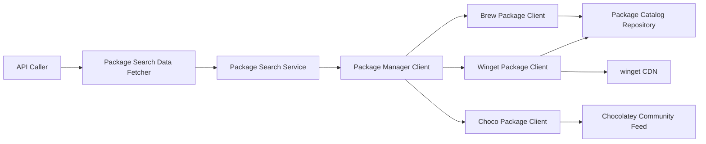
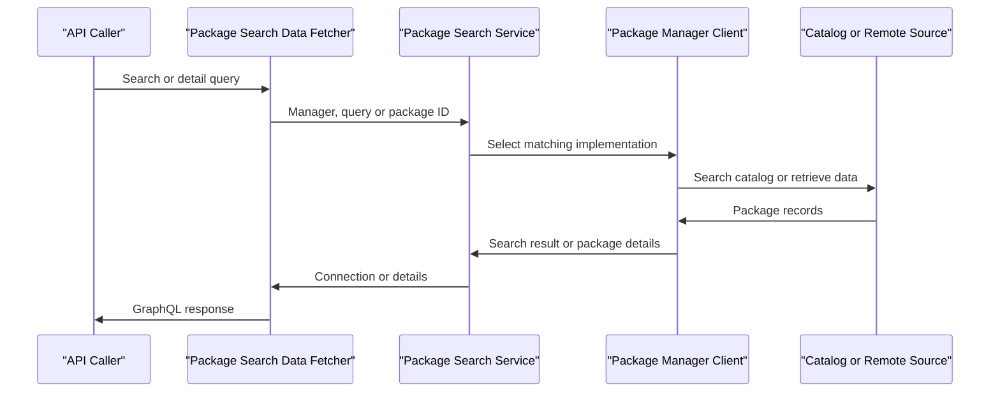
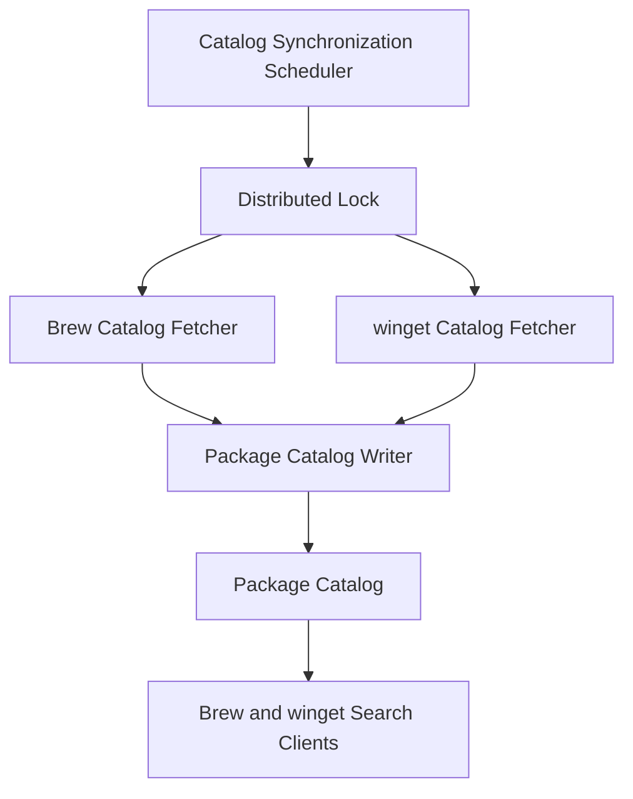

# Api Service Packagesearch

Api Service Packagesearch is the package-manager integration layer used by the OpenFrame API service. It gives API consumers a common way to search software packages and retrieve install-ready package details across Homebrew, winget, and Chocolatey.

The implementation comes from the `com.openframe.oss:openframe-api-service-core` library at version `7.0.11` and is assembled into this repository's `openframe-api` service. It is a service-layer module rather than an HTTP endpoint: the GraphQL package-search data fetcher forwards requests to a higher-level package search service, which selects the relevant package-manager client.

## Responsibilities

- Normalize search and detail operations behind a single client contract.
- Provide manager-specific installation commands with every returned package.
- Support cursor pagination despite differing source capabilities.
- Search locally synchronized catalogs for Brew and winget.
- Query the Chocolatey community feed directly.
- Cache remote detail responses and translate source failures into domain errors.

## Architecture

The module combines catalog-backed discovery with source-specific enrichment. Brew runs entirely from the catalog. winget searches the catalog, then downloads version metadata and a manifest for selected-package details. Chocolatey performs both search and detail lookup against its upstream OData feed.

## Request Flow

## Shared Client Contract

[`PackageManagerClient`](https://github.com/flamingo-stack/openframe-oss-lib/blob/7a766f00e4f58b5d89db007b878ac8d6e0c344f4/openframe-api-service-core/src/main/java/com/openframe/api/service/packagesearch/PackageManagerClient.java) defines the extension boundary for package-manager integrations.

| Operation | Responsibility | Notes |
|---|---|---|
| `getPackageManagerType()` | Identifies the implementation. | Enables client selection by manager type. |
| `search(query, afterCursor, limit)` | Returns `PackageSearchHit` values and page metadata. | Cursors are opaque and specific to the implementation that produced them. |
| `findPackage(packageId, packageType)` | Returns `PackageDetails`. | The type distinguishes Brew formulae from casks; other managers ignore it. |

## Brew Package Client

[`BrewPackageClient`](https://github.com/flamingo-stack/openframe-oss-lib/blob/7a766f00e4f58b5d89db007b878ac8d6e0c344f4/openframe-api-service-core/src/main/java/com/openframe/api/service/packagesearch/BrewPackageClient.java) is a catalog-only implementation.

- Searches `PackageCatalogRepository` using popularity-first ordering.
- Preserves the repository's cursor, exact total, and `hasMore` result.
- Looks up package IDs case-insensitively.
- Resolves duplicate IDs formula-first and then cask when the caller does not supply a Brew type.
- Builds `brew install <id>` for formulae and `brew install --cask <id>` for casks.
- Exposes the catalog's current version as the available version when present.

## Winget Package Client

[`WingetPackageClient`](https://github.com/flamingo-stack/openframe-oss-lib/blob/7a766f00e4f58b5d89db007b878ac8d6e0c344f4/openframe-api-service-core/src/main/java/com/openframe/api/service/packagesearch/WingetPackageClient.java) uses the local catalog for search and the winget CDN for package details.

- Searches the local catalog by name because winget does not publish install counts.
- Resolves a package case-insensitively in the catalog before loading details.
- Downloads and decompresses version metadata, then parses relevant lines as strings to preserve version formatting.
- Loads the latest manifest to enrich the package with description, publisher, URLs, license, tags, and an optional icon.
- Falls back to catalog fields when manifest data is unavailable.
- Caches detail records with a configured lifetime and a maximum of 5,000 entries.
- Builds `winget install -e --id <id>` commands.

## Choco Package Client

[`ChocoPackageClient`](https://github.com/flamingo-stack/openframe-oss-lib/blob/7a766f00e4f58b5d89db007b878ac8d6e0c344f4/openframe-api-service-core/src/main/java/com/openframe/api/service/packagesearch/ChocoPackageClient.java) queries the Chocolatey community OData feed directly.

- Escapes search and ID values as OData literals before embedding them in requests.
- Represents cursors as zero-based upstream indexes and restarts at the first page for missing or invalid cursors.
- Requests one additional item so `hasMore` can be calculated without a count request. Total is therefore unavailable.
- Ranks the returned page by relevance, then download count, then package ID.
- Retrieves the latest package and version records for details.
- Uses summary text where available, truncates lengthy list descriptions, and splits feed tags on whitespace.
- Caches details with a configured lifetime and a maximum of 2,000 entries.
- Builds `choco install <id>` commands.

## Catalog Search and Synchronization

Brew and winget catalog searches score names case-insensitively: exact match outranks prefix match, which outranks a non-prefix substring match. The repository then orders results by manager policy and emits a cursor containing score, package ID, and the manager's secondary ordering value. This gives stable forward pagination and exact totals for catalog-backed sources.

The management service refreshes Brew and winget catalog snapshots independently. Each synchronization task is lock-protected; on a fetch or write failure, it keeps the previous catalog rather than replacing it with incomplete data.

## Configuration and Caching

The `PackageSearchProperties` configuration binds beneath `openframe.package-search`.

| Source | Default base URL | Default timeout | Detail cache duration |
|---|---|---:|---:|
| Chocolatey | `https://community.chocolatey.org/api/v2` | 15 seconds | 30 minutes |
| winget | `https://cdn.winget.microsoft.com` | 30 seconds | 30 minutes |

Chocolatey and winget create HTTP clients through the shared package-search REST client factory. Brew does not need a runtime HTTP client because it reads the local catalog.

## Failure Behavior

| Condition | Result |
|---|---|
| Package cannot be found in the selected source | `PackageNotFoundException` |
| Chocolatey transport, feed parsing, or null-response failure | `PackageSourceUnavailableException` with a Chocolatey availability message |
| winget transport, decompression, metadata parsing, or manifest parsing failure | `PackageSourceUnavailableException` with a winget availability message |
| Invalid local catalog cursor | Repository logs a warning and serves the first page |

## Maintenance Guidance

- Never reuse cursors across package managers. Catalog cursors encode ordering fields, while Chocolatey cursors are numeric offsets.
- Retain OData escaping when changing Chocolatey request construction.
- Keep winget version-data parsing string-based; YAML numeric conversion can alter package version values.
- New package managers must implement the complete `PackageManagerClient` contract and define independent cursor semantics.
- Changes to catalog ranking or cursor shape can affect active client pagination and require compatibility review.
