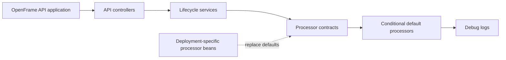
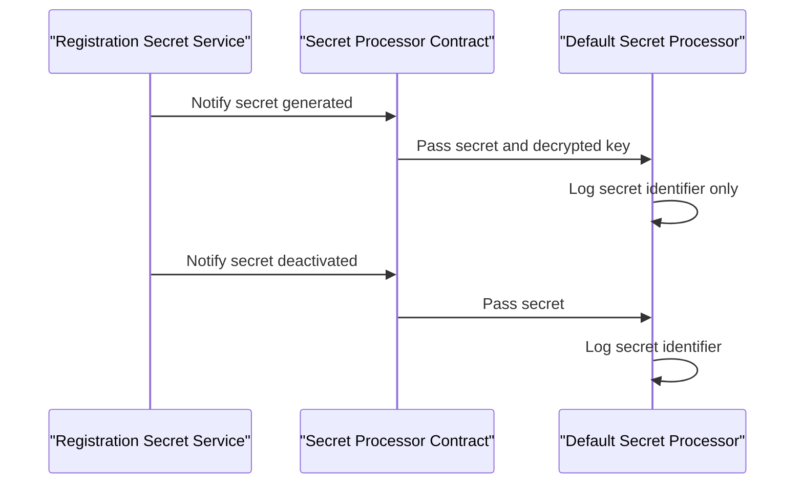
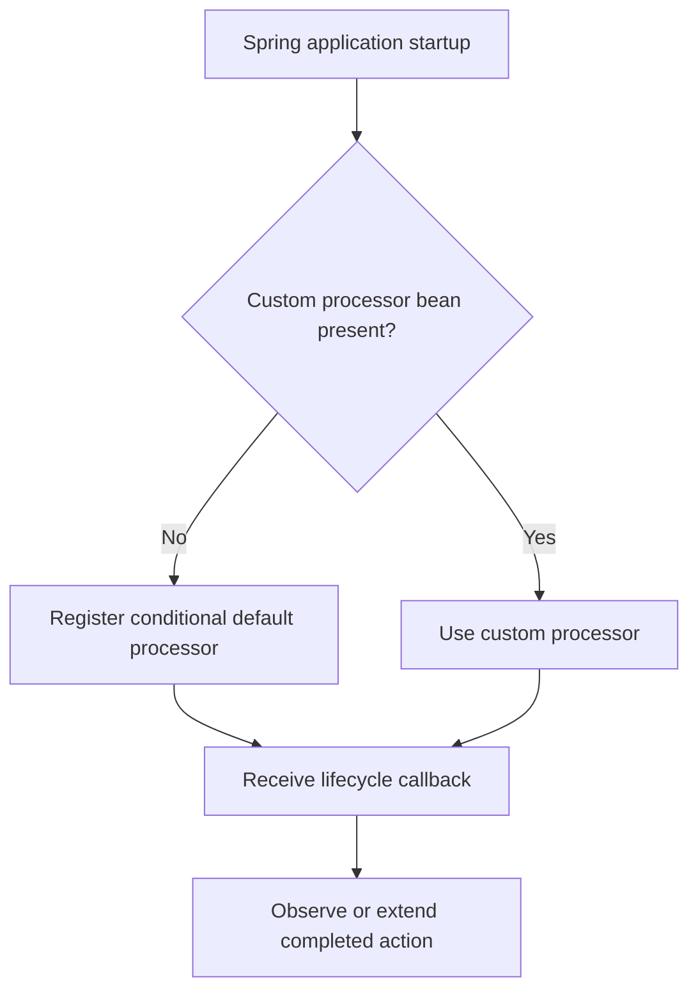

# Api Service Processors

## Purpose

Api Service Processors supplies the OpenFrame API service with safe default extension points for lifecycle events involving agent registration secrets, user invitations, single sign-on configuration, and users. The module is provided by the `com.openframe.oss:openframe-api-service-core` library at version `7.0.11` and is assembled by this repository's OpenFrame API application.

Each default processor is a Spring component guarded by `@ConditionalOnMissingBean`. It becomes active only when the application has not supplied another implementation of the corresponding processor contract. In the OSS default, processors deliberately perform no state-changing integration work; they emit debug logs that identify the completed lifecycle action. This preserves a stable callback boundary for deployments that need custom automation without imposing one on all deployments.

## Architecture

The module is an adapter layer rather than a primary persistence or transport layer:

1. Controllers and services own request handling, validation, persistence, and lifecycle decisions.
2. A processor contract is invoked after a relevant lifecycle action has completed.
3. Spring selects the default implementation only when no alternate contract implementation is registered.
4. Default implementations log identifying metadata and return, leaving domain state unchanged.

## Component Responsibilities

| Component | Lifecycle callbacks | Default behavior |
|---|---|---|
| [`DefaultAgentRegistrationSecretProcessor`](https://github.com/flamingo-stack/openframe-oss-lib/blob/7a766f00e4f58b5d89db007b878ac8d6e0c344f4/openframe-api-service-core/src/main/java/com/openframe/api/service/processor/DefaultAgentRegistrationSecretProcessor.java) | Registration secret generated or deactivated | Logs the secret identifier. |
| [`DefaultInvitationProcessor`](https://github.com/flamingo-stack/openframe-oss-lib/blob/7a766f00e4f58b5d89db007b878ac8d6e0c344f4/openframe-api-service-core/src/main/java/com/openframe/api/service/processor/DefaultInvitationProcessor.java) | Invitation created or revoked | Logs the invitation identifier and email address. |
| [`DefaultSSOConfigProcessor`](https://github.com/flamingo-stack/openframe-oss-lib/blob/7a766f00e4f58b5d89db007b878ac8d6e0c344f4/openframe-api-service-core/src/main/java/com/openframe/api/service/processor/DefaultSSOConfigProcessor.java) | SSO configuration saved, deleted, or toggled | Logs the provider and, where relevant, whether it is enabled. |
| [`DefaultUserProcessor`](https://github.com/flamingo-stack/openframe-oss-lib/blob/7a766f00e4f58b5d89db007b878ac8d6e0c344f4/openframe-api-service-core/src/main/java/com/openframe/api/service/processor/DefaultUserProcessor.java) | User deleted, fetched, or updated | Logs the user identifier or the number of returned users. |

## Lifecycle Flows

### Agent Registration Secrets

`DefaultAgentRegistrationSecretProcessor` implements the secret-processing extension point. When the surrounding service generates a secret, it receives both the persisted secret and a decrypted key; the default implementation intentionally logs only the persisted secret ID and does not log the decrypted key. On deactivation, it logs the same stable identifier.

This is an appropriate extension boundary for a deployment-specific implementation that must react to secret lifecycle events. Any replacement must treat the decrypted key as sensitive material and avoid emitting it in logs.

### Invitations

`DefaultInvitationProcessor` observes creation and revocation. Its logging includes an invitation ID and email address, making the default useful for debug-level lifecycle tracing while not introducing delivery, identity-provider, or notification side effects.

A custom implementation can replace this bean to connect invitation lifecycle events to an approved workflow. It should preserve the completion semantics of the caller: the source API operation remains responsible for the invitation domain change.

### Single Sign-On Configuration

`DefaultSSOConfigProcessor` provides callbacks after SSO configuration saves, deletes, and enabled-state changes. It reports the configuration provider, and it reports the enabled state for save and toggle operations.

This separation makes SSO configuration lifecycle observation optional. The default processor does not modify the SSO configuration, reload clients, or initiate an authentication flow.

### Users

`DefaultUserProcessor` covers mutations and reads:

- On deletion and update, it logs the user ID.
- For a paged user result, it logs the number of items in the response.
- For a single-user result, it logs the response ID.

The two read callbacks let a replacement distinguish aggregate retrieval from individual retrieval without requiring the default implementation to transform response data.

## Replacement and Operational Boundaries

All four classes use Spring's conditional-bean mechanism with their processor interface as the condition target and the default class ignored in the missing-bean check. Therefore, registering one compatible custom implementation for a processor contract prevents its corresponding default processor from being selected.

### Implementation Guidance

- Keep callback work bounded and failure-aware so a custom integration does not unexpectedly compromise the originating lifecycle operation.
- Do not duplicate persistence responsibilities already owned by the service that invokes the processor.
- Protect secret material and personally identifiable data. In particular, the default secret processor receives a decrypted key but does not write it to logs.
- Use the callback-specific object or response type rather than re-querying data unless the custom integration requires additional context.
- Treat the default debug output as operational trace data, not as a guaranteed audit trail.

## Position in the OpenFrame API Service

The processors run in the OpenFrame API service, whose image is published as `ghcr.io/flamingo-stack/openframe-oss-tenant/openframe-api`. The library that supplies this module is an upstream dependency rather than source maintained in this repository; component links above point to the pinned library revision.

The module complements nearby API-service areas without replacing them:

- API controllers expose management operations and initiate the relevant application workflows.
- Data repositories persist domain documents such as registration secrets, invitations, SSO configuration, and users.
- Api Service Processors provide opt-in post-lifecycle hooks after those workflows act on their domain objects.

No HTTP route is defined by these four processor classes. They are invoked through their processor contracts, so endpoint details belong to the applicable controller and API contract documentation.

## Verification Focus

When changing or replacing a processor, verify:

1. The intended custom processor bean is discovered and the default for that contract is not selected.
2. Generated or deactivated secrets never expose decrypted values through logs or telemetry.
3. Invitation, SSO configuration, and user callbacks receive the expected post-action data.
4. Read callbacks correctly handle both a page response and a single-user response.
5. Debug logging provides enough correlation information without adding unapproved side effects.
