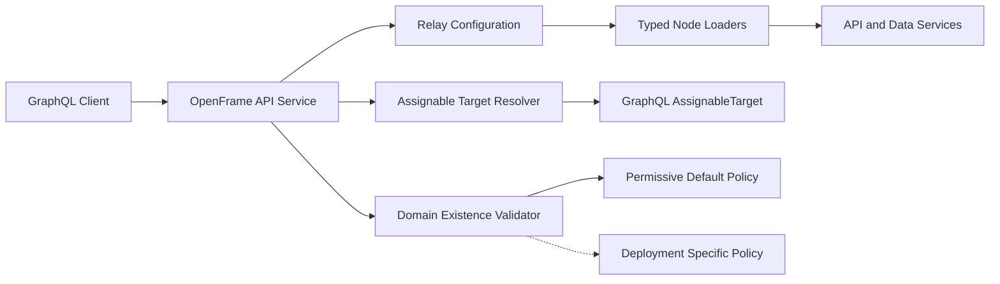
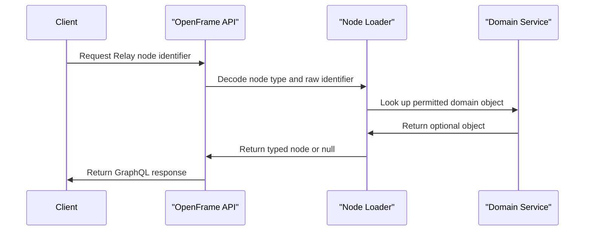

# Api Service Relay Auth Domains

Api Service Relay Auth Domains is a small integration layer in the OpenFrame API service. It is supplied by the `com.openframe.oss:openframe-api-service-core` library and assembled by this repository's `openframe-api` application. The module has two responsibilities:

- make domain objects addressable through GraphQL Relay node identifiers and resolve the concrete GraphQL type for assignable targets;
- provide an overridable policy boundary for checking whether one or more email or tenant domains already exist.

The library's default domain policy is deliberately permissive: `anyExists` returns `false`. A deployment that needs domain collision checks supplies its own `DomainExistenceValidator` bean, which replaces the default implementation.

## Architecture

`ApiNodeLoaderConfiguration` publishes Spring `NodeLoader` beans. Each loader binds one Relay `NodeType`, a Java model type, and a lookup function. Most lookups use service methods directly. Tenant, software-bundle, and ticket loaders use optional service providers so deployments without the underlying feature resolve those nodes as absent rather than failing startup. Ticket lookup additionally passes the authenticated principal to preserve authorization during node resolution.

`AssignableTargetTypeResolver` converts the runtime object returned by an assignable-target query into a GraphQL type name. It recognizes organizations, machines, tickets, and knowledge-base items, and explicitly rejects unexpected types.

## Resolution Flow

A missing optional dependency, an unknown identifier, a closed invitation, or an unavailable record produces no node. The configuration treats accepted and revoked invitations as non-nodes because its invitation lookup asks specifically for open invitations.

## Components

### Relay Integration

The Relay integration provides the Spring node-loader registry and the DGS resolver for the `AssignableTarget` GraphQL abstraction. It spans GraphQL concerns and domain services without duplicating data-access logic.

### Domain Validation Policy

The domain-validation policy is a narrow interface and a Spring default. Consumers call one method with a list of domains. The default implementation is activated only when no other `DomainExistenceValidator` bean is available, allowing a tenant-specific application to substitute stricter behavior without modifying this library.

## Detailed Modules

- [Relay Integration](api_service_relay_auth_domains/relay_integration/relay_integration.md) documents the Relay node-loader registry, optional feature handling, authorization-aware ticket lookup, and `AssignableTarget` runtime-type mapping.
- [Domain Validation](api_service_relay_auth_domains/domain_validation/domain_validation.md) documents the domain-existence contract, its permissive fallback, and the bean-replacement mechanism for tenant-specific policy.

## Runtime Boundaries

This module runs inside the API service rather than exposing an HTTP endpoint itself. It depends on API service interfaces for machine, organization, tool, tag, installed-agent, script, scheduling, ticket, invitation, and user retrieval. The actual persistence and tenant behavior belong to the services and repositories behind those interfaces.

The implementation is sourced from OpenFrame OSS Library release `7.0.11`. The application routing the API behind the gateway is configured in the tenant repository, while the Relay and validation code documented here remains library-owned.

## Source Files

- [Api Node Loader Configuration](https://github.com/flamingo-stack/openframe-oss-lib/blob/7a766f00e4f58b5d89db007b878ac8d6e0c344f4/openframe-api-service-core/src/main/java/com/openframe/api/relay/ApiNodeLoaderConfiguration.java)
- [Assignable Target Type Resolver](https://github.com/flamingo-stack/openframe-oss-lib/blob/7a766f00e4f58b5d89db007b878ac8d6e0c344f4/openframe-api-service-core/src/main/java/com/openframe/api/relay/AssignableTargetTypeResolver.java)
- [Default Domain Existence Validator](https://github.com/flamingo-stack/openframe-oss-lib/blob/7a766f00e4f58b5d89db007b878ac8d6e0c344f4/openframe-api-service-core/src/main/java/com/openframe/api/service/DefaultDomainExistenceValidator.java)
- [Domain Existence Validator](https://github.com/flamingo-stack/openframe-oss-lib/blob/7a766f00e4f58b5d89db007b878ac8d6e0c344f4/openframe-api-service-core/src/main/java/com/openframe/api/service/DomainExistenceValidator.java)
