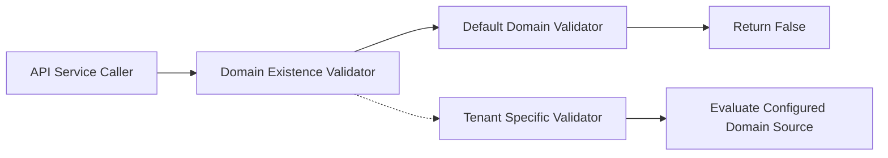

# Domain Validation

Domain Validation defines an extension point for domain-existence checks in Api Service Relay Auth Domains. It consists of the `DomainExistenceValidator` contract and `DefaultDomainExistenceValidator` library implementation.

## Contract

`DomainExistenceValidator` exposes a single operation, `anyExists`, that accepts a list of domain strings and returns whether at least one supplied domain already exists. The small interface keeps calling code independent of storage, tenant topology, and the particular definition of existence.

## Default Behavior

`DefaultDomainExistenceValidator` is a Spring component whose `anyExists` implementation always returns `false`. It therefore does not block a workflow based on an existing domain when the API service core library is used without a specialized validator.

The class is annotated with `ConditionalOnMissingBean`. Spring creates it only when no other bean implementing `DomainExistenceValidator` is available, while explicitly excluding the default class itself from that condition. An application can register another implementation to replace this fallback policy without changing callers or library code.

## Operational Implications

- The default result is permissive, not a database-backed absence check.
- A tenant-specific override is responsible for its own normalization, storage query, and failure behavior.
- Callers should treat the validator as a policy decision point rather than infer persistence semantics from the interface.

## Source

- [Domain Existence Validator](https://github.com/flamingo-stack/openframe-oss-lib/blob/7a766f00e4f58b5d89db007b878ac8d6e0c344f4/openframe-api-service-core/src/main/java/com/openframe/api/service/DomainExistenceValidator.java)
- [Default Domain Existence Validator](https://github.com/flamingo-stack/openframe-oss-lib/blob/7a766f00e4f58b5d89db007b878ac8d6e0c344f4/openframe-api-service-core/src/main/java/com/openframe/api/service/DefaultDomainExistenceValidator.java)
