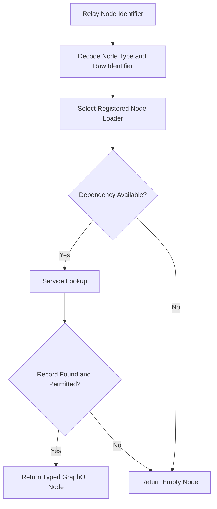

# Relay Integration

Relay Integration supplies the GraphQL wiring in Api Service Relay Auth Domains. It is implemented by `ApiNodeLoaderConfiguration` and `AssignableTargetTypeResolver` from OpenFrame OSS Library's API service core.

## Node Loader Registry

`ApiNodeLoaderConfiguration` is a Spring configuration class that registers a `NodeLoader` for each supported Relay node type. Every loader is created with `LookupNodeLoader` and maps a decoded raw identifier to an optional domain object.

| Node category | Resolved Java representation | Lookup collaborator |
|---|---|---|
| Machine | `Machine` | `DeviceService.findByMachineId` |
| Organization | `Organization` | `OrganizationService.getOrganizationByOrganizationId` |
| Integrated tool | `IntegratedTool` | `ToolService.findById` |
| Tag and machine tag | `Tag` or `MachineTag` | `TagService` |
| Tool connection | `ToolConnection` | `ToolConnectionService.findById` |
| Installed agent | `InstalledAgent` | `InstalledAgentService.getInstalledAgent` |
| Script, execution, schedule, and run | API response DTOs | Script and scheduling services |
| User and invitation | API response DTOs | `UserService` and `InvitationService` |

Machine-tag and user APIs operate on identifier lists. The configuration adapts a Relay raw identifier into a one-element list and returns the first result when present.

## Optional Features and Authorization

Tenant, software-bundle, and ticket support can be absent in a deployment. The configuration receives those dependencies via `ObjectProvider`; when no dependency is registered, it returns an empty result instead of failing application initialization.

Ticket resolution uses `LookupNodeLoader.byPrincipalAndRawId`. The loader forwards the authenticated `AuthPrincipal` to `TicketService.getTicket`, so a Relay lookup follows the same authorization-aware retrieval path as other ticket access.

Invitations are intentionally narrower: `InvitationService.findOpenInvitation` means only open invitations can be resolved as nodes. Accepted and revoked invitations do not participate in this Relay lookup.

## Assignable Target Resolution

`AssignableTargetTypeResolver` is a DGS component that selects the GraphQL runtime type for an `AssignableTarget` value:

- `Organization` becomes `Organization`.
- `Machine` becomes `Machine`.
- `Ticket` becomes `Ticket`.
- `KnowledgeBaseItem` becomes `KnowledgeBaseItem`.

An unknown runtime class triggers `IllegalArgumentException`. This makes a missing schema mapping visible rather than silently returning a mismatched GraphQL type.

## Source

- [Api Node Loader Configuration](https://github.com/flamingo-stack/openframe-oss-lib/blob/7a766f00e4f58b5d89db007b878ac8d6e0c344f4/openframe-api-service-core/src/main/java/com/openframe/api/relay/ApiNodeLoaderConfiguration.java)
- [Assignable Target Type Resolver](https://github.com/flamingo-stack/openframe-oss-lib/blob/7a766f00e4f58b5d89db007b878ac8d6e0c344f4/openframe-api-service-core/src/main/java/com/openframe/api/relay/AssignableTargetTypeResolver.java)
