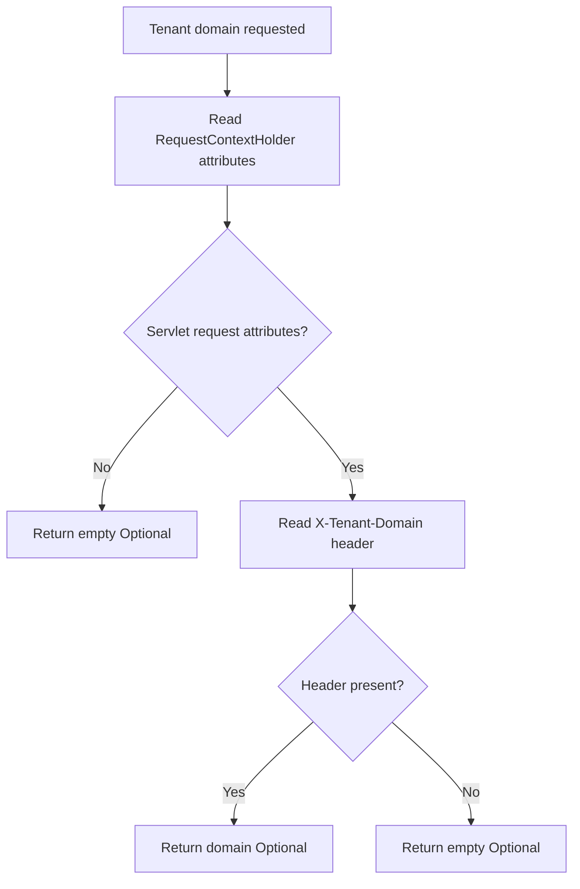
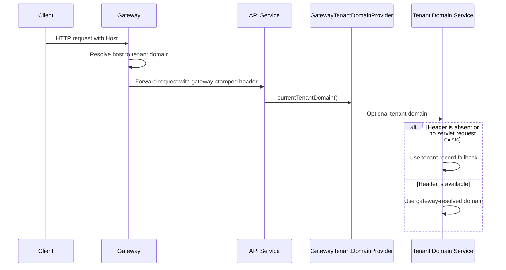
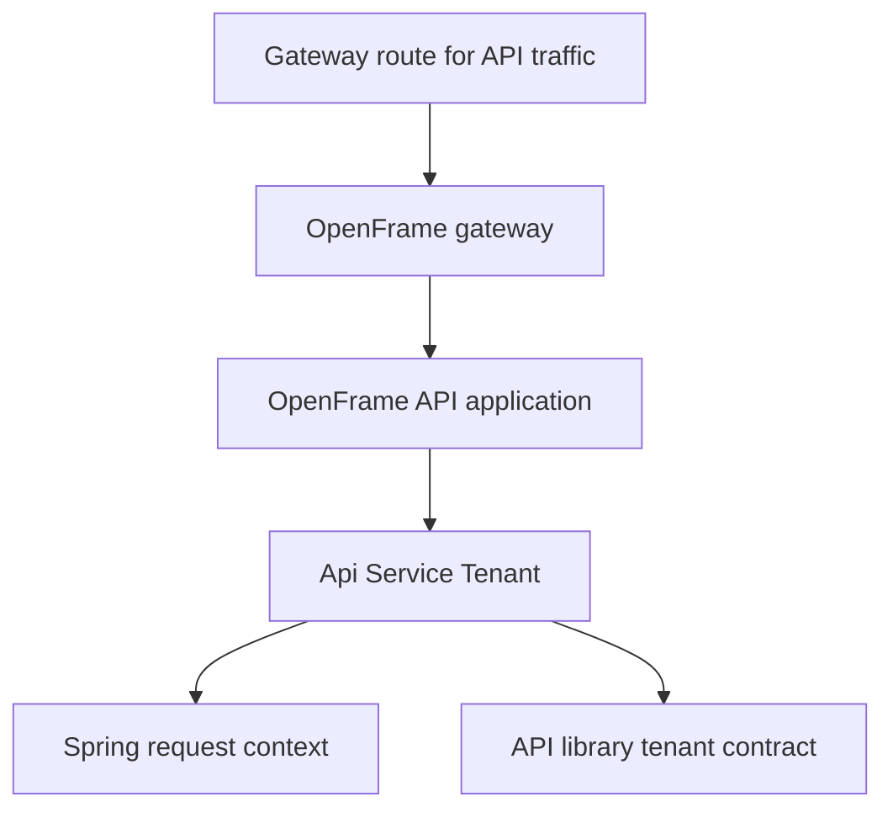

# Api Service Tenant

Api Service Tenant provides request-scoped tenant-domain resolution for the OpenFrame API service. Its single Spring component, `GatewayTenantDomainProvider`, reads the `X-Tenant-Domain` value placed on an HTTP request by the shared gateway and exposes it through the API library's `RequestTenantDomainProvider` contract.

The implementation is supplied by the OpenFrame OSS Library artifact `com.openframe.oss:openframe-api-service-core` at version `7.0.11` and is assembled into this repository's `openframe-api` service. The component source is maintained in [GatewayTenantDomainProvider.java](https://github.com/flamingo-stack/openframe-oss-lib/blob/7a766f00e4f58b5d89db007b878ac8d6e0c344f4/openframe-api-service-core/src/main/java/com/openframe/api/tenant/GatewayTenantDomainProvider.java).

## Purpose and Scope

The module bridges two concerns:

- **Gateway context:** the gateway resolves the inbound `Host` against the tenant domain and stamps the resolved domain into `X-Tenant-Domain`.
- **API tenant services:** API code can request the domain for the current servlet request without directly coupling itself to servlet APIs or the gateway header name.

It does not authenticate a request, resolve host names itself, query tenant records, persist data, or expose an HTTP endpoint. Its responsibility is deliberately limited to retrieving an already-stamped request value.

## Architecture

```mermaid
flowchart LR
    Client["Client request with Host"] --> Gateway["OpenFrame gateway"]
    Gateway -->|"resolves tenant domain"| StampedRequest["HTTP request with X-Tenant-Domain"]
    StampedRequest --> ApiService["OpenFrame API service"]
    ApiService --> Provider["GatewayTenantDomainProvider"]
    Provider --> Contract["RequestTenantDomainProvider contract"]
    Contract --> TenantService["Tenant domain consumer"]
    TenantService --> Fallback["Tenant record fallback when header is absent"]
```

The gateway is the trust boundary for this context. According to the component contract, the gateway removes any inbound tenant-domain header before injecting its own resolved value. Consequently, the provider treats the header as gateway-derived rather than accepting a client-supplied tenant identity.

## Component Design

| Element | Role |
|---|---|
| `GatewayTenantDomainProvider` | Spring `@Component` implementation used by the API service. |
| `RequestTenantDomainProvider` | API-library abstraction for retrieving an optional tenant domain from request context. |
| `TENANT_DOMAIN_HEADER` | Package-visible constant whose value is `X-Tenant-Domain`. |
| `RequestContextHolder` | Spring request-context access point used to obtain the current request attributes. |
| `ServletRequestAttributes` | Required request-attribute type; it provides access to the servlet request and its headers. |

The provider's `currentTenantDomain()` method follows this behavior:

1. Obtain the request attributes from Spring's `RequestContextHolder`.
2. Return an empty `Optional` when no attributes exist or the attributes are not servlet request attributes.
3. Read `X-Tenant-Domain` from the current servlet request.
4. Return the header value as an `Optional`, empty when the header is absent.

## Runtime Interaction

On a gateway-routed API request, the provider participates in tenant selection as a read-only context adapter. The component comment identifies two normal cases where it has no value: execution outside an HTTP request, such as scheduled work or NATS consumers, and requests that did not traverse the gateway, such as actuator probes or local runs. In those cases, the downstream tenant-domain service is expected to use its tenant-record fallback.

## Dependencies and System Placement

Api Service Tenant belongs to the API service layer provided by the OpenFrame OSS Library. It relies on Spring Web's servlet request context and the API library's tenant-domain interface. It is activated through component scanning when the OpenFrame API application starts.

The deployed platform routes `/api/**` from the OpenFrame gateway to the `openframe-api` service. This placement means the provider is relevant to API traffic that arrives through the configured gateway route; it is not a general tenant resolver for messaging, scheduled processing, or direct probe traffic.

## Operational and Maintenance Notes

- Preserve the exact header name, `X-Tenant-Domain`, in both gateway stamping and provider lookup. A mismatch causes the provider to return an empty value.
- Do not treat a missing value as an exceptional condition in this component. It is intentional for non-request execution and traffic that bypasses the gateway.
- Keep tenant-domain resolution at the gateway; adding host parsing or database access here would duplicate responsibilities and weaken the module's focused adapter role.
- The security assumption depends on the gateway stripping externally supplied tenant-domain headers before forwarding requests. Any gateway change affecting that behavior must be reviewed together with this provider.
- When testing, cover both a servlet request with the header and contexts without servlet request attributes. Verify that header-absent behavior reaches the tenant-record fallback in the consuming service.

## Data and Failure Semantics

The module has no persistent state and performs no I/O beyond accessing the in-memory request context. It does not validate the header format or report errors. Its complete output domain is an `Optional<String>`:

| Condition | Result | Expected consumer behavior |
|---|---|---|
| Gateway-routed servlet request contains `X-Tenant-Domain` | Domain value is returned | Use the gateway-resolved domain. |
| Servlet request lacks the header | Empty result | Resolve using the tenant record fallback. |
| No active request or non-servlet request attributes | Empty result | Resolve using the tenant record fallback. |

This narrow contract makes the module suitable for request-aware tenant selection while leaving policy, persistence, and fallback decisions to the API library's tenant-domain service.
