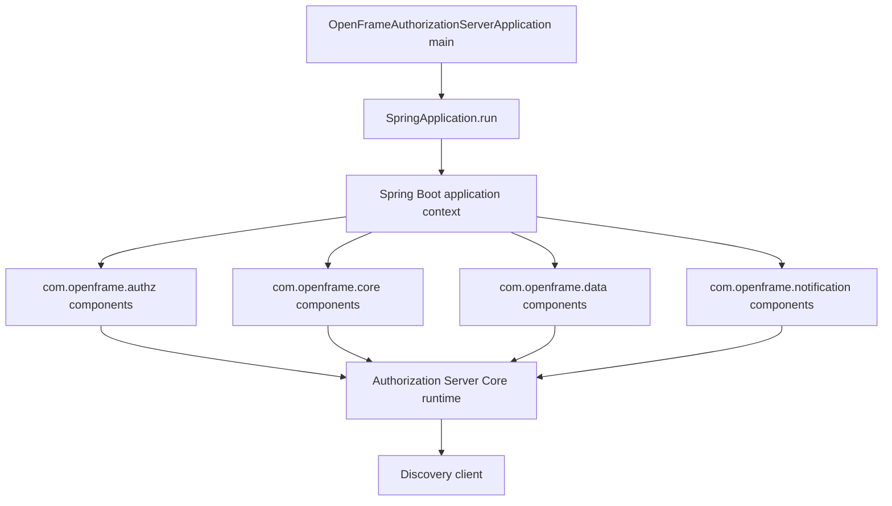
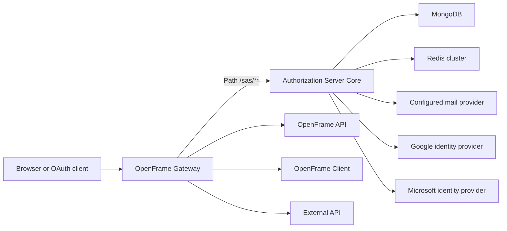
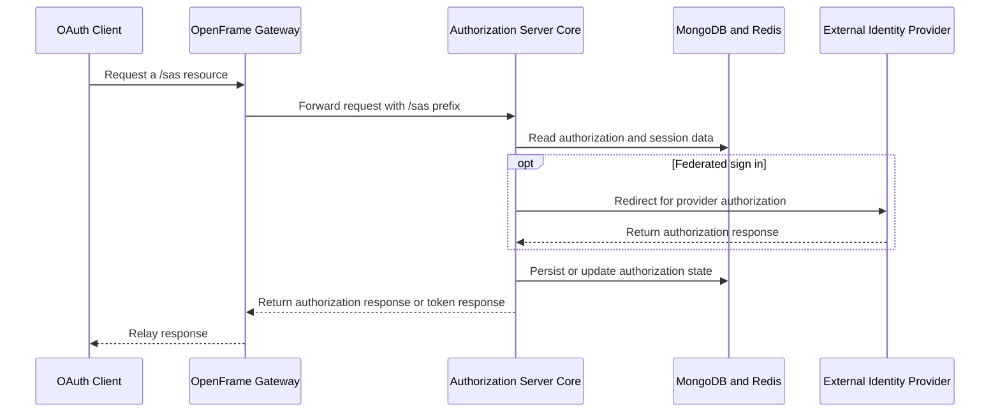
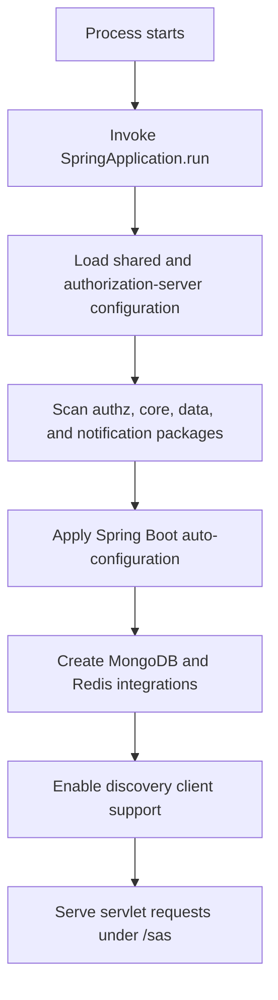

# Authorization Server Core

Authorization Server Core is the Spring Boot entry point for OpenFrame's OAuth2 and OpenID Connect authorization service. It starts the servlet-based authorization-server process, discovers it as a platform service, and composes the OpenFrame authorization, data, and notification capabilities into one runtime. The module publishes the `com.openframe:openframe-authorization-server` Maven artifact and is delivered as the `openframe-authorization-server` container image.

The application class is intentionally small: authorization protocols, persistence behavior, and notification integrations are supplied by the OpenFrame OSS library dependencies rather than implemented in the bootstrap class. This module's responsibilities are therefore to define the executable application boundary, select its component scan, and load service configuration.

## Entry Point and Runtime Composition

[`OpenFrameAuthorizationServerApplication`](https://github.com/flamingo-stack/openframe-oss-tenant/blob/main/openframe/services/openframe-authorization-server/src/main/java/com/openframe/authz/OpenFrameAuthorizationServerApplication.java) is the module's sole provided core component. Its `main` method delegates startup to `SpringApplication.run`.

The class combines three Spring annotations:

| Annotation | Role in Authorization Server Core |
| --- | --- |
| `@SpringBootApplication` | Enables Spring Boot configuration, auto-configuration, and component discovery for the executable service. |
| `@EnableDiscoveryClient` | Enables service-discovery client support so the authorization server can participate in the platform's discovery-aware runtime. |
| `@ComponentScan` | Extends scanning beyond `com.openframe.authz` to include `com.openframe.core`, `com.openframe.data`, and `com.openframe.notification`. |

The expanded scan boundary is significant. It makes the authorization service's locally declared bootstrap package work alongside shared OpenFrame library components for authorization, persistence, common facilities, and notifications. The executable depends directly on `openframe-authorization-service-core` and `openframe-data-redis`, both supplied from OpenFrame OSS Library release `7.0.11`; it also includes Spring Cloud Config and the Spring Boot starter.

## Position in the Platform

Authorization Server Core is a servlet service with a configured application port of `9005` and context path `/sas`. Its management server listens on `9006`. The gateway configuration exposes the service through the `/sas/**` route, forwarding to the in-cluster authorization-server service on port `9005` without stripping the `/sas` prefix.

The module is one service in the tenant deployment. The gateway is the configured request entry point for `/sas/**`; backend services can rely on the platform's authentication and authorization arrangements without embedding an authorization-server bootstrap of their own. The gateway configuration also identifies the authorization-server URL as the OAuth authorization-server base and the permitted issuer base for gateway JWT validation.

### Dependency Boundaries

| Dependency or system | How Authorization Server Core uses it |
| --- | --- |
| OpenFrame Authorization Service Core | Provides the authorization-service capability assembled by this application's Maven module. |
| OpenFrame Data Redis | Is included for Redis-backed data support; the service enables Redis and configures the Lettuce client pool. |
| MongoDB | Is enabled for the service. Shared configuration supplies the MongoDB connection settings and automatic index creation. |
| Redis cluster | Is enabled with a 2-second connection and command timeout. Shared configuration supplies the cluster nodes. |
| Spring Cloud Config | Is a direct dependency. Shared configuration points logging configuration at the platform config service. |
| Gateway Service Core | Routes `/sas/**` requests to this service and uses the configured authorization-server base for its OAuth integration and JWT issuer policy. |
| Google and Microsoft | Their OAuth/OIDC endpoint settings and redirect URIs are configured as supported SSO providers. |

## Request and Token Flow

The module configuration establishes the `/sas` boundary and includes OAuth2 token lifetimes. The authorization service core dependency supplies the protocol implementation. The sequence below describes the configured integration boundary, not a replacement specification for protocol behavior.

For the configured Google provider, the service defines authorization, token, user-info, issuer, and JWK-set endpoints and requests `openid`, `profile`, and `email` scopes. Microsoft settings support both tenant-specific endpoints, selected when a Microsoft tenant ID is present in SSO configuration, and common endpoints otherwise. Both login and registration callback URLs are constructed beneath `/sas` using `TENANT_HOST_URL`, which defaults to `https://localhost` when it is not set.

## Configuration Model

Service-specific settings are in [`openframe-authorization-server.yml`](https://github.com/flamingo-stack/openframe-oss-tenant/blob/main/configs/base/openframe-authorization-server.yml). Shared settings, including MongoDB, Redis-cluster, management, logging, encryption, and tenant-isolation defaults, are in [`application.yml`](https://github.com/flamingo-stack/openframe-oss-tenant/blob/main/configs/base/application.yml).

| Configuration area | Effective module behavior |
| --- | --- |
| Web runtime | Uses the servlet web-application type, port `9005`, native forwarded-header handling, and `/sas` context path. |
| Persistence | Enables MongoDB and Redis. The shared MongoDB configuration enables automatic index creation. |
| Redis client | Uses Lettuce with an enabled pool: up to 8 active and 8 idle connections, 0 minimum idle connections, and a 1-second maximum wait. |
| Tokens | Configures a 900-second access-token lifetime and a 604800-second refresh-token lifetime. |
| Password reset | Builds reset links from `TENANT_HOST_URL` with the `/reset-password` path and a token parameter. |
| Encryption | Reads encryption password and salt from `ENCRYPTION_PASSWORD` and `ENCRYPTION_SALT`, with values defined in the current configuration as fallbacks. Treat these settings as secrets and provide deployment-specific values. |
| Observability | The common management endpoint base is `/management/<release version>` and exposes health, info, metrics, and Prometheus endpoints as read-only. |

The shared configuration enables tenant isolation for the OSS deployment. It defines a default Redis tenant identifier and notes that tenant-aware repository infrastructure is required by the shared libraries. Although this deployment is OSS single-tenant, the setting ensures shared tenant-aware repository and Mongo template components can be created consistently.

## Startup Process

A successful startup depends on configuration availability and reachable enabled dependencies. In the tenant deployment, MongoDB and Redis are configured from shared settings. The service's mail host defaults to `localhost` on port `25`; production deployments should provide an appropriate provider configuration. Health and metrics are exposed through the management server rather than the application port.

## Operational Considerations

- Keep the service context path and the gateway `/sas/**` predicate aligned. Removing or rewriting the prefix at the gateway would no longer match the service's configured context path.
- Keep the gateway authorization-server base and allowed issuer base aligned with the URL at which the authorization service issues tokens. A mismatch can prevent JWT validation at the gateway.
- Configure `TENANT_HOST_URL` to the externally reachable HTTPS host so password-reset and SSO callback URLs are correct.
- Supply `ENCRYPTION_PASSWORD` and `ENCRYPTION_SALT` as deployment secrets rather than relying on repository defaults.
- Protect the management server on port `9006` according to the deployment's network and ingress policy, even though endpoints are configured read-only.
- The application class should remain a bootstrap boundary. New authorization behavior normally belongs in an appropriate scanned OpenFrame package or the shared authorization library, while changes to component scanning should be reviewed for unintended bean inclusion.

## Source Map

| Concern | Repository location |
| --- | --- |
| Application bootstrap | [`openframe/services/openframe-authorization-server/src/main/java/com/openframe/authz/OpenFrameAuthorizationServerApplication.java`](https://github.com/flamingo-stack/openframe-oss-tenant/blob/main/openframe/services/openframe-authorization-server/src/main/java/com/openframe/authz/OpenFrameAuthorizationServerApplication.java) |
| Maven dependencies and artifact metadata | [`openframe/services/openframe-authorization-server/pom.xml`](https://github.com/flamingo-stack/openframe-oss-tenant/blob/main/openframe/services/openframe-authorization-server/pom.xml) |
| Service configuration | [`configs/base/openframe-authorization-server.yml`](https://github.com/flamingo-stack/openframe-oss-tenant/blob/main/configs/base/openframe-authorization-server.yml) |
| Shared platform configuration | [`configs/base/application.yml`](https://github.com/flamingo-stack/openframe-oss-tenant/blob/main/configs/base/application.yml) |
| Gateway route and OAuth integration | [`configs/base/openframe-gateway.yml`](https://github.com/flamingo-stack/openframe-oss-tenant/blob/main/configs/base/openframe-gateway.yml) |
