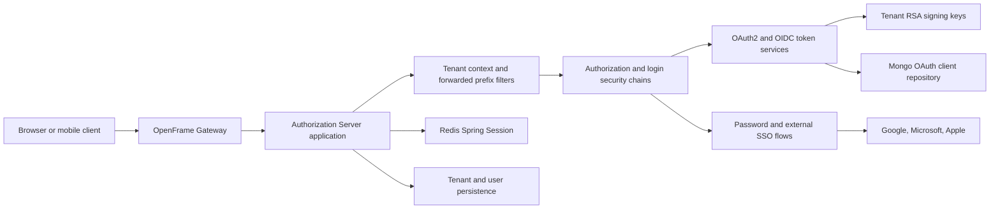
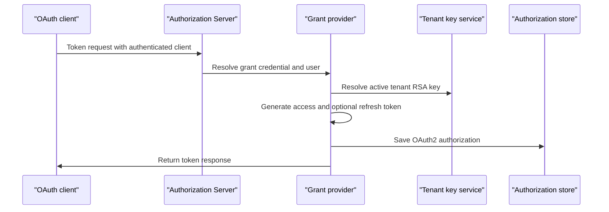

# Authorization Service Core

Authorization Service Core is the shared library assembled by the tenant repository's `openframe-authorization-server` application. It provides a multi-tenant OAuth 2.1 and OpenID Connect authorization server, local password authentication, external OIDC sign-in, tenant onboarding, invitations, password recovery, and mobile-specific token exchanges.

The implementation is supplied by the OpenFrame OSS Library artifact `com.openframe.oss:openframe-authorization-service-core` at version `7.0.11`. The tenant service runs it from the `OpenFrameAuthorizationServerApplication` entry point. At deployment, the gateway routes `/sas/**` to the authorization-server service; the authorization server therefore acts as the identity boundary for the rest of the platform.

## Responsibilities

- Issue tenant-scoped JWT access tokens and opaque refresh tokens through Spring Authorization Server.
- Resolve a tenant before user lookup, client registration, signing-key selection, and issuer construction.
- Authenticate users through password login or Google, Microsoft, and Apple OIDC providers.
- Register tenants and invited users, including session-bound SSO consent flows.
- Provide native Apple discovery and token exchange, plus mobile signup-ticket redemption.
- Persist OAuth clients and login session state in MongoDB and Redis-backed Spring Session.
- Enforce safeguards around active tenants, password availability, ID-token validation, verified email routing, SSO identity linking, and invitation binding.

## Architecture

The gateway configuration in this repository exposes the authorization service at `/sas/**`. The library uses two ordered Spring Security filter chains:

1. **Authorization-server chain** — handles authorization-server endpoints, enables OIDC, requires authentication, validates bearer JWTs, and accepts built-in as well as custom token grants.
2. **Default application chain** — handles login pages, form login, OIDC client login, onboarding, invitations, password reset, tenant discovery, SSO discovery, mobile policy, and well-known metadata.

`TenantContextFilter` is supplied outside the listed components, while this library registers the subsequent prefix and forwarded-header filters. Spring Session must execute first; the tenant context is then available to the authorization, client-registration, and signing-key paths.

## Tenant Isolation and Issuer Resolution

`TenantForwardedPrefixFilter` detects authorization-server metadata, OAuth2, connect, and user-info paths. When a request has a resolved tenant but no existing forwarded prefix, it adds `X-Forwarded-Prefix: /{tenant}` before `ForwardedHeaderFilter` consumes headers. This lets Spring Authorization Server calculate a tenant-specific issuer even when accessed without the gateway.

The signing key source refuses requests with no tenant context. For a resolved tenant it obtains that tenant's active RSA key and serves only the matching JWK set. The JWT customizer adds these access-token claims:

| Claim | Source | Purpose |
|---|---|---|
| `tenant_id` | Resolved tenant context | Identifies the tenant security boundary. |
| `userId` | Active tenant user | Identifies the authenticated OpenFrame user. |
| `roles` | Effective user roles | Conveys authorization roles to resource servers. |

The same user lookup is tenant-qualified, and refresh-token access-token issuance attempts to update the user's last-login timestamp. Tenant activation is checked before password authentication, preventing account information leakage across inactive tenants.

## Token Issuance and OAuth Clients

[AuthorizationServerConfig](https://github.com/flamingo-stack/openframe-oss-lib/blob/7a766f00e4f58b5d89db007b878ac8d6e0c344f4/openframe-authorization-service-core/src/main/java/com/openframe/authz/config/AuthorizationServerConfig.java) explicitly composes a JWT generator, access-token generator, and refresh-token generator. This ensures custom grants use the same claims, signing path, authorization persistence, and refresh behavior as standard grants.

`AbstractTokenMintingGrantProvider` is the common tail for custom grants. It requires an authenticated client, builds an authorization with the resolved user principal and registered scopes, generates an access token and—when allowed—a refresh token, persists the authorization, and returns the standard token response.

The custom grant types are:

- `urn:openframe:params:oauth:grant-type:apple-native` — exchanges a native Apple identity token, a single-use Apple authorization code, and optional nonce/name data for OpenFrame tokens.
- `urn:openframe:params:oauth:grant-type:signup-ticket` — redeems a server-bound mobile signup ticket after registration, without relying on the browser auth-sheet session.

`MongoRegisteredClientRepository` adapts Mongo documents to Spring Authorization Server `RegisteredClient` records. It persists client credentials, client authentication methods, grants, redirect URIs, scopes, PKCE and consent settings, token lifetimes, and refresh-token reuse behavior.

## Signing-Key Management

The key subsystem generates RSA key pairs with configurable algorithm, size, and secure-random implementation. `AuthenticationKeyPair` carries public/private keys, PEM encodings, and a generated key identifier. `PemUtil` parses and serializes X.509 public keys and PKCS#8 private keys. The authorization configuration uses tenant key material through `TenantKeyService`, so key selection and JWK publication remain tenant-specific.

## Authentication and Session Security

Password login uses a BCrypt password encoder and a `DaoAuthenticationProvider` backed by the tenant-aware user-details service. Users with an absent or blank password hash cannot authenticate with a password; this avoids treating an SSO-provisioned account as having an empty password.

Sessions use Spring Session backed by Redis rather than servlet-memory sessions. They retain the security context, CSRF state, authorization request, tenant ID, and SSO flow state across replicas and restarts. Session Redis keys are namespaced through the OpenFrame Redis key builder, using a shared fallback namespace if no configured tenant key namespace exists. The serializer tolerates stale attributes that cannot be deserialized after a dependency upgrade by discarding the attribute and allowing a fresh login rather than failing the request.

The session cookie keeps the `JSESSIONID` name and the configured servlet-context path. This avoids a tenant-prefixed forwarded path creating a cookie that is not returned to the authorization-server context.

## External SSO

### Dynamic provider registrations

`DynamicClientRegistrationRepository` resolves a registration from the tenant context, falling back to the session tenant ID when necessary. It delegates construction to `DynamicClientRegistrationService`, so provider credentials, URLs, and client IDs are evaluated per tenant rather than fixed at process startup.

`BaseOidcClientRegistrationStrategy` builds authorization-code registrations from an effective tenant-specific or default SSO configuration. Provider-specific strategies implement the differences:

- **Google** pins the configured issuer, enabling standard issuer validation.
- **Microsoft** accepts a Microsoft v2 issuer pattern because a multi-tenant application receives tokens from many directories.
- **Apple** uses `client_secret_post`, requests `response_mode=form_post`, pins Apple's issuer, and mints its client secret dynamically from tenant key material.

The ID-token decoder cache is keyed by provider, client ID, JWK-set URI, and issuer rather than only provider ID. This prevents a decoder created for one tenant from incorrectly enforcing that tenant's audience or metadata for another tenant.

### SSO completion and trust controls

`SsoFlowSuccessHandler` routes a successful OIDC callback to the active flow handler by its returned OAuth state. When no special flow is active, it performs tenant-login auto-provisioning where permitted, captures Apple web credentials when applicable, and attempts a best-effort federated identity link.

`LoginSsoHandler` owns email-less login through generic provider applications. It prefers an existing provider-subject link over an email claim. On first association, it requires trusted provider email signals before using email for account routing, prevents generic provider access where a tenant has its own provider configuration, verifies that the tenant remains active, and only then persists the SSO identity link.

`MicrosoftLoginEmailGate` optionally adds a verified-email defense for tenant-scoped generic Microsoft logins. A tenant-owned Microsoft application or a pre-existing link to the same user is accepted; otherwise the configured email trust policy must approve the provider claims.

`SsoIdentityCapture` only saves a link after a successful plain tenant login with a positive trust signal. It is deliberately best-effort, so capture failures do not block an already valid login.

### Invitation and consent flows

`InvitationRegistrationController` supports password invitation acceptance and starts invitation SSO acceptance. It clears prior authentication state, writes a signed invitation-flow cookie, and redirects to the provider authorization request.

`InviteSsoHandler` processes the callback. It can defer a new member to the consent page when configured; otherwise it registers the invitee, binds the created user to the session, clears the flow cookie, and continues to the target tenant.

`SsoJoinController` is the final consent gate for invitation and shared-domain provisioning. It reads identity only from the authenticated OIDC session and validates that the invitation cookie matches the invitation ID stamped into that same session. Completion requires explicit terms acceptance, creates the user, rebinds the session principal, clears the relevant flow cookie, and resumes OAuth continuation.

## Registration, Discovery, and Recovery Endpoints

The following routes are implemented by this module. Security configuration permits these public routes where appropriate; clients must still satisfy each controller's validation and flow requirements.

| Route | Behavior |
|---|---|
| `GET /login` | Renders the login view and may expose the configured password-reset page URL. |
| `POST /oauth/register` | Registers a tenant and signs its owner into the authorization-server session. |
| `GET /tenant/discover` | Finds tenant authentication options for a normalized email address. |
| `GET /tenant/email-available` | Checks global active-user ownership and the email-domain policy. |
| `GET /tenant/email-domain-allowed` | Evaluates email policy without account ownership lookup. |
| `POST /password-reset/request` | Creates a reset token for a normalized email address. |
| `POST /password-reset/confirm` | Validates a reset token and replaces the password. |
| `POST /invitations/accept` | Registers a user from an invitation. |
| `GET /invitations/accept/sso` | Starts invitation acceptance through SSO. |
| `GET /sso/providers/invite` | Returns effective provider IDs for an acceptable invitation. |
| `GET /sso/providers/registration` | Returns default providers for pre-tenant registration. |
| `GET /oauth/login/sso` | Starts an email-less SSO login flow. |
| `GET /oauth/login/sso/pending` | Returns the pending SSO identity from a session or mobile signup ticket. |
| `GET` or `POST /oauth/login/sso/complete` | Completes browser or mobile SSO-based tenant signup. |
| `GET /oauth/join/pending` | Returns the session-authenticated identity and pending join details. |
| `GET /oauth/join/complete` | Requires terms acceptance, creates the pending user, and continues the flow. |
| `POST /oauth/apple/native/discover` | Resolves a tenant from a verified native Apple token. |
| `POST /oauth/apple/native/register` | Registers a tenant for a verified, unlinked Apple identity. |
| `GET /mobile/version-policy` | Returns enabled mobile version policy with a five-minute public cache lifetime. |

The password reset request and confirmation DTOs require a valid email or a nonblank token plus a password of at least eight characters containing uppercase, lowercase, digit, and special-character categories. `CoreUserRequest` applies the same password policy and validates first and last names.

## Native Apple and Mobile Signup

Native Apple discovery verifies the identity token and nonce before reading the email. It first resolves an existing Apple subject link and then falls back to an active email lookup. The endpoint only returns an active tenant and refuses identities without a verified email claim. Native registration rejects an already linked subject or active email, derives verified identity data from the token, and generates an internal password because future authentication is provider-based.

For mobile browser isolation, `LoginSsoHandler` creates an opaque signup ticket when a new SSO identity needs registration. The client supplies organization details later, while the server retains the asserted identity. Once registration binds the ticket to the owner and tenant, the BFF redeems it at the token endpoint through the signup-ticket grant. This limits client control over the identity and keeps single-use minting enforcement server-side.

## Extension Points and Background Work

The default registration, user-deactivation, and email-verification processors are conditional no-op implementations. Deployments can provide their own processor beans to add behavior around tenant creation, invitation completion, auto-provisioning, deactivation, or email verification without replacing the core flows.

`NoopGlobalDomainPolicyLookup` is likewise a conditional fallback that disables global-domain auto-provision lookup when no deployment-specific policy implementation is installed.

`AppleTokenRevocationScheduler` is enabled by default unless explicitly disabled. It periodically finds retained Apple tokens for absent or deleted users, asks `AppleTokenService` to revoke and remove them, and leaves failed attempts for later retry. This keeps Apple revocation key material inside the authorization-server service.

## Operational Considerations

- Treat Redis session availability as required for reliable multi-replica login flows.
- Maintain tenant-context resolution before any authorization-server token, JWK, or dynamic-provider operation.
- Configure each provider's redirect URI, JWK endpoint, scopes, and credentials consistently with the gateway-visible authorization-server URL.
- Enable the Microsoft verified-email gate only after the generic Microsoft application produces the required email-trust signal; otherwise valid logins can be refused.
- Preserve the token generator composition and avoid exposing custom grant providers as global Spring `AuthenticationProvider` beans. They are constructed inside authorization-server configuration so password login retains its DAO provider.
- Review Apple token-revocation scheduling and stored Apple-token lifecycle when changing user deletion workflows.

## Primary Source Components

- [Authorization server configuration](https://github.com/flamingo-stack/openframe-oss-lib/blob/7a766f00e4f58b5d89db007b878ac8d6e0c344f4/openframe-authorization-service-core/src/main/java/com/openframe/authz/config/AuthorizationServerConfig.java)
- [Default security configuration](https://github.com/flamingo-stack/openframe-oss-lib/blob/7a766f00e4f58b5d89db007b878ac8d6e0c344f4/openframe-authorization-service-core/src/main/java/com/openframe/authz/config/SecurityConfig.java)
- [Redis session configuration](https://github.com/flamingo-stack/openframe-oss-lib/blob/7a766f00e4f58b5d89db007b878ac8d6e0c344f4/openframe-authorization-service-core/src/main/java/com/openframe/authz/config/SessionConfig.java)
- [Tenant forwarded-prefix filter](https://github.com/flamingo-stack/openframe-oss-lib/blob/7a766f00e4f58b5d89db007b878ac8d6e0c344f4/openframe-authorization-service-core/src/main/java/com/openframe/authz/config/tenant/TenantForwardedPrefixFilter.java)
- [Custom grant minting base](https://github.com/flamingo-stack/openframe-oss-lib/blob/7a766f00e4f58b5d89db007b878ac8d6e0c344f4/openframe-authorization-service-core/src/main/java/com/openframe/authz/security/grant/AbstractTokenMintingGrantProvider.java)
- [Email-less SSO callback handler](https://github.com/flamingo-stack/openframe-oss-lib/blob/7a766f00e4f58b5d89db007b878ac8d6e0c344f4/openframe-authorization-service-core/src/main/java/com/openframe/authz/security/flow/LoginSsoHandler.java)
