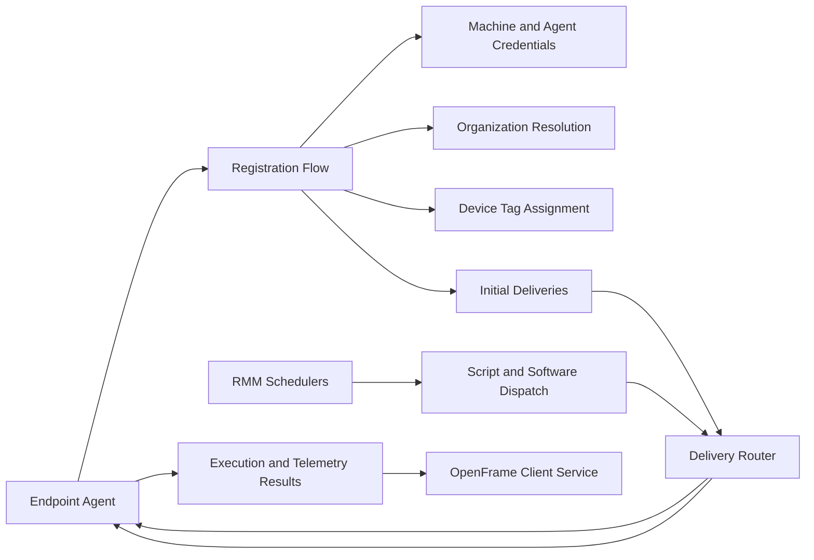
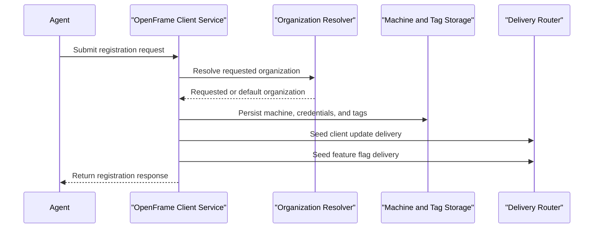
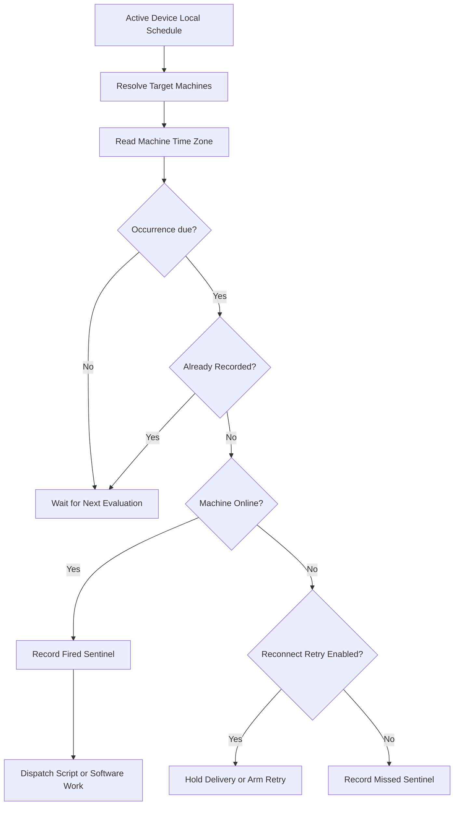

# Client Core Registration Agent

## Purpose

Client Core Registration Agent is the server-side registration and remote-management support layer supplied by the `com.openframe.oss:openframe-client-core` library and run by this repository's OpenFrame Client service. It turns an incoming agent registration into a machine identity, credentials, tenant organization placement, optional device tags, and initial deliveries. It also contains the dispatch paths that run scheduled scripts and software actions on registered machines.

The module is implemented in the OpenFrame OSS Library at version `7.0.11`. This tenant repository assembles that library into the OpenFrame Client service rather than defining the implementation locally.

## Architecture Overview

### Responsibilities

- Generate a UUID machine identifier and a cryptographically random, URL-safe agent secret.
- Resolve the requested organization when it exists, otherwise use the tenant default organization.
- Create or reuse device-scoped tags and associate them with the registered machine.
- Seed client update and feature-flag deliveries for a newly registered machine when their delivery types are enabled.
- Start enabled integrated-tool installation processing asynchronously after registration.
- Normalize external tool-agent identifiers for Fleet MDM and MeshCentral.
- Generate short-lived access tokens and refresh tokens for registered OAuth clients.
- Evaluate device-local schedules using each machine's reported time zone and persist per-machine occurrence sentinels.
- Dispatch scripts, package actions, and delivery retries through NATS-backed delivery collaborators.

## Registration Lifecycle

The registration processor extension point permits deployments to add behavior after the main registration is complete. The provided default processor is deliberately a no-op, so a custom processor can replace it without changing the registration core.

## Key Behaviors and Constraints

### Identity and credentials

`MachineIdGenerator` creates a random UUID. `AgentSecretGenerator` draws 32 bytes from `SecureRandom` and encodes them as unpadded URL-safe Base64. Access-token claims include the OAuth client ID as subject, machine ID, grant type, and roles; their expiry is controlled by `security.oauth2.token.access.expiration-seconds`. Refresh tokens begin with a `refresh_count` claim of zero, increment it on rotation, and use the configured expiry and maximum refresh-count properties.

### Organization and tags

`OrganizationIdResolver` accepts a nonblank requested organization only if it exists. Otherwise it logs the fallback and resolves the default organization; registration cannot continue if no default organization exists. `RegistrationTagAssignmentService` validates supplied tag keys and values, reuses or creates `DEVICE` tags, merges new predefined values into an existing tag, and saves a device tag assignment. Individual tag failures are isolated and logged, allowing the remaining tags to be processed.

### Initial post-registration work

The client-update and feature-flag seeders are best-effort. Each checks whether its `DeliveryType` is enabled, builds a delivery seed from current client configuration, and dispatches it. A dispatch failure is logged but does not fail registration. The tool-installation processor independently runs on the configured tool-install executor and processes every enabled integrated tool agent for the new machine.

### Tool-agent identifier transformations

Fleet MDM transformation looks up a matching enrolled host by UUID, then by osquery host identifier for instance-mode devices. A successful match returns the Fleet numeric host ID and attempts to populate host facts; fact persistence is non-fatal. Before the final retry, an unmatched Fleet identifier fails the transformation; at the final attempt, the original identifier is retained for manual remediation. MeshCentral prefixes an agent ID using either tenant-scoped `node/{nodeId}/{agentToolId}` form or the legacy empty-domain form.

## Remote Management Dispatch

Device-local schedules treat the stored start instant as a wall-clock value. For every target machine, the schedule service derives the due occurrence in the machine's reported zone, prevents duplicate dispatch using a persisted sentinel, and records either `FIRED`, `MISSED`, or a reconnect-armed state. Script schedules can wait for a reconnect when configured; software schedules use skip semantics for offline targets.

`ScheduleFireDispatcher` records a schedule execution header and one queued script-execution row per script and machine before sending a per-machine delivery seed. Software dispatchers select a package-manager handler, require a seeded compatible software script, split eligible targets to package-update orders where applicable, and otherwise publish a script message. Both paths retain retry payloads for watchdog processing.

## Delivery Recovery

`DeliveryRepublisherRegistry` registers exactly one `DeliveryRepublisher` for each delivery channel and rejects duplicates at application startup. `ScheduleDeliveryRepublisher` deserializes retained schedule messages, reveals encrypted values, and republishes them. `SoftwareDeliveryRepublisher` republishes retained software script messages only when software RMM support is enabled. Republish failures are contained and logged.

## Source and Runtime Context

The implementation originates in the OpenFrame OSS Library. The provided source files include the registration services, identifier transformers, token generators, RMM schedulers and dispatchers, and delivery watchdog implementations. This repository publishes and deploys the OpenFrame Client service, which consumes `com.openframe.oss:openframe-client-core` at version `7.0.11`.

The following source anchors are verified library sources:

- [Registration feature flag seeding](https://github.com/flamingo-stack/openframe-oss-lib/blob/7a766f00e4f58b5d89db007b878ac8d6e0c344f4/openframe-client-core/src/main/java/com/openframe/client/service/agentregistration/AgentRegistrationClientFeatureFlagsService.java)
- [Registration tag assignment](https://github.com/flamingo-stack/openframe-oss-lib/blob/7a766f00e4f58b5d89db007b878ac8d6e0c344f4/openframe-client-core/src/main/java/com/openframe/client/service/agentregistration/RegistrationTagAssignmentService.java)
- [Device-local script scheduling](https://github.com/flamingo-stack/openframe-oss-lib/blob/7a766f00e4f58b5d89db007b878ac8d6e0c344f4/openframe-client-core/src/main/java/com/openframe/client/service/rmm/DeviceLocalScheduleService.java)
- [Schedule delivery republishing](https://github.com/flamingo-stack/openframe-oss-lib/blob/7a766f00e4f58b5d89db007b878ac8d6e0c344f4/openframe-client-core/src/main/java/com/openframe/client/service/rmm/watchdog/ScheduleDeliveryRepublisher.java)

## Detailed Modules

- [Registration Foundations](client_core_registration_agent/registration_foundations/registration_foundations.md) covers identity generation, organization fallback, tag assignment, initial deliveries, and registration hooks.
- [Tool Agent Identifiers](client_core_registration_agent/tool_agent_identifiers/tool_agent_identifiers.md) describes Fleet MDM and MeshCentral identifier normalization.
- [Token Generation](client_core_registration_agent/token_generation/token_generation.md) describes access and refresh token claims and rotation state.
- [RMM Dispatch and Recovery](client_core_registration_agent/rmm_dispatch_and_recovery/rmm_dispatch_and_recovery.md) details scheduling, software and script dispatch, bootstrap work, and delivery republishing.
