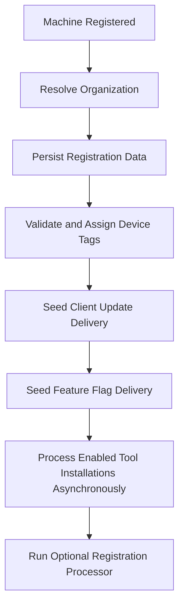

# Registration Foundations

## Scope

Registration Foundations establishes registration identity, organization placement, device tags, first-run delivery seeds, and optional post-registration processing. It is supplied by the OpenFrame OSS Library as part of `com.openframe.oss:openframe-client-core`.

## Components

| Component | Responsibility |
|---|---|
| `MachineIdGenerator` | Generates a UUID machine identifier. |
| `AgentSecretGenerator` | Generates 32 random bytes with `SecureRandom` and returns unpadded URL-safe Base64. |
| `OrganizationIdResolver` | Uses a valid requested organization ID or falls back to the tenant default. |
| `RegistrationTagAssignmentService` | Validates, creates or updates, and assigns device tags. |
| `AgentRegistrationClientUpdateService` | Seeds a client-update delivery from current client configuration. |
| `AgentRegistrationClientFeatureFlagsService` | Seeds the current feature-flag set as a delivery. |
| `AgentRegistrationToolInstallationService` | Asynchronously processes enabled integrated tools for the machine. |
| `DefaultAgentRegistrationProcessor` | Provides a replaceable no-op registration post-processing implementation. |

## Processing Rules

Organization resolution is strict about availability: a supplied ID is used only when it resolves to an existing organization. If it does not, the resolver falls back to the default organization. Absence of a default organization raises an error because the tenant is not ready to place the machine.

Tag assignment is intentionally fault-isolated. Each requested tag is validated and processed separately. The service locates a matching `DEVICE` tag by key, appends new predefined values when appropriate, and stores a `DEVICE` assignment for the new machine. A bad tag is logged without stopping the rest of the registration operation.

The update and feature-flag services are intentionally non-blocking from the registration workflow's perspective. They first check the relevant delivery type, then dispatch a seed; failures are logged instead of being propagated. A later release or rollout can still reach the agent.

## Extension Point

`DefaultAgentRegistrationProcessor` is conditional on no alternative `AgentRegistrationProcessor` bean. Deployments can supply a processor implementation to add post-registration work while retaining the standard behavior. The default implementation only records a debug log entry.

## Verified Source

- [Agent registration client update service](https://github.com/flamingo-stack/openframe-oss-lib/blob/7a766f00e4f58b5d89db007b878ac8d6e0c344f4/openframe-client-core/src/main/java/com/openframe/client/service/agentregistration/AgentRegistrationClientUpdateService.java)
- [Registration tag assignment service](https://github.com/flamingo-stack/openframe-oss-lib/blob/7a766f00e4f58b5d89db007b878ac8d6e0c344f4/openframe-client-core/src/main/java/com/openframe/client/service/agentregistration/RegistrationTagAssignmentService.java)
