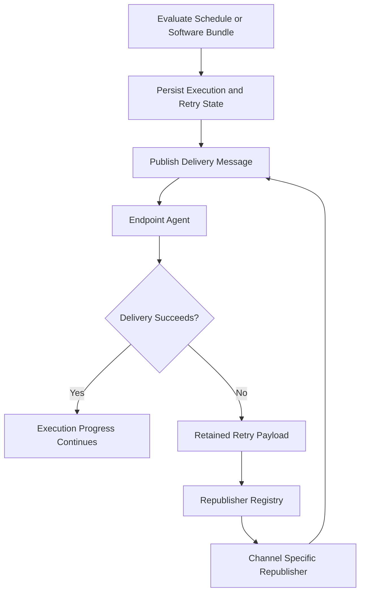

# RMM Dispatch and Recovery

## Scope

RMM Dispatch and Recovery evaluates device-local schedules, creates script or software executions, routes delivery messages, and retries retained delivery payloads. Software-specific components activate only when `openframe.rmm.software.enabled` is true.

## Device-Local Scheduling

`DeviceLocalOccurrence` calculates due wall-clock occurrences in a device's time zone, validates zone identifiers, and determines whether a persisted dispatch sentinel has already handled an occurrence. `DeviceLocalScheduleService` applies this to script schedules, while `SoftwareDeviceLocalScheduleService` applies it to software schedules.

Both services persist a `ScheduleLocalMachineTimeDispatch` sentinel before dispatching. This prevents duplicate firing when evaluations race. Online devices fire within the configured catch-up window. Script schedules can hold a delivery or arm a reconnect retry when configured; software schedules mark offline occurrences as missed after their window.

`ScheduleRecurrence.nextRunAfter` advances a recurring next-run timestamp until it is strictly after the current time.

## Script Scheduling

`ScheduleFireDispatcher` resolves targets and runnable scripts, skips inactive or missing scripts, creates one shared execution ID for a fire, persists a schedule-execution header and queued leaf execution rows, then sends a per-machine `ScriptScheduleDeliverySeed`. It uses the schedule's offline rule to decide whether to skip or wait for offline devices, and retains payloads in the retry store before dispatch.

## Software Dispatch

`SoftwareBundleOnlineDispatcher` dispatches package actions when a machine is software-manageable and the package manager has a compatible seeded software script. Eligible targets follow the package-update order path; other targets receive a software script message.

`SoftwareScheduleFireDispatcher` performs the equivalent work for a software schedule. It resolves platform compatibility, separates order-eligible and script-message targets, persists execution rows for direct script targets, and retains those messages for retry.

## Package-Manager Bootstrap

`PackageManagerBootstrapService` is enabled by `openframe.rmm.package-manager-bootstrap.enabled`. It dispatches a system bootstrap script only for known, connected machines with a seeded tenant script. It suppresses duplicate work while a matching bootstrap is queued or running and during the configured cooldown. Stored script environment-variable secrets are decrypted before the bootstrap message is published.

## Recovery

The `DeliveryRepublisher` interface separates retained-message recovery by `DeliveryChannel`. `DeliveryRepublisherRegistry` constructs an enum-keyed registry and fails startup if more than one republisher claims the same channel. The schedule republisher deserializes a schedule payload, reveals encrypted fields, and publishes it again; the software republisher deserializes and republishes the software script payload.

## Verified Source

- [Device-local script schedule service](https://github.com/flamingo-stack/openframe-oss-lib/blob/7a766f00e4f58b5d89db007b878ac8d6e0c344f4/openframe-client-core/src/main/java/com/openframe/client/service/rmm/DeviceLocalScheduleService.java)
- [Schedule fire dispatcher](https://github.com/flamingo-stack/openframe-oss-lib/blob/7a766f00e4f58b5d89db007b878ac8d6e0c344f4/openframe-client-core/src/main/java/com/openframe/client/service/rmm/ScheduleFireDispatcher.java)
- [Software schedule fire dispatcher](https://github.com/flamingo-stack/openframe-oss-lib/blob/7a766f00e4f58b5d89db007b878ac8d6e0c344f4/openframe-client-core/src/main/java/com/openframe/client/service/rmm/SoftwareScheduleFireDispatcher.java)
- [Delivery republisher registry](https://github.com/flamingo-stack/openframe-oss-lib/blob/7a766f00e4f58b5d89db007b878ac8d6e0c344f4/openframe-client-core/src/main/java/com/openframe/client/service/rmm/watchdog/DeliveryRepublisherRegistry.java)
