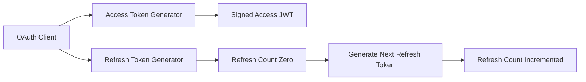

# Token Generation

## Scope

Token Generation creates JWT access and refresh tokens for OAuth clients associated with registered agents. Both generators delegate signing to `JwtService`; expiration is controlled by application properties rather than hard-coded lifetimes.

## Access Tokens

`AccessTokenGenerator` creates a bearer token with these claims:

| Claim | Value |
|---|---|
| Issuer | `https://auth.openframe.com` |
| Subject | OAuth client ID |
| Machine ID | OAuth client machine ID |
| Grant type | Grant supplied by the caller |
| Roles | OAuth client roles |
| Issued and expiry times | Current time and configured access-token lifetime |

The lifetime is configured through `security.oauth2.token.access.expiration-seconds`.

## Refresh Tokens

`RefreshTokenGenerator` creates refresh tokens whose subject is the client ID. The initial token includes `refresh_count` set to zero. `generateNext` creates the next token with the count incremented by one. Configuration provides both the refresh-token lifetime and the maximum permitted refresh count.

## Security Notes

These components assemble claims and request signing; enforcement of token validation and refresh limits is performed by the surrounding security and authentication flow. Keep expiration and refresh-count properties aligned with the deployment's authentication policy.

## Verified Source

- [Access token generator](https://github.com/flamingo-stack/openframe-oss-lib/blob/7a766f00e4f58b5d89db007b878ac8d6e0c344f4/openframe-client-core/src/main/java/com/openframe/client/service/auth/AccessTokenGenerator.java)
- [Refresh token generator](https://github.com/flamingo-stack/openframe-oss-lib/blob/7a766f00e4f58b5d89db007b878ac8d6e0c344f4/openframe-client-core/src/main/java/com/openframe/client/service/auth/RefreshTokenGenerator.java)
