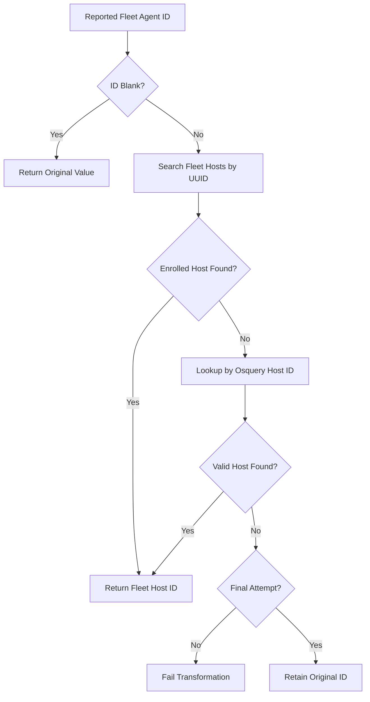

# Tool Agent Identifiers

## Scope

Tool Agent Identifiers converts external tool-side identifiers into the identifiers OpenFrame stores for a registered machine. `ToolAgentIdTransformer` is the common contract: each transformer declares its `ToolType` and receives the machine ID, reported tool-agent ID, and whether this is the final lookup attempt.

## Fleet MDM

`FleetMdmAgentIdTransformer` supports two discovery paths:

1. Search hosts by the reported UUID and choose the newest enrolled host with an osquery version.
2. If that fails, look up by osquery host identifier, which supports instance-mode devices whose identifier is not searchable as a UUID.

A match returns the Fleet numeric host ID as a string. The transformer also attempts to populate Fleet host facts, but failure to store those facts does not fail the identifier transformation. A missing match fails before the final attempt; at the final attempt, the original agent ID is retained and logged for manual remediation.

## MeshCentral

`MeshCentralAgentIdTransformer` returns a MeshCentral node identifier. With tenant-scoped nodes enabled, it creates `node/{nodeId}/{agentToolId}`. Otherwise it uses the legacy `node//{agentToolId}` form. A blank reported ID is returned unchanged after a warning.

## Operational Considerations

The Fleet path wraps unexpected lookup failures in an `IllegalStateException`, while allowing host-fact enrichment to fail independently. The MeshCentral path relies on configuration properties for node formatting; changing the tenant-scoped setting changes the identifier shape persisted for future registrations.

## Verified Source

- [Fleet MDM agent ID transformer](https://github.com/flamingo-stack/openframe-oss-lib/blob/7a766f00e4f58b5d89db007b878ac8d6e0c344f4/openframe-client-core/src/main/java/com/openframe/client/service/agentregistration/transformer/FleetMdmAgentIdTransformer.java)
- [MeshCentral agent ID transformer](https://github.com/flamingo-stack/openframe-oss-lib/blob/7a766f00e4f58b5d89db007b878ac8d6e0c344f4/openframe-client-core/src/main/java/com/openframe/client/service/agentregistration/transformer/MeshCentralAgentIdTransformer.java)
