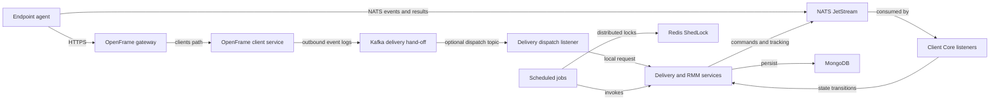
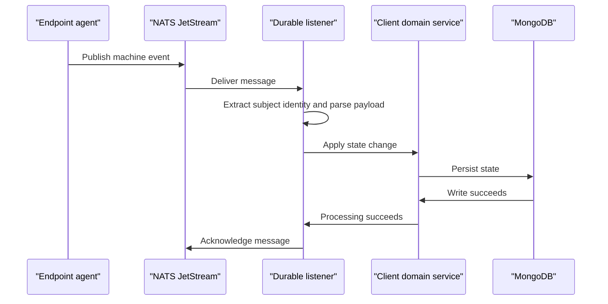
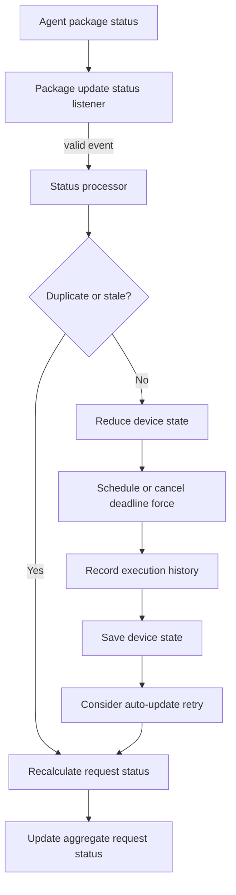

# Client Core Server Controllers

Client Core Server Controllers is the server-side integration layer that runs in the tenant's `openframe-client` service. Its implementation is supplied by the `com.openframe.oss:openframe-client-core` library at version `7.0.11`. It exposes the HTTP and GraphQL surfaces used by endpoint agents, consumes device events from NATS JetStream, receives cross-service delivery hand-offs from Kafka when enabled, and runs scheduled Remote Monitoring and Management (RMM) work safely across service replicas.

The module is not the endpoint agent itself. The agent is implemented by the Rust `openframe_client` artifact; this module receives its registration, authentication, health, inventory, execution, update, and delivery-result signals and coordinates the server-side state changes.

## Responsibilities

- **Agent lifecycle APIs** — registers, reinstalls, authenticates, and unregisters agents; it also exposes the current agent log key.
- **Device-state ingestion** — consumes connection, heartbeat, hostname, time-zone, installed-agent, tool-connection, and user-agent events from NATS.
- **Command and delivery tracking** — processes delivery acknowledgements and completion reports, dispatches locally handed-off delivery requests, and prevents duplicate Kafka dispatch handling.
- **RMM execution and software updates** — records command, script, bootstrap, and software results; tracks package-update progress and delivery failures; schedules eligible automatic retries.
- **Recurring operations** — executes due schedules, reconnect and device-online dispatches, watchdogs, retry sweeps, and Fleet hardware-fact backfill under Redis-backed distributed locks.
- **Observability and configuration** — publishes OSS event logs to Kafka, exports device-online backlog metrics, provides feature flags through GraphQL, and configures BCrypt password encoding.

## Runtime Context

The tenant deployment publishes `openframe-client` as a service image. The platform configuration routes `/clients/**` through the OpenFrame gateway to that service. The shared configuration supplies MongoDB, Redis, Kafka, and NATS endpoints; this module uses each according to its responsibility:

| Dependency | Role in this module |
|---|---|
| NATS and JetStream | Agent-originated state, result, connection, and delivery-result messages. |
| Kafka | Optional delivery dispatch hand-off and outbound event-log publication. |
| MongoDB | Device, delivery, execution, package-update, and processed-command records through the data repositories. |
| Redis | ShedLock lock records that coordinate scheduled work across replicas. |
| Gateway | Routes client-service traffic, including the `/clients/**` path. |

## Architecture

The controllers, listeners, and schedulers are thin entry points. Domain services and repositories, supplied by the same client-core library and the tenant's other library dependencies, own registration rules, machine state, delivery orchestration, and persistence.

## HTTP and GraphQL Entry Points

### Agent Authentication

`AgentAuthController` handles `POST /oauth/token`. It accepts the OAuth-style `grant_type` plus either a refresh token or client credentials and delegates token issuance to `AgentAuthService`. Invalid arguments result in `401`; unexpected failures are logged and return a generic `400` response without exposing internal details.

### Registration and Uninstallation

`AgentController` provides these agent-facing operations under `/api/agents`:

| Operation | Required request data | Delegated responsibility |
|---|---|---|
| `POST /register` | `X-Initial-Key` and a validated registration body | Creates the agent registration. |
| `POST /reinstall` | Initial key, machine ID, client secret, and validated registration body | Re-establishes an existing agent installation. |
| `POST /uninstall` | Machine ID and client secret | Requests server-side agent uninstallation and returns no content. |

`AgentLogKeyController` exposes `GET /agent/log-key`, returning the current key through `AgentLogKeyService`. `PasswordEncoderConfig` supplies the BCrypt `PasswordEncoder` used by password-sensitive service logic.

### Feature-Flag Query and Data Shapes

`ClientFeatureFlagsDataFetcher` exposes the GraphQL `clientFeatureFlags` query. It converts configuration-service entries into name, enabled-state, and minimum-version responses. `CreateClientRequest` carries client grant types and scopes, while `MetricsMessage` represents a machine identifier, CPU use, memory use, and timestamp for metrics-oriented messaging.

## Event Consumption

The listener layer distinguishes best-effort NATS subscriptions from durable JetStream consumers.

- `ClientConnectionListener` registers connection and disconnection consumers and changes machine status using the event timestamp.
- `MachineHeartbeatListener` subscribes to `machine.*.heartbeat` when the application is ready, timestamps the heartbeat server-side, and drains its dispatcher during shutdown.
- `MachineHostnameListener` and `MachineTimezoneListener` are durable consumers. Blank values are acknowledged without changing state; processing errors remain unacknowledged for redelivery.
- `InstalledAgentListener`, `ToolConnectionListener`, and `UserInstalledAgentListener` persist inventory or connection state and acknowledge only after successful processing. The machine-oriented listeners use delivery groups to allow replicas to share work.

Malformed hostname, time-zone, package-manager, delivery-result, and package-update status payloads are explicitly acknowledged and dropped when they violate the relevant wire contract. Transient or unexpected failures are generally left unacknowledged so durable consumers can redeliver them.

## Delivery Dispatch and Results

`DeliveryDispatchListener` is activated only when Kafka is enabled and a dispatch topic is configured. It validates the message and embedded delivery reference, rejects incomplete or malformed requests in metrics, and checks `ProcessedCommandRepository` by dispatch identifier before invoking `LocalDeliverySink`. The processed-command row is written only after local acceptance, making redelivery idempotent.

`DeliveryDispatchListenerConfiguration` enables Kafka and configures record acknowledgement. It retries Mongo availability failures indefinitely with a five-second backoff, while other failures use a bounded retry policy and are counted as unrecoverable when skipped. Deserialization failures are wrapped so malformed records do not stall a partition before the listener runs.

`DeliveryResultListener` consumes agent reports from the delivery-result JetStream stream. Valid results are mapped to `DeliveryTracker` transitions:

| Agent result | Server-side action |
|---|---|
| `ACKED` | Marks the delivery acknowledged. |
| `DONE` | Marks the delivery completed. |
| `FAILED` | Marks the delivery failed with the reported error. |

## RMM Results and Package Updates

`AbstractRmmResultListener` implements the common subscription, parsing, machine-ID extraction, result-service delegation, and shutdown behavior for command, script, bootstrap-script, and software result listeners. It deliberately logs metadata rather than raw result payloads because command output can contain sensitive data.

`ScriptExecutionAcknowledgeListener` durably processes execution acknowledgements. `MachinePackageManagersListener` accepts nonempty package-manager reports when the package-manager bootstrap capability is enabled. `DeviceOnlineCriteriaArmingListener` reacts to a machine-online event by creating one sentinel per matching active `DEVICE_ONLINE` schedule; a duplicate-key race is harmless.

Package-update processing is enabled only with the software and package-update properties. The flow is designed to be monotonic and resilient to retries:

`PackageUpdateStatusProcessor` loads or creates the per-device state, ignores duplicate and stale events, invokes `PackageUpdateDeviceStateReducer`, persists history through `PackageUpdateExecutionRecorder`, and rolls all device states into the request state. Waiting, completed, and failed details are normalized by the reducer. For wait-mode updates, it arms a deadline-force delivery when an application is blocking the update, and cancels the appropriate delivery when work finishes.

`PackageUpdateDeliveryFailureListener` closes an update as undelivered when a normal package-update delivery fails. `PackageAutoUpdateRetry` creates a new delayed delivery only for eligible automatic-update failures and only while the current policy/version still matches the failed request. A `NOT_INSTALLED` report disables the matching automatic-update policy instead of retrying it.

## Scheduled Work and Replica Safety

`ShedLockConfig` enables scheduling and creates a Redis `LockProvider` whose keys are tenant-scoped and environment-namespaced. Jobs annotated with `SchedulerLock` therefore run on at most one client-service replica for a lock window.

| Scheduler | Work performed | Activation |
|---|---|---|
| `DeviceOnlineDispatchScheduler` | Drains first-online dispatch sentinels. | Always available. |
| `FleetHostFactsBackfillScheduler` | Backfills Fleet-known host facts for incomplete machines. | Enabled by default unless disabled. |
| `PackageAutoUpdateTriggerScheduler` | Triggers automatic software-update evaluation. | Requires cloud-stream, software, and trigger properties. |
| `ScheduleScriptScheduler` | Runs due script schedules in UTC. | Requires schedule runner. |
| `SoftwareScheduleScheduler` | Runs due software schedules in UTC. | Requires schedule runner and software. |
| `ScriptDeliveryRetryScheduler` | Retries queued deliveries considered stuck. | Requires execution retry. |
| `ScriptExecutionWatchdogScheduler` | Marks stale script executions failed. | Requires execution watchdog. |
| `ScheduleJobExecutionWatchdogScheduler` | Marks stalled schedule-header jobs failed. | Requires schedule watchdog. |
| `SoftwareBundleOnlineDispatchScheduler` | Dispatches software bundles to newly online devices. | Requires software. |
| `SoftwareScheduleOnlineDispatchScheduler` | Dispatches software schedules to reconnected devices. | Requires software. |

`DeviceOnlineDispatchMetrics` refreshes gauges for pending first-online sentinels and the configured drain batch size. These gauges are suitable for identifying a growing dispatch backlog.

## Publishing

`DefaultEventLogsPublisher` is the default OSS implementation of `EventLogsPublisher`. It uses the tenant Kafka producer and the configured outbound logs-events topic. The bean is conditional: a deployment can provide another publisher, such as one for a shared SaaS Kafka topology, without replacing application code.

## Operational Notes

- Enable Kafka delivery dispatch only when both Kafka support and a nonempty dispatch topic are configured. Without them, no dispatch listener or placeholder configuration is created.
- Do not remove delivery-group names casually. They determine how JetStream work is shared among service replicas and are versioned in selected consumers where safe migration required a new consumer.
- Package-update reports must include event ID, request ID, machine ID, and a recognized state. Invalid reports are acknowledged to prevent poison-message loops.
- Distributed scheduler locks depend on Redis availability and the configured tenant/environment key namespace.
- The service processes events from the library source at the pinned revision documented by the artifact source headers, while the tenant repository assembles and runs that library in `openframe-client`.

## Source Components

The core implementation is supplied by [OpenFrame OSS Library](https://github.com/flamingo-stack/openframe-oss-lib) in the `openframe-client-core` artifact. Representative verified source files include [Agent Controller](https://github.com/flamingo-stack/openframe-oss-lib/blob/7a766f00e4f58b5d89db007b878ac8d6e0c344f4/openframe-client-core/src/main/java/com/openframe/client/controller/AgentController.java), [Delivery Dispatch Listener](https://github.com/flamingo-stack/openframe-oss-lib/blob/7a766f00e4f58b5d89db007b878ac8d6e0c344f4/openframe-client-core/src/main/java/com/openframe/client/listener/delivery/DeliveryDispatchListener.java), [Package Update Status Processor](https://github.com/flamingo-stack/openframe-oss-lib/blob/7a766f00e4f58b5d89db007b878ac8d6e0c344f4/openframe-client-core/src/main/java/com/openframe/client/listener/packageupdate/PackageUpdateStatusProcessor.java), and [ShedLock Configuration](https://github.com/flamingo-stack/openframe-oss-lib/blob/7a766f00e4f58b5d89db007b878ac8d6e0c344f4/openframe-client-core/src/main/java/com/openframe/client/config/ShedLockConfig.java).
