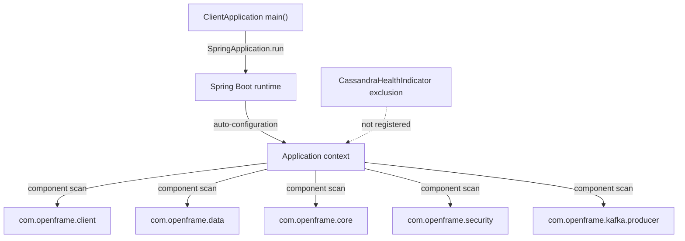
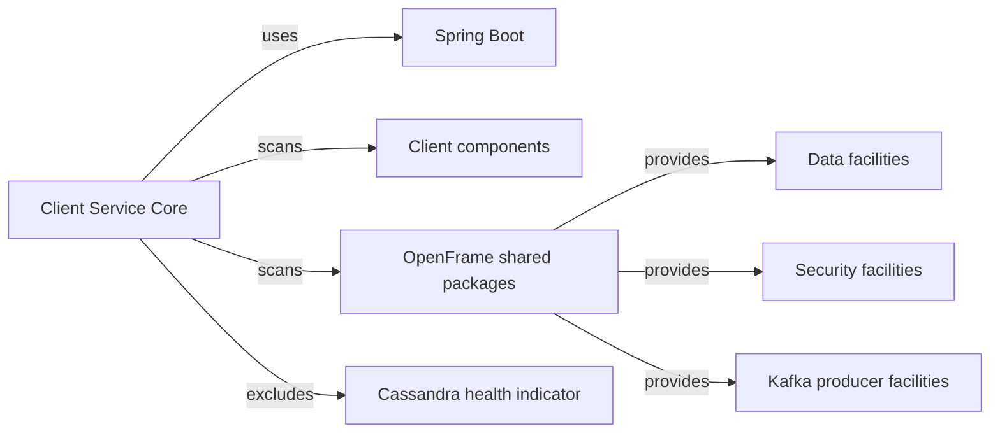
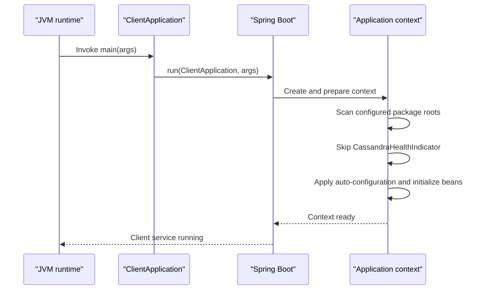
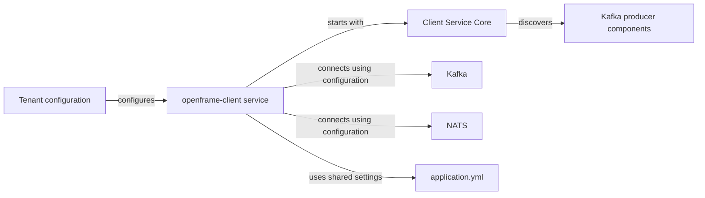

# Client Service Core

Client Service Core is the Spring Boot entry point for the OpenFrame client service. Its sole local component, `ClientApplication`, establishes the application context: it enables Spring Boot auto-configuration, scans the client and shared OpenFrame packages, deliberately omits the Cassandra health indicator, and starts the process.

The implementation is available in [ClientApplication.java](https://github.com/flamingo-stack/openframe-oss-tenant/blob/main/openframe/services/openframe-client/src/main/java/com/openframe/client/ClientApplication.java). The business capabilities discovered through the scan are supplied by the client package and shared libraries; this module does not define HTTP endpoints, domain handlers, or persistence repositories itself.

## Responsibilities

- Bootstrap the `openframe-client` JVM process through `SpringApplication.run`.
- Discover application components from the client service and selected shared OpenFrame packages.
- Allow Spring Boot to supply conventional infrastructure through auto-configuration.
- Prevent `CassandraHealthIndicator` from becoming a bean in this service.
- Provide a service runtime that is deployed with the tenant platform alongside gateway, authorization, API, management, stream, configuration, and external API services.

## Component Architecture

`ClientApplication` is both the executable main class and the composition boundary. `@SpringBootApplication` includes configuration, auto-configuration, and component scanning behavior. The explicit `@ComponentScan` broadens discovery to shared packages needed by the service.

### Scanned Package Boundaries

| Package | Role in Client Service Core |
|---|---|
| `com.openframe.client` | Service-local components and configuration discovered by the entry point. |
| `com.openframe.data` | Shared data-layer components made available to the client service. |
| `com.openframe.core` | Shared platform facilities used by scanned client components. |
| `com.openframe.security` | Shared security components available to the application context. |
| `com.openframe.kafka.producer` | Kafka producer components available to client-side workflows. |

The package list is intentional. A component outside these roots is not picked up by this explicit scan unless another auto-configuration mechanism registers it.

## Dependency Model

Client Service Core directly depends on Spring Boot APIs for startup and scanning. Its broader behavior is assembled from OpenFrame shared libraries at runtime. Repository dependency metadata records the OpenFrame OSS Library as the source of the `openframe-client-core` library and related data, security, and core libraries, all pinned to version `7.0.11`.

The exclusion of `CassandraHealthIndicator` is narrowly targeted: it removes that assignable type from component scanning rather than disabling all data components. Maintainers adding another Cassandra health component should not assume it is excluded; only the exact imported class is filtered.

## Startup Flow

The service has no custom startup logic around `main`. Failures during class loading, environment preparation, bean discovery, property binding, or bean initialization are therefore handled by the normal Spring Boot startup path.

## Runtime Integration

Tenant configuration identifies the client service as `openframe-client`. Its service-specific configuration is held in `configs/base/openframe-client.yml`, while shared settings are in `configs/base/application.yml`. The repository's deployment metadata configures this service to use Kafka and NATS endpoints and publishes the `openframe-client` container image. Those integrations are configured outside `ClientApplication`; the bootstrap class only makes the Kafka producer package eligible for discovery.

The client service is one of the backend targets operated within the tenant deployment. The gateway route inventory exposes the client service through the `/clients/**` path; routing belongs to the gateway configuration rather than to this module.

## Operational Notes

- Start the service through its packaged Spring Boot application or the repository's service build workflow; the entry point is `ClientApplication`.
- Ensure the configuration service and required tenant configuration are available before diagnosing missing or invalid properties.
- Treat Kafka and NATS availability as environment dependencies for client-service workloads configured to use them.
- Cassandra health status is intentionally not exposed through the excluded `CassandraHealthIndicator`. Do not interpret its absence as proof that Cassandra is unavailable.
- When adding a new shared feature, verify that its component package is already inside a scan root or is registered by an appropriate auto-configuration. Expanding scan roots changes the set of beans in the production context and can introduce collisions.

## Maintenance Guide

### Adding Local Components

Place a conventional Spring component under `com.openframe.client` when it belongs to this service. It will be considered by the existing scan. Components in other packages require an explicit registration decision rather than relying on incidental package placement.

### Changing Scan Configuration

Changes to `@ComponentScan` should be reviewed as dependency-graph changes. Adding a root can enable configurations, schedulers, listeners, and clients that were previously absent. Removing a root can silently prevent required beans from being created. Keep the Cassandra exclusion unless the client service is intentionally changed to expose that health indicator.

### Validating a Change

1. Build the `openframe-client` service and run its Spring context tests or startup check.
2. Confirm that required client, data, security, and Kafka producer beans are present.
3. Confirm that `CassandraHealthIndicator` is absent from the context.
4. Exercise the configured Kafka and NATS connectivity in an environment with tenant configuration.
5. Verify the gateway's `/clients/**` route against a running client service when the change affects externally reached behavior.

## Scope Summary

Client Service Core is intentionally small: it is the stable assembly point for a larger service implementation. Its most consequential behavior is declarative—the scanned package boundaries and the Cassandra health-indicator exclusion determine which shared capabilities participate in the `openframe-client` runtime.
