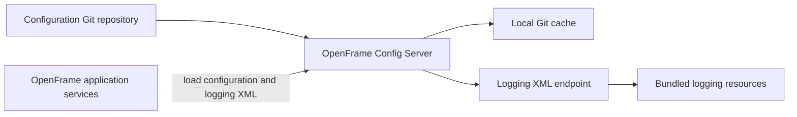
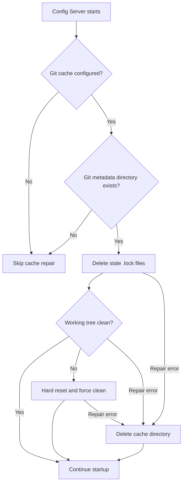
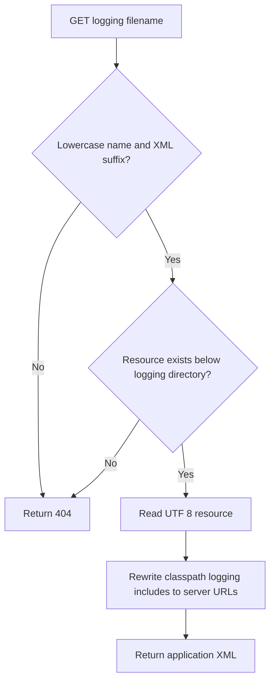

# Config Core

Config Core supplies the runtime behavior of the OpenFrame Config Server. The server is a Spring Cloud Config Server embedded in the tenant repository's `openframe-config` service, and is backed by the `com.openframe.oss:openframe-config-core` library at version `7.0.11`. It serves centrally managed application configuration and provides a constrained endpoint for shared Logback XML files.

The module also hardens the Config Server's local Git checkout. Before the HTTP server begins accepting requests, it removes stale Git locks and restores a dirty cache. If recovery cannot safely complete, it deletes the cache so Spring Cloud Config can clone it again later.

## Scope and Runtime Placement

The local application entry point is `ConfigServerApplication`; it loads the library configuration through Spring Boot component scanning. The platform deployment exposes the service internally on port `8888` and a management port on `8889`. Other services use the in-cluster Config Server URL as their default `SPRING_CONFIG_URL` for the shared logging configuration.

## Core Components

| Component | Responsibility |
|---|---|
| `ConfigServerConfiguration` | Activates Spring Cloud Config Server support by declaring `@EnableConfigServer`. It is the integration point that makes the Config Server behavior available to the application. |
| `ConfigGitCacheRepair` | Runs after bean construction when `spring.cloud.config.server.git.basedir` is configured. It repairs the local Git cache before traffic is served. |
| `LoggingConfigController` | Serves allow-listed Logback XML resources from the application's `logging/` classpath directory at the `/logging/{filename}` endpoint. |

The implementation is provided by the OpenFrame OSS Library:

- [`ConfigServerConfiguration`](https://github.com/flamingo-stack/openframe-oss-lib/blob/7a766f00e4f58b5d89db007b878ac8d6e0c344f4/openframe-config-core/src/main/java/com/openframe/config/core/ConfigServerConfiguration.java)
- [`ConfigGitCacheRepair`](https://github.com/flamingo-stack/openframe-oss-lib/blob/7a766f00e4f58b5d89db007b878ac8d6e0c344f4/openframe-config-core/src/main/java/com/openframe/config/core/ConfigGitCacheRepair.java)
- [`LoggingConfigController`](https://github.com/flamingo-stack/openframe-oss-lib/blob/7a766f00e4f58b5d89db007b878ac8d6e0c344f4/openframe-config-core/src/main/java/com/openframe/config/controller/LoggingConfigController.java)

## Startup and Cache Recovery

`ConfigGitCacheRepair` is conditional: it only exists when `spring.cloud.config.server.git.basedir` has a value. This keeps it inactive for deployments that do not use a filesystem Git cache.

At startup, the repair routine performs the following sequence:

### Recovery Guarantees

- The repair occurs in `@PostConstruct`, before the embedded web server begins serving requests.
- All regular files below the cache's `.git` directory ending in `.lock` are removed. This targets stale JGit lock files left by interrupted branch changes.
- A non-clean checkout is restored using a hard reset followed by a forced clean that includes directories.
- An I/O, JGit, or runtime failure during repair triggers recursive cache deletion. The next Config Server access can recreate the clone rather than reusing an unreliable checkout.

This behavior intentionally favors availability and a clean clone over preserving uncommitted files in the cache. The cache is derived state; it is not the authoritative configuration source.

## Logging Configuration Endpoint

`LoggingConfigController` exposes `GET /logging/{filename}` and returns XML when a matching bundled resource exists. It is intended for services that load Logback configuration remotely rather than from their own classpaths.

### Request Validation and Resource Rewriting

The filename must match the regular expression `[a-z0-9-]+\.xml`. This allow-list prevents the path variable from selecting arbitrary classpath content, including configuration files outside the logging resource directory. Invalid or missing resources produce `404 Not Found` and emit a warning log entry.

When a resource contains an include whose `resource` attribute begins with `logging/`, the controller replaces that prefix with an HTTP `url` rooted at the current server context path plus `/logging/`. Included Logback fragments therefore resolve from the Config Server that supplied the parent file, not from the consuming service's classpath.

## Configuration and Deployment Notes

### Shared Logging Consumer Configuration

The base configuration configures services to load a shared Logback file from the platform Config Server using the `logging.config` property. The default value points at `/logging/shared-logback-spring-logfmt.xml`, which is a valid use of the endpoint above. A caller may override the Config Server host through `SPRING_CONFIG_URL`.

### Platform Deployment

The `openframe-config` Helm deployment:

- publishes HTTP on `8888` and management endpoints on `8889` through a cluster-internal `ClusterIP` service;
- supplies `CONFIG_GIT_BRANCH` and `SPRING_CLOUD_CONFIG_SERVER_GIT_TIMEOUT` from its ConfigMap;
- uses an `emptyDir` mount at `/tmp`, including `XDG_CONFIG_HOME=/tmp/.config` for JGit-related temporary state;
- runs as a non-root user with a read-only root filesystem, while mounting writable temporary and log directories; and
- starts a single replica, with startup, liveness, and readiness probes configured in the chart.

The service is built in this repository as the `openframe-config` Maven artifact and delivered as the `ghcr.io/flamingo-stack/openframe-oss-tenant/openframe-config` image.

## Operational Considerations

- Treat the Git cache directory as disposable. If the server repeatedly removes it, investigate the upstream repository, branch configuration, storage behavior, and pod interruption patterns.
- Keep shared Logback filenames lowercase and limited to letters, digits, and hyphens before the `.xml` suffix. Other names are deliberately unavailable through the logging endpoint.
- If a logging file includes another logging resource, use the expected `resource="logging/"` prefix so the controller can rewrite the include for remote resolution.
- The cache repair logic is only relevant when a Config Server Git base directory is configured; it does not enable or configure a Git backend by itself.

## Relationship to the Tenant Repository

Config Core is consumed by the tenant repository's `openframe/services/openframe-config` application. It is one library module within the broader OpenFrame OSS Library dependency set. The tenant repository is responsible for application bootstrapping, container image construction, Helm deployment values, and the configuration repository content that the Config Server serves.
