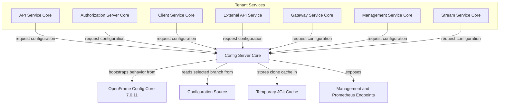
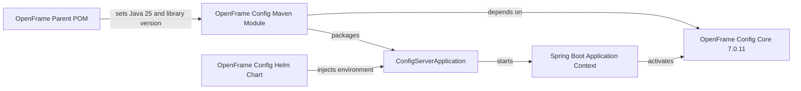
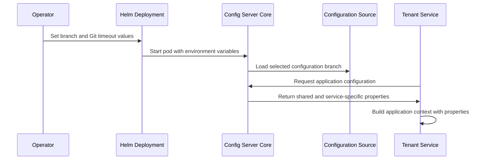
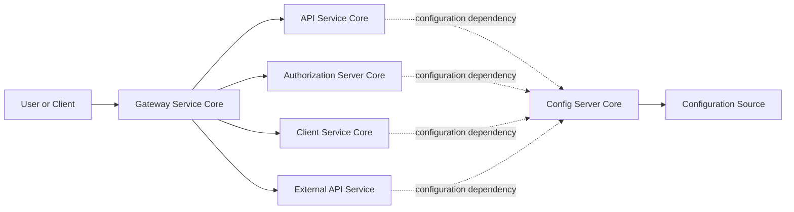
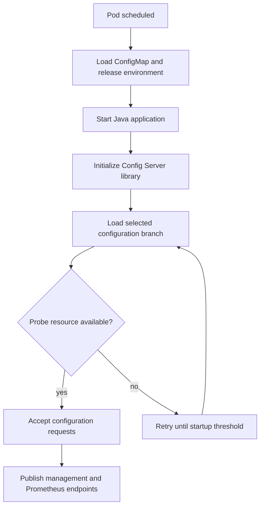

# Config Server Core

Config Server Core is the OpenFrame service entry point for centralized runtime configuration. The local module is intentionally thin: `ConfigServerApplication` starts a Spring Boot application and relies on the version-pinned OpenFrame Config Core library to supply the configuration-server capability. In Kubernetes, the platform deploys it as `openframe-config` before tenant services, where it exposes HTTP configuration content on port 8888 and management endpoints on port 8889.

## Scope and Responsibilities

The module owns the executable wrapper, container image, and Kubernetes deployment for the configuration service. It does not define feature-specific configuration for the API, client, stream, management, gateway, external API, or authorization services; those service settings are maintained as configuration files and are consumed at runtime.

| Responsibility | Implementation in this repository | Boundary |
| --- | --- | --- |
| Application bootstrap | `ConfigServerApplication` is annotated with `@SpringBootApplication` and calls `SpringApplication.run`. | It contains no custom controllers, configuration classes, or business logic. |
| Configuration-server behavior | The Maven module depends on `com.openframe.oss:openframe-config-core` version 7.0.11. | The library implementation is external to this repository. |
| Configuration source selection | The Helm chart supplies `CONFIG_GIT_BRANCH` and `SPRING_CLOUD_CONFIG_SERVER_GIT_TIMEOUT`. | The local chart selects a branch and clone timeout, but does not declare the repository URL. |
| Service delivery | A two-stage Java 25 image builds the Maven module and runs the resulting JAR as an unprivileged user. | Image publication is performed by the release workflow. |
| Platform operation | The Helm deployment exposes ports 8888 and 8889, uses probes, and provides writable temporary and log volumes. | The Service is `ClusterIP`; it is intended for in-cluster consumers. |

## Architecture



The diagram distinguishes repository-owned code from library-provided behavior. `ConfigServerApplication` only initializes the Spring application context. The Config Server library dependency supplies the server-specific implementation, while the Helm deployment provides runtime settings and operating constraints.

## Core Component

### ConfigServerApplication

`com.openframe.config.ConfigServerApplication` is the sole local Java component in this module.

```java
@SpringBootApplication
@Slf4j
public class ConfigServerApplication {
    public static void main(String[] args) {
        SpringApplication.run(ConfigServerApplication.class, args);
    }
}
```

`@SpringBootApplication` enables component discovery and Spring Boot auto-configuration. The `main` method delegates lifecycle management to Spring Boot, which creates the application context and starts the embedded server configuration supplied by its dependencies. Lombok's `@Slf4j` provides a logger field, although this class does not currently emit log messages directly.

Because the module has no local configuration-server controllers or property classes, maintainers should treat the application class as a stable executable boundary. Changes to configuration-server semantics normally belong in the OpenFrame Config Core dependency or in runtime configuration, not in this bootstrap class.

## Dependency Model



The parent POM defines Java 25 and centralizes the OpenFrame library version at 7.0.11. The module POM adds the single service-specific dependency, `openframe-config-core`. Parent-level dependencies also make Actuator, Prometheus registry support, SLF4J, and Logback available to the service.

The Helm chart injects two configuration-server variables:

| Variable | Chart value | Purpose |
| --- | --- | --- |
| `CONFIG_GIT_BRANCH` | `repository.branch`, default `main` | Chooses the branch to serve from the configured configuration source. |
| `SPRING_CLOUD_CONFIG_SERVER_GIT_TIMEOUT` | `repository.timeoutSeconds`, default `5` | Sets the configured Git operation timeout in seconds. |

The repository URL itself is not declared by the module POM, Helm values, or the local application class. Do not assume a source location when changing this module; inspect the deployed runtime configuration or the Config Server library defaults first.

## Configuration Delivery Flow

The repository contains shared configuration plus service-specific configuration files. For example, shared settings define MongoDB, Redis, Cassandra, management endpoint, logging, security, and tenant-isolation properties, while files named for individual services contain their service-specific settings.



Configuration is served before or during dependent service startup. The app-of-apps delivery configuration places the `openframe-config` platform application in sync wave 0, alongside other platform components. Consumers must therefore tolerate normal startup ordering and transient configuration-source availability according to their own Spring configuration-client settings.

## Service Interaction Boundaries

Config Server Core provides configuration content; it is not the request gateway for tenant traffic. Gateway Service Core separately routes browser and API traffic to authorization, API, client, external API, and frontend services. The configuration service is an internal platform dependency rather than a gateway route in the local gateway configuration.



The dashed links represent configuration dependency, not proxied end-user traffic. The same pattern applies to Management Service Core and Stream Service Core when they consume centrally supplied settings.

## Deployment and Runtime

### Container Image

The Dockerfile builds the `openframe/services/openframe-config` Maven module in an Eclipse Temurin Java 25 Alpine builder image. Maven runs with `-pl` for this module and `-am` to also build required project modules. The runtime stage uses Eclipse Temurin Java 25 JRE Alpine, copies the packaged JAR to `/app/app.jar`, and runs it as user and group ID 1001.

The build requires a GitHub token secret to resolve Maven dependencies through the configured Maven settings. Tests are skipped in this image-build command, so image publication should not be treated as a replacement for running the project's test lifecycle elsewhere.

### Kubernetes Workload

| Setting | Value or behavior |
| --- | --- |
| Workload | One-replica Deployment named `openframe-config` |
| HTTP service port | 8888 |
| Management service port | 8889 |
| Exposure | Internal `ClusterIP` Service |
| Resource request | 250 millicores CPU and 512 MiB memory |
| Resource limit | 500 millicores CPU and 1 GiB memory |
| Security | Non-root UID and GID 1001, read-only root filesystem, dropped Linux capabilities, runtime-default seccomp profile |
| Writable paths | Empty directory volumes at `/tmp` and `/app/logs` |
| Git cache location | `XDG_CONFIG_HOME` is set to `/tmp/.config` |

The temporary writable volume is required because the deployment assigns the JGit cache location under `/tmp` while the root filesystem is read-only. The log directory likewise has an explicit writable volume.

### Health and Metrics

Startup, liveness, and readiness probes all request `/xml/shared-logback-spring.xml` on the HTTP port. Startup probing allows up to three minutes, accounting for an initial Git clone. Liveness and readiness checks run every 30 seconds after startup. Prometheus scraping is configured against port 8889 at `/management/{image tag}/prometheus`, where the image tag is also provided to the pod as `RELEASE_VERSION`.

Shared configuration sets the management endpoint base path to `/management/${RELEASE_VERSION:v1}` and exposes health, info, metrics, and Prometheus endpoints with read-only access. Shared logging configuration is loaded from the config-service address specified by `SPRING_CONFIG_URL`, whose default host is `openframe-config.platform.svc.cluster.local` on port 8888.

## Operational Process



If initial configuration-source access is slow, Kubernetes keeps the pod in startup probing for the configured threshold. A failure beyond that threshold restarts the container according to Deployment behavior. Troubleshooting should begin with the config-server pod logs, the selected `CONFIG_GIT_BRANCH`, the configured Git timeout, and reachability of the configuration source.

## Maintenance Guidance

- Keep `ConfigServerApplication` free of service-domain behavior. It should remain a clear Spring Boot executable boundary.
- Upgrade the OpenFrame Config Core dependency through the parent POM's centralized `openframe.libs.version` property so all module versioning remains consistent.
- Validate changes to shared configuration against every consuming service because `application.yml` supplies common infrastructure, observability, security, logging, and tenant-isolation settings.
- Preserve the writable `/tmp` mount when retaining a read-only root filesystem, because the deployment explicitly directs JGit cache data there.
- Update probe paths, management paths, and `RELEASE_VERSION` usage together. Prometheus scrape annotations and shared management configuration both derive the effective versioned management path from the release version.
- Use the OpenMSP Slack community for questions and coordination; this project does not use GitHub Issues or GitHub Discussions.
