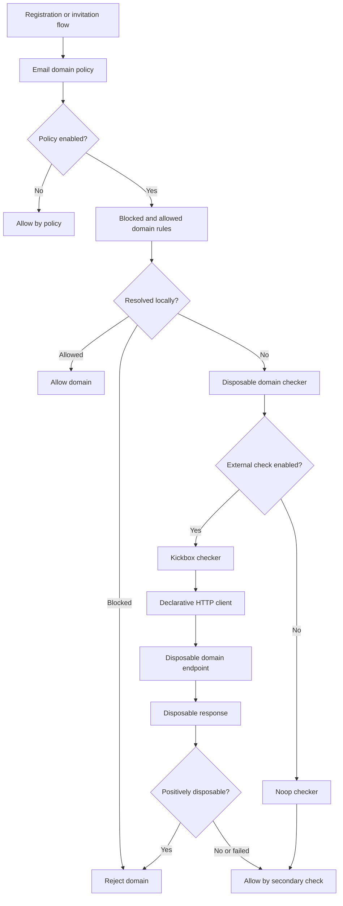
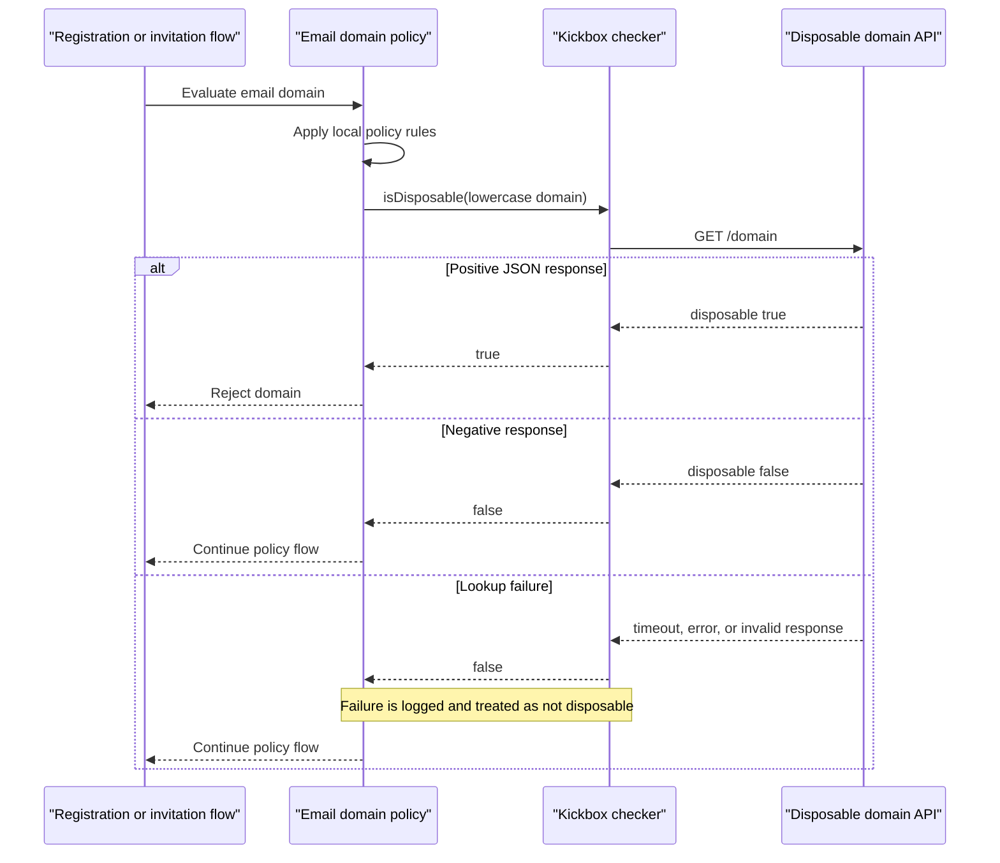

# Core Email Validation

Core Email Validation is an email-domain screening capability supplied at runtime by the OpenFrame OSS Library artifact `com.openframe.oss:openframe-core` version `7.0.11`. OpenFrame OSS Tenant consumes that library to apply a local domain policy and, when enabled, enrich the policy with a bounded lookup against a disposable-email-domain service.

The module is deliberately protective without making registration availability depend on a third party. A configured blocklist can reject known unwanted domains, but a lookup failure, malformed response, DNS error, or timeout from the external service is treated as **not disposable**. Therefore, the remote lookup can add a positive block only when it obtains a valid positive result.

## Scope and Runtime Role

The module provides the disposable-domain portion of the wider email policy. Its surrounding email-policy classes, including `EmailDomainPolicy`, are implemented by the same upstream OpenFrame OSS Library artifact. The policy properties describe the wider decision inputs:

- A master `enabled` switch controls whether the email-domain policy blocks anything.
- `blockedDomains` is initialized from the library's bundled defaults and may be overridden by deployment configuration.
- `allowedDomains` supplies deployment-specific exceptions to the blocklist.
- `disposableCheck` controls the optional external classification lookup.

The supplied checker abstraction accepts a lower-case domain with no local part. It is a secondary check for domains not resolved by the built-in policy, rather than an email-address parser or a persistence component.

## Architecture



### Spring Bean Selection

The same property selects both the HTTP client configuration and checker implementation:

| Disposable-check setting | Active checker | HTTP client configuration | Result |
| --- | --- | --- | --- |
| `enabled: true` or omitted | `KickboxDisposableDomainChecker` | `DisposableDomainClientConfig` creates `DisposableDomainHttpClient` | A remote lookup may identify a domain as disposable. |
| `enabled: false` | `NoopDisposableDomainChecker` | Not created | The secondary lookup always reports not disposable; local policy remains available. |

The two checker implementations use complementary `@ConditionalOnProperty` conditions, so component-scan order does not determine which checker is injected.

## Request and Failure Flow



## Core Components

All source components below are provided by the [OpenFrame OSS Library](https://github.com/flamingo-stack/openframe-oss-lib) rather than implemented in this repository.

| Component | Responsibility |
| --- | --- |
| [`DisposableDomainChecker`](https://github.com/flamingo-stack/openframe-oss-lib/blob/7a766f00e4f58b5d89db007b878ac8d6e0c344f4/openframe-core/src/main/java/com/openframe/core/email/DisposableDomainChecker.java) | Defines the narrow `isDisposable(domain)` contract. Implementations must fail open and return `false` whenever classification cannot be obtained. |
| [`EmailDomainPolicyProperties`](https://github.com/flamingo-stack/openframe-oss-lib/blob/7a766f00e4f58b5d89db007b878ac8d6e0c344f4/openframe-core/src/main/java/com/openframe/core/email/EmailDomainPolicyProperties.java) | Binds the `openframe.email-domain-policy` configuration tree, including master policy state, local domain sets, URL, secondary-check state, and timeout. |
| [`DisposableDomainClientConfig`](https://github.com/flamingo-stack/openframe-oss-lib/blob/7a766f00e4f58b5d89db007b878ac8d6e0c344f4/openframe-core/src/main/java/com/openframe/core/email/DisposableDomainClientConfig.java) | Builds a Spring `RestClient` proxy with the configured base URL and applies the same timeout independently to connection and read operations. |
| [`DisposableDomainHttpClient`](https://github.com/flamingo-stack/openframe-oss-lib/blob/7a766f00e4f58b5d89db007b878ac8d6e0c344f4/openframe-core/src/main/java/com/openframe/core/email/DisposableDomainHttpClient.java) | Declares the JSON HTTP exchange: `GET /{domain}` relative to the configured base URL. |
| [`DisposableDomainResponse`](https://github.com/flamingo-stack/openframe-oss-lib/blob/7a766f00e4f58b5d89db007b878ac8d6e0c344f4/openframe-core/src/main/java/com/openframe/core/email/DisposableDomainResponse.java) | Models the response body as a single `disposable` boolean. |
| [`KickboxDisposableDomainChecker`](https://github.com/flamingo-stack/openframe-oss-lib/blob/7a766f00e4f58b5d89db007b878ac8d6e0c344f4/openframe-core/src/main/java/com/openframe/core/email/KickboxDisposableDomainChecker.java) | Uses the HTTP proxy when secondary checking is enabled. It accepts only an explicit positive response as disposable and logs exceptions before failing open. |
| [`NoopDisposableDomainChecker`](https://github.com/flamingo-stack/openframe-oss-lib/blob/7a766f00e4f58b5d89db007b878ac8d6e0c344f4/openframe-core/src/main/java/com/openframe/core/email/NoopDisposableDomainChecker.java) | Provides the disabled-mode implementation, always returning `false` without a network call. |

## Configuration

The configuration prefix is `openframe.email-domain-policy`. Defaults in the library activate the policy and enable the disposable check. The default endpoint is Kickbox's open disposable-domain endpoint, and the default timeout is 1500 milliseconds for each connection and read phase.

A deployment can turn off only remote classification while retaining local domain rules:

```yaml
openframe:
  email-domain-policy:
    disposable-check:
      enabled: false
```

A deployment can also replace the remote endpoint and reduce or increase the timeout according to its availability requirements:

```yaml
openframe:
  email-domain-policy:
    disposable-check:
      enabled: true
      url: "https://disposable-check.example.internal/v1/domain/"
      timeout-ms: 1000
```

The URL must be a base ending at the disposable-domain resource path because the client appends the domain as the final path segment. The external endpoint is expected to return JSON equivalent to `{"disposable": true}` or `{"disposable": false}`.

## Operational Guarantees and Boundaries

- **Fail-open remote dependency:** Exceptions from the HTTP call are caught, logged at warning level, and converted to `false`. A third-party outage must not independently prevent invitation or registration.
- **Bounded inline work:** Both connect and read timeouts use `disposable-check.timeout-ms`; this limits the latency added to request paths that consult the checker.
- **No lookup when disabled:** Disabled mode selects the no-operation implementation, preventing an external call.
- **Explicit-positive classification:** The remote checker returns `true` only when a non-null parsed response states that the domain is disposable.
- **Policy controls stay local:** The master switch, blocked-domain set, and allowed-domain set belong to deployment configuration and remain distinct from the availability-dependent remote signal.

## System Integration

OpenFrame OSS Tenant consumes `com.openframe.oss:openframe-core` version `7.0.11` from the OpenFrame OSS Library. The upstream policy is exercised in authentication and invitation-related library tests, including tenant registration and user invitation flows. The module tree also places it alongside the authorization service, whose registration and invitation controllers are natural request-path integrations.

The feature does not publish an HTTP endpoint, persist records, or schedule background jobs. It is an in-process Spring component used by the broader email-domain policy during synchronous validation decisions.
