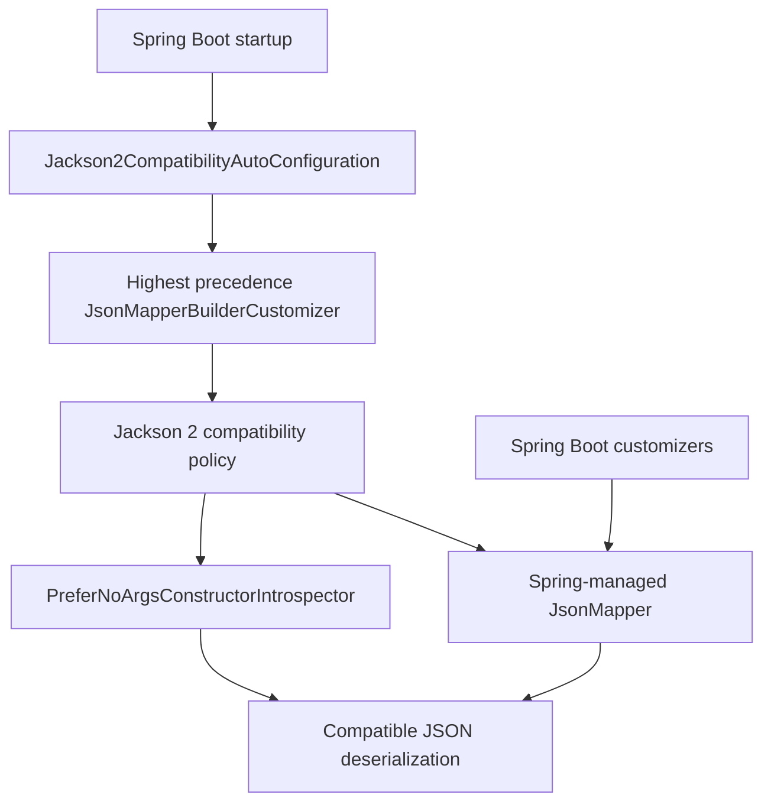
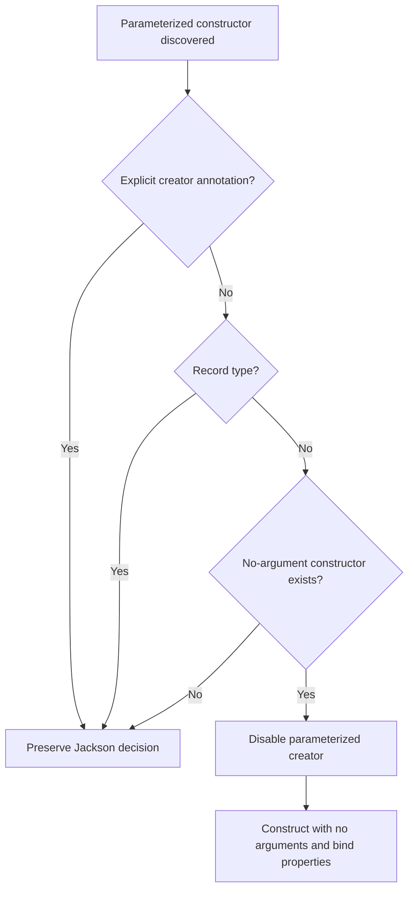

# Core Jackson

Core Jackson is a small compatibility layer supplied by the `com.openframe.oss:openframe-core` library. It preserves selected Jackson 2 deserialization and mapper behaviors while OpenFrame services run on Jackson 3. The module is activated as Spring Boot auto-configuration and applies its policy to the framework-managed `JsonMapper` before Boot's standard customizers run.

This matters for persisted and partner JSON: a Jackson 3 constructor-selection change can otherwise bypass a no-argument constructor and setters, causing defaults defined by field initializers or `@Builder.Default` to be lost when older payloads omit recently added properties.

## Scope and Role

Core Jackson is infrastructure rather than an API surface. It has no controllers, storage, routes, or application-specific DTOs. Its responsibilities are to:

- configure compatible reads for the Spring-managed JSON mapper;
- retain Jackson 2-style constructor selection for eligible mutable classes;
- offer the same mapper policy to non-Spring JSON clients through the supporting compatibility utility; and
- leave explicit creator annotations, records, and classes without no-argument constructors under Jackson's native handling.

The source belongs to the OpenFrame OSS Library, which this repository consumes as `com.openframe.oss:openframe-core` version `7.0.11`.

## Architecture Overview

The ordering is intentional. The customizer is registered at highest precedence so the compatibility policy is established first. Spring Boot can subsequently apply an explicit `spring.jackson.deserialization.fail-on-null-for-primitives` setting, which therefore overrides the compatibility default for that option.

## Components

### Jackson 2 Compatibility Auto-Configuration

[`Jackson2CompatibilityAutoConfiguration`](https://github.com/flamingo-stack/openframe-oss-lib/blob/7a766f00e4f58b5d89db007b878ac8d6e0c344f4/openframe-core/src/main/java/com/openframe/core/jackson/Jackson2CompatibilityAutoConfiguration.java) is an `@AutoConfiguration` class. It contributes one ordered `JsonMapperBuilderCustomizer` bean that delegates to the compatibility policy.

The policy, provided by the adjacent `Jackson2Compatibility` utility in the same library package, configures a mapper to:

- disable failure on `null` values for primitive properties by default;
- disable alphabetical property sorting;
- disable enum serialization and deserialization via `toString()`; 
- use creator visibility compatible with Jackson 2; and
- install the no-argument-constructor preference introspector.

The utility also exposes a plain configured `JsonMapper` and helpers for configuring `WebClient` codecs and `RestClient` message converters. Those helpers let code outside the Spring-managed mapper opt into the same policy; the auto-configuration itself only installs the customizer for Boot's mapper.

### Prefer No-Argument Constructor Introspector

[`PreferNoArgsConstructorIntrospector`](https://github.com/flamingo-stack/openframe-oss-lib/blob/7a766f00e4f58b5d89db007b878ac8d6e0c344f4/openframe-core/src/main/java/com/openframe/core/jackson/PreferNoArgsConstructorIntrospector.java) extends Jackson's annotation introspector and adjusts creator discovery during deserialization.

For a constructor with parameters, it first preserves any explicit Jackson creator annotation. If no explicit annotation exists, the type is not a record, and reflection finds a no-argument constructor, it returns `JsonCreator.Mode.DISABLED` for the parameterized constructor. Jackson then uses the no-argument construction path and property setters. This preserves defaults for JSON properties that are absent.

It deliberately does not alter these cases:

| Case | Behavior |
|---|---|
| Explicit `@JsonCreator` | Preserved exactly as declared. |
| Record type | Left to Jackson's standard record handling. |
| No no-argument constructor | Left to Jackson's standard constructor detection. |
| No-argument constructor itself | Not disabled. |

## Deserialization Decision Flow

## System Integration

At runtime, applications in this repository assemble the OpenFrame OSS Library into Spring Boot services. Core Jackson affects JSON mapping used by those services whenever the library's auto-configuration is discovered. It is particularly relevant at boundaries where older persisted data, partner payloads, or evolving DTOs omit fields that currently have in-memory defaults.

The module is a foundational compatibility concern for other OpenFrame library modules that serialize or deserialize JSON. It is intentionally generic: DTO contracts, HTTP endpoints, persistence configuration, and application bootstraps remain the responsibility of their respective modules.

## Maintenance Considerations

- Preserve the auto-configuration order when changing mapper defaults. Its current order lets explicit Spring Boot configuration take precedence for primitive-null failure behavior.
- Treat the constructor preference as a backward-compatibility policy, not a general replacement for explicit creator annotations.
- Add tests for both JSON written before a field was introduced and JSON that intentionally uses an annotated creator before changing the introspector.
- When configuring a standalone JSON client, use the library compatibility utility rather than duplicating individual mapper flags, so standalone and Spring-managed JSON behavior remain aligned.
