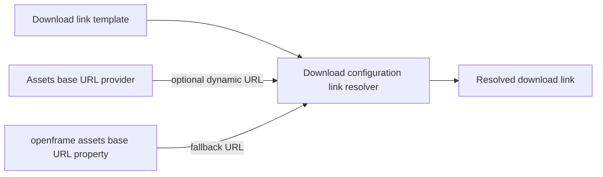
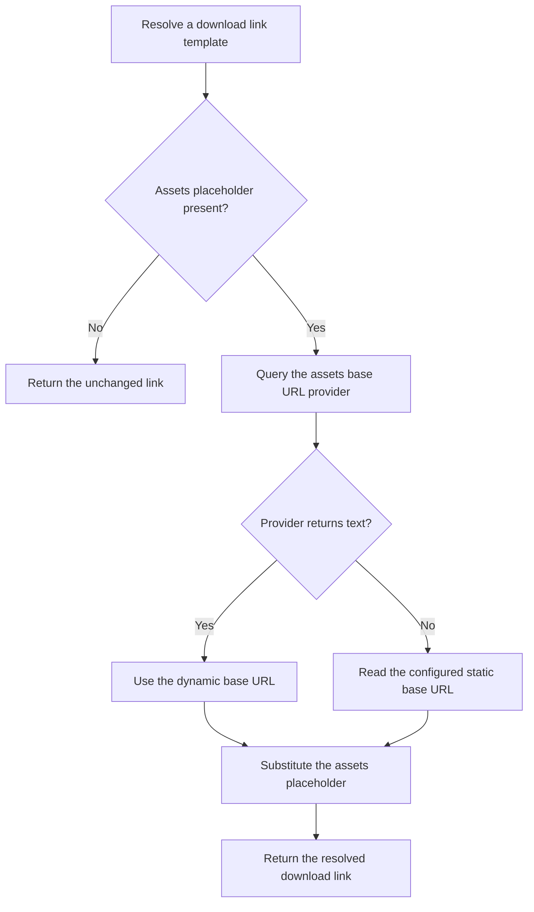
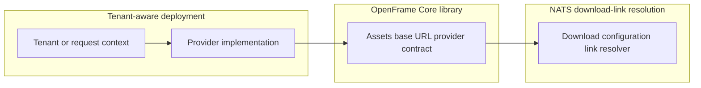

# Core Service Util

Core Service Util is a small shared contract from the OpenFrame Core library. It separates the decision of which public asset origin applies to a request from the component that expands download-link templates. The module exposes one interface, [`AssetsBaseUrlProvider`](https://github.com/flamingo-stack/openframe-oss-lib/blob/7a766f00e4f58b5d89db007b878ac8d6e0c344f4/openframe-core/src/main/java/com/openframe/core/service/AssetsBaseUrlProvider.java), which lets a deployment supply a tenant-aware asset base URL without taking a dependency on the NATS messaging implementation.

The OpenFrame OSS Tenant repository consumes `com.openframe.oss:openframe-core` at version `7.0.11`. Although this module is part of the library dependency, it is a runtime extension point for services assembled by this repository rather than an application entry point.

## Purpose and Responsibilities

`AssetsBaseUrlProvider` has a single operation, `getAssetsBaseUrl()`, returning the base URL used when a download-link template contains the `{assetsBaseUrl}` placeholder.

The contract has three deliberate responsibilities:

- **Dynamic origin selection:** an application can derive the asset host from deployment context, such as a tenant domain, instead of using one static origin.
- **Optional contribution:** implementations may return `null`, an empty string, or whitespace when they do not have a dynamic value.
- **Dependency isolation:** the interface lives in OpenFrame Core, allowing an implementation in a persistence or service layer to remain independent of the NATS module and its Spring Cloud Stream binder.

It does not construct URLs, retrieve assets, validate tenant domains, or manage HTTP transport. Those concerns belong to the resolver and to the service-specific configuration that supplies the final value.

## Architecture



The provider is optional. The resolver checks whether the provider yields text and uses that value only when it is nonblank. Otherwise it preserves the static-property behavior. Consequently, deploying no provider must remain a supported configuration.

## Resolution Flow



The fallback is significant for compatibility: installations using only the `openframe.assets.base-url` property do not need a bean. A tenant-aware deployment can add one without changing download templates or the resolver call path.

## Component Contract

| Element | Role | Behavioral expectation |
|---|---|---|
| `AssetsBaseUrlProvider` | Extension-point interface | Provides an optional dynamic asset origin. |
| `getAssetsBaseUrl()` | Single provider operation | Returns a full base URL when dynamic resolution is available; otherwise returns blank or `null` to delegate to property fallback. |
| `{assetsBaseUrl}` | Template placeholder | Is replaced by the resolver-selected origin. |
| `openframe.assets.base-url` | Static configuration fallback | Supplies the origin when a provider is absent or returns no text. |

The authoritative source for the interface is [AssetsBaseUrlProvider.java](https://github.com/flamingo-stack/openframe-oss-lib/blob/7a766f00e4f58b5d89db007b878ac8d6e0c344f4/openframe-core/src/main/java/com/openframe/core/service/AssetsBaseUrlProvider.java).

## Integration Boundaries



The download-link resolver is implemented in the OpenFrame OSS Library's NATS data module. Core Service Util intentionally only defines the contract, so applications that use a different messaging binder do not acquire the NATS binder merely to define or inject an asset-origin provider.

At the indexed revision, the organization-wide code graph records no concrete implementation or direct caller of this interface. Treat it as an available integration seam: an implementation is relevant only in a deployment that needs per-tenant or otherwise dynamic asset origins.

## Implementing the Contract

A provider should return a normalized absolute origin suitable for prefixing asset paths. It should return no text when it cannot determine an origin, rather than guessing a host, so the resolver can apply the configured fallback.

```java
import com.openframe.core.service.AssetsBaseUrlProvider;

final class TenantAssetsBaseUrlProvider implements AssetsBaseUrlProvider {
    @Override
    public String getAssetsBaseUrl() {
        return "https://tenant.example.openframe.build";
    }
}
```

The example illustrates the contract only. Bean registration, tenant-context lookup, origin allowlisting, and URL normalization are deployment responsibilities and are not supplied by Core Service Util.

## Operational and Security Considerations

- Return a canonical HTTPS origin appropriate for the active tenant or environment.
- Do not derive the host directly from unvalidated user-controlled input; otherwise generated links can be redirected to an attacker-controlled origin.
- Preserve the blank-or-`null` fallback semantics. Throwing merely because dynamic context is unavailable converts a safe static fallback into a download-link failure.
- Keep any tenant-resolution dependency outside OpenFrame Core. This maintains the module's intended low-level, binder-independent boundary.
- Test both branches: a nonblank provider value must replace the placeholder, while a blank value must select `openframe.assets.base-url`.

## Maintenance Guide

Changes to this interface affect any deployment-specific provider implementation. Preserve its minimal shape unless a broader cross-service contract is justified.

When investigating a wrong asset link, verify the flow in this order:

1. Confirm the link template contains `{assetsBaseUrl}`.
2. Determine whether a provider bean is installed for the active service.
3. Inspect the provider result and ensure it is nonblank and tenant-correct.
4. If no dynamic value is produced, verify the `openframe.assets.base-url` property.
5. Confirm the final resolved origin is reachable from the client that downloads the asset.

This module has no persistence model, endpoint, scheduler, or background process. Its sole contribution is the stable contract that connects dynamic deployment context to download-link resolution.
