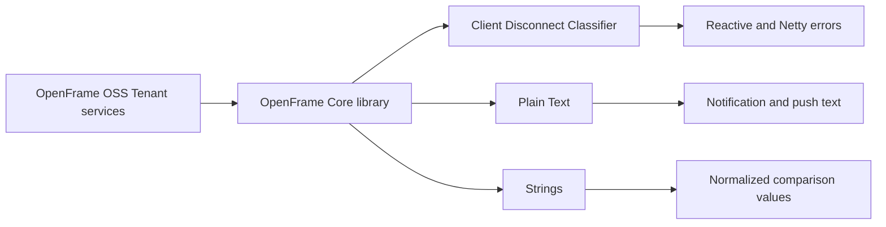
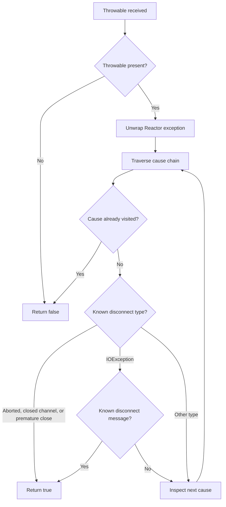
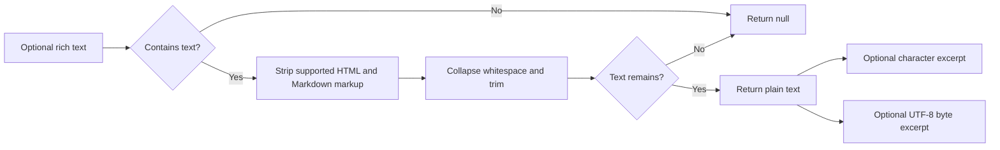

# Core Utils Validation

Core Utils Validation is a small, dependency-light utility surface supplied by the `com.openframe.oss:openframe-core` library (version `7.0.11`). The OpenFrame OSS Tenant services assemble this library at runtime. Its three utilities standardize common boundary behavior:

- classifying expected peer disconnects so reactive HTTP infrastructure does not report them as application failures;
- converting rich notification content to safe, concise plain text while preserving Unicode and UTF-8 limits; and
- normalizing optional text for stable, locale-independent comparisons.

The implementation lives in the OpenFrame OSS Library rather than this repository. This repository consumes it as a Maven dependency; the linked source below is pinned to the library revision supplied with the component metadata.

## Architecture Overview

The module is intentionally stateless. Each public utility exposes static behavior and performs no persistence, network I/O, or configuration lookup. That makes it suitable for use in request handling, error handling, notification preparation, and input normalization without introducing lifecycle dependencies.

## Components

| Component | Responsibility | Key behavior |
|---|---|---|
| [Client Disconnect Classifier](https://github.com/flamingo-stack/openframe-oss-lib/blob/7a766f00e4f58b5d89db007b878ac8d6e0c344f4/openframe-core/src/main/java/com/openframe/core/util/ClientDisconnectClassifier.java) | Identifies exceptions caused by a remote peer closing a connection. | Unwraps Reactor exceptions, traverses the cause chain safely, and recognizes Netty closure types plus known `IOException` messages. |
| [Plain Text](https://github.com/flamingo-stack/openframe-oss-lib/blob/7a766f00e4f58b5d89db007b878ac8d6e0c344f4/openframe-core/src/main/java/com/openframe/core/util/PlainText.java) | Sanitizes markup-bearing text and produces display-safe excerpts. | Removes a defined subset of HTML and Markdown markup, collapses whitespace, and truncates without splitting Unicode surrogate pairs or exceeding UTF-8 byte budgets. |
| [Strings](https://github.com/flamingo-stack/openframe-oss-lib/blob/7a766f00e4f58b5d89db007b878ac8d6e0c344f4/openframe-core/src/main/java/com/openframe/core/util/Strings.java) | Applies minimal canonicalization to optional strings. | Returns `null` for blank input, otherwise trims and lowercases with `Locale.ROOT`. |

## Client Disconnect Classification

`ClientDisconnectClassifier.isClientDisconnect(Throwable)` distinguishes expected connection termination from faults that should be surfaced as server errors. This is particularly relevant to reactive and Netty request paths, where a browser navigating away, an agent reconnecting, or a load balancer closing an idle stream can produce exception chains after application work has started.

### Classification flow

### Recognition rules

The classifier returns `true` for these conditions anywhere in the unwrapped causal chain:

- Reactor Netty `AbortedException`;
- Java `ClosedChannelException`, which also covers stackless closed-channel cases;
- Reactor Netty `PrematureCloseException`;
- an `IOException` whose lowercased message contains `broken pipe`, `connection reset`, `prematurely closed`, or `connection has been closed`.

An identity-based visited set prevents loops in pathological exception graphs. All nonmatching exceptions, missing messages, and a `null` input return `false`. Callers can therefore suppress or lower the severity of expected disconnect noise without masking unrelated I/O or application failures.

## Plain Text Sanitization and Excerpts

`PlainText` prepares rich content for single-line presentation contexts such as notifications and FCM push titles. It is a formatting utility, not a general-purpose HTML sanitizer or a security boundary: it removes markup for display, rather than parsing and enforcing an HTML policy.

### Sanitization pipeline

### Markup handling

`sanitize` applies its rules in a deliberate order that mirrors the web client's notification markup stripping behavior:

1. removes tag-shaped HTML;
2. replaces Markdown images with their alternative text;
3. replaces Markdown links with their visible label;
4. removes supported emphasis delimiters while retaining the emphasized content;
5. removes inline or fenced backtick delimiters while retaining their body;
6. removes headings, blockquote prefixes, and list markers; and
7. collapses all whitespace runs to a single space and trims the result.

A blank or whitespace-only source, or content that becomes empty after transformation, produces `null`.

### Excerpt semantics

`sanitizeAndExcerpt` composes sanitization with character-limited truncation. `excerpt` returns the original value when it is `null`, within the supplied character limit, or the limit is nonpositive. Otherwise it appends the Unicode ellipsis character. It uses a surrogate-safe cut, backs off to a word boundary only when a cut falls inside a word, and removes trailing whitespace and common punctuation before appending the ellipsis.

`excerptToBytes` has equivalent intent for byte-constrained transports. It measures UTF-8 encoded size by code point, never cuts through a multi-byte code point, and reserves bytes for the ellipsis. If the available budget cannot hold that ellipsis, it returns an empty string rather than emitting an invalid or oversized payload.

## String Canonicalization

`Strings.lowerTrimmed(String)` is the module's narrow normalization primitive. It delegates blank detection to Spring's text utility, returning `null` for `null`, empty, or whitespace-only input. For present text, it removes leading and trailing whitespace and applies lowercase conversion with `Locale.ROOT`.

Using the root locale avoids environment-dependent casing behavior. Consumers should use this helper where a nullable, case-insensitive canonical value is required. It does not validate syntax, collapse internal whitespace, or apply domain-specific normalization; those remain the responsibility of the caller or of the dedicated validation modules.

## Operational Boundaries

Core Utils Validation complements, rather than replaces, other platform concerns:

- Use Core Validation for domain validation such as email and tool-argument rules.
- Use Core Email Validation for disposable-domain and email-domain policy decisions.
- Use application-specific exception handling to choose logging, metrics, response, and retry behavior after Client Disconnect Classification has identified an expected peer closure.
- Use security-focused encoding and sanitization appropriate to the final output context when handling untrusted content. Plain Text is designed for readable plain-text display.

## Maintenance Notes

- Keep the Plain Text rule sequence aligned with the web client behavior; changing its order can cause notification text to differ across surfaces.
- Extend disconnect matching conservatively. A broad exception or message rule could hide genuine server-side failures.
- Preserve Unicode-aware truncation behavior when modifying excerpts, especially the distinction between character count and UTF-8 byte count.
- Preserve `Locale.ROOT` in String Canonicalization to keep normalized values deterministic across deployments.
