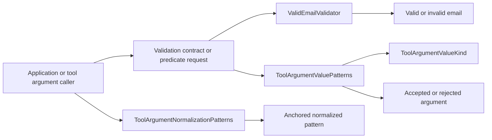
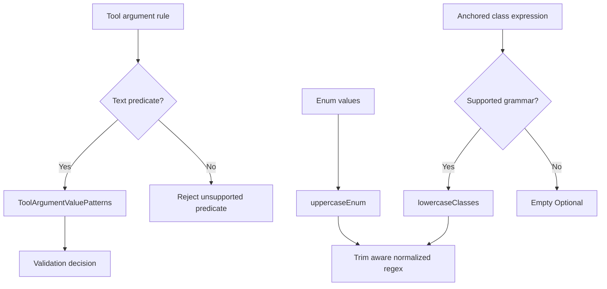

# Core Validation

Core Validation is a small shared library supplied by the OpenFrame OSS Library artifact `com.openframe.oss:openframe-core` version `7.0.11`. It provides two validation capabilities used by the tenant services at run time:

- a Jakarta Bean Validation validator for email values; and
- portable predicates and regular-expression builders for validating and normalizing tool arguments.

The module deliberately contains no controllers, persistence, or transport code. It establishes reusable validation semantics that higher-level API, client, and tool-management components can apply at their boundaries.

## Architecture Overview

The email path is annotation-driven: `ValidEmailValidator` implements Jakarta Validation's `ConstraintValidator` contract and compiles the regular expression supplied by its associated `ValidEmail` annotation. The tool-argument path is model-independent. It expresses a small set of value kinds, evaluates string values against those kinds, and can derive regexes that accept padding and Unicode case variants while preserving a canonical interpretation.

## Components

| Component | Responsibility |
| --- | --- |
| `ValidEmailValidator` | Initializes an email regex from the `ValidEmail` constraint, rejects `null`, and requires a full regular-expression match for non-null values. |
| `ToolArgumentValueKind` | Defines the portable predicates: `NON_NULL`, `HAS_TEXT`, `NOT_TRIM_EMPTY`, `NOT_TRIM_BLANK`, and `PATTERN`. |
| `ToolArgumentValuePatterns` | Applies text-oriented predicates, caches compiled regexes by pattern string, and exposes the `ENVIRONMENT_ENTRY` pattern for `NAME=value`-style entries. |
| `ToolArgumentNormalizationPatterns` | Builds anchored patterns for enum-like values and eligible character-class expressions with whitespace trimming and Unicode case normalization. |

## Email Validation

`ValidEmailValidator` is initialized once by the Jakarta Validation runtime with a `ValidEmail` annotation. During initialization, it compiles `constraintAnnotation.regex()` into a `Pattern`. Each call to `isValid` then follows a narrow, deterministic rule:

1. A `null` value is invalid.
2. A non-null value is valid only when the complete value matches the configured expression.

The validator does not trim, lowercase, or otherwise transform input. Consequently, the annotation's regex is the single source of policy for accepted email syntax, including whether whitespace or particular domains are allowed. Callers that need optional input should model that policy outside this validator rather than assuming that `null` is accepted.

The associated annotation is defined in the OpenFrame OSS Library alongside this module. Its implementation source is available at [Valid Email Validator](https://github.com/flamingo-stack/openframe-oss-lib/blob/7a766f00e4f58b5d89db007b878ac8d6e0c344f4/openframe-core/src/main/java/com/openframe/core/validation/ValidEmailValidator.java).

## Tool Argument Value Predicates

`ToolArgumentValueKind` separates predicate selection from the models that carry tool arguments. `ToolArgumentValuePatterns.isMatchingValue` only accepts `String` values; any other type, including `null`, returns `false`.

| Value kind | Evaluation behavior |
| --- | --- |
| `HAS_TEXT` | Uses Spring's `StringUtils.hasText`, requiring at least one non-whitespace character. |
| `NOT_TRIM_EMPTY` | Trims the value and requires the result not to be empty. |
| `NOT_TRIM_BLANK` | Trims the value and requires the result not to be blank. |
| `PATTERN` | Casts the operand to a pattern string, compiles or reuses the cached `Pattern`, and requires a complete match. |
| `NON_NULL` | Is intentionally not a text predicate; passing it to `isMatchingValue` raises `IllegalArgumentException`. |

The `PATTERN` branch stores compiled patterns in a process-wide `ConcurrentHashMap`, avoiding repeated compilation for identical operand strings and allowing concurrent evaluation. The operand must be a `String` when this branch is chosen; a mismatched operand type fails with the normal Java cast behavior.

`ENVIRONMENT_ENTRY` is an anchored expression for environment-style entries. It requires at least one leading character that is not `=`, permits any following characters before the first required `=`, and permits any value after it, including an empty value. The anchors and terminal negative lookahead ensure the entire string is evaluated.

## Pattern Normalization

`ToolArgumentNormalizationPatterns` generates regex source rather than directly transforming values. Generated patterns are fully anchored and wrap the accepted body with padding that accepts characters from Unicode code point zero through space. This makes leading and trailing control or whitespace padding acceptable while maintaining an exact match requirement for the normalized body.

### Enum Values

`uppercaseEnum` accepts a list of canonical values and produces a pattern that recognizes source characters whose Unicode uppercase mapping yields those values under `Locale.ROOT`. It computes the relevant Unicode preimages once for the class and escapes source code points in the generated expression. This avoids dependence on the host locale and allows matching case variants that normalize to ASCII uppercase text.

### Character-Class Expressions

`lowercaseClasses` accepts only an anchored expression whose body matches the module's restricted class-expression grammar. For eligible expressions, it expands positive character classes with source characters whose Unicode lowercase mapping fits the original class, then adds the same trim-padding behavior.

If an expression is not anchored with `^` and `$`, or its body is outside the supported grammar, `lowercaseClasses` returns an empty `Optional`. This is a compatibility boundary, not a general-purpose regex rewriter: callers must preserve the original expression when no normalized projection is available.

## Runtime Placement

Core Validation is consumed as part of the OpenFrame OSS Library dependency set assembled by this repository's service applications. It is a low-level utility layer: service components define their own request and domain policies, while this module supplies the common mechanics for email constraints and tool argument checks. It does not make network calls, read configuration, or persist state.

## Maintenance Notes

- Keep email behavior aligned with the `ValidEmail` annotation's regex contract. Changing null handling or adding implicit normalization would change validation semantics globally.
- Treat `ToolArgumentValueKind` as an API contract. Add a new kind only with corresponding evaluation behavior and explicit caller expectations.
- Keep normalized regex generation anchored. Removing anchoring or trim-padding changes both accepted input and security expectations at tool-execution boundaries.
- The normalization implementation scans Unicode code points to build static preimage maps. Preserve this initialization model unless a replacement retains locale-independent behavior and equivalent Unicode coverage.
