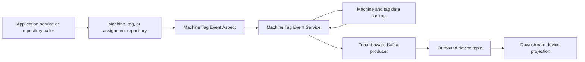
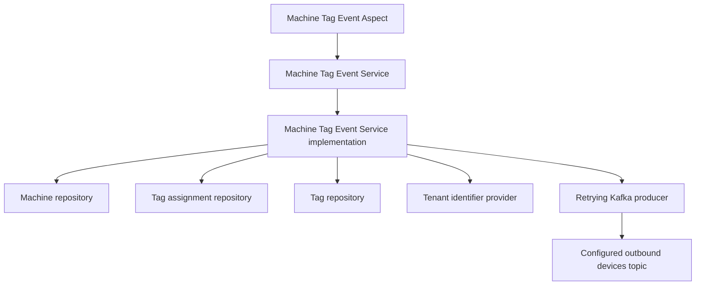
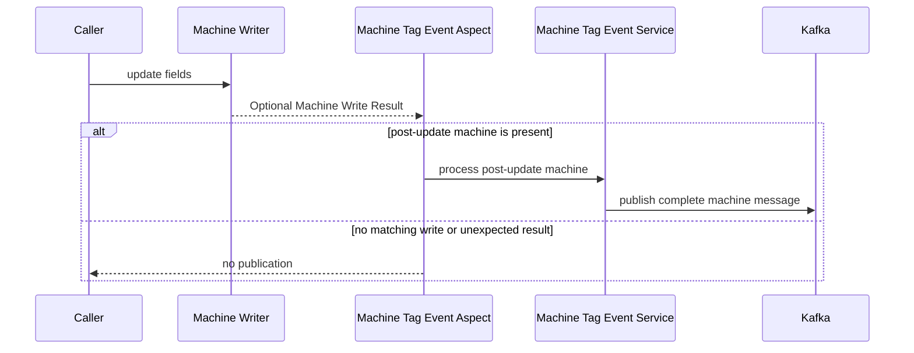
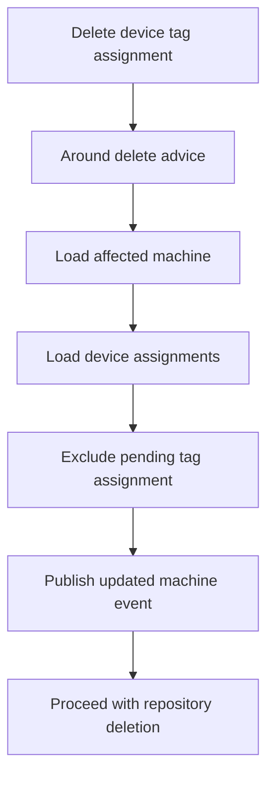

# Machine Tag Event Aspect

Machine Tag Event Aspect is the persistence-to-event bridge for device records and device tag data. It is implemented by `MachineTagEventAspect` in the OpenFrame OSS Library artifact `com.openframe.oss:openframe-data-device-aspect`, version 7.0.11, which this repository consumes at run time.

The aspect observes selected repository and machine-writer calls. It delegates to the Machine Tag Event Service, which reconstructs the affected machine's current searchable representation and publishes a machine event to the configured outbound Kafka device topic. This allows downstream indexing, including Pinot-oriented projections, to be refreshed whenever machine attributes, tag assignments, or tag definitions change.

**Source:** [Machine Tag Event Aspect in OpenFrame OSS Library](https://github.com/flamingo-stack/openframe-oss-lib/blob/7a766f00e4f58b5d89db007b878ac8d6e0c344f4/openframe-data-device-aspect/src/main/java/com/openframe/data/aspect/MachineTagEventAspect.java)

## Scope and Activation

The component is a Spring `@Aspect` and `@Component`. It is active when `openframe.device.aspect.enabled` is `true`; because `matchIfMissing` is enabled, it is also active unless the property is explicitly set to `false`.

Its responsibility is intentionally narrow:

- identify persistence operations that can alter a machine's indexed representation;
- preserve normal repository behavior by proceeding with intercepted calls;
- invoke the service-level publication workflow at the appropriate point in the operation; and
- isolate most publication failures from repository-write callers through logging.

The aspect does not build Kafka payloads, query related records, resolve tenant context, or publish messages itself. Those responsibilities belong to the Machine Tag Event Service implementation supplied by the same library.

## Intercepted Operations

The following advice is installed. Pointcuts are type-specific, so similarly named methods on other repository types are not intercepted.

| Mutation source | Advice timing | Delegated operation | Behavior |
|---|---|---|---|
| `MachineRepository.save` | After successful return | `processMachineSave` | Republishes the supplied machine with its current tags. |
| `MachineRepository.saveAll` | After successful return | `processMachineSaveAll` | Republishes every supplied machine. |
| `MachineWriter.update` | After successful return | `processMachineSave` | Publishes only when the return value is an `Optional` containing a `MachineWriteResult`; it uses the result's post-update machine document. |
| `TagAssignmentRepository.save` | After successful return | `processTagAssignmentSave` | Republishes the related machine only for a device assignment. |
| `TagAssignmentRepository.saveAll` | After successful return | `processTagAssignmentSaveAll` | Republishes each affected device once, even when multiple assignment records target it. |
| `TagAssignmentRepository.deleteByEntityIdAndTagIdAndEntityType` | Around, before deletion | `processTagAssignmentDelete` | For a `DEVICE` entity type, calculates and emits the remaining tag state before the assignment is removed. |
| `TagAssignmentRepository.deleteByTagId` | Around, before deletion | `processTagAssignmentDeleteByTagId` | Locates affected devices and emits each device's state excluding the tag before bulk removal. |
| `TagRepository.save` | Around, after a successful save | `processTagSave` | When the input tag has an identifier, republishes every device assigned to that tag. |
| `TagRepository.saveAll` | Around, after a successful save | `processTagSave` per returned existing tag | Records input tag identifiers before the call and republishes returned tags whose identifiers match that set. |

## Component Relationships

The aspect receives only a `MachineTagEventService` dependency. The service implementation supplies the data and messaging work that the aspect deliberately omits.

For a publication, the service reads the machine, its device-scoped tag assignments, and matching tags. It then emits a `MachinePinotMessage` keyed by machine identifier. The message includes tenant and organization identifiers, machine type and status, connectivity, operating system, tag keys, tag key/value pairs, directory-source names, directory-user-link state, and an ingestion timestamp. A missing directory-user link is represented as `NONE` rather than omitted.

## Data Flow

### Machine writes

Machine repository writes are handled after the intercepted method returns. Field-scoped writes through `MachineWriter.update` differ because the aspect uses the returned `MachineWriteResult.after()` document rather than a pre-update object. An empty optional or a return value with another shape produces no event, which covers unmatched writes and rejected guarded updates.

### Tag assignment changes

Saving a device tag assignment makes the service load the associated machine and all of its current tags, then publish a complete replacement-style representation. Non-device assignments are ignored by the service.

Deletion uses pre-delete advice because the assignment would otherwise be unavailable to identify affected devices and construct an event that excludes the removed tag. The service reads the still-present assignments, filters the assignment being removed in memory, and publishes the resulting tag set before the repository deletion proceeds. Bulk deletion follows the same approach for every device associated with the tag.

### Tag definition changes

A tag definition can affect every machine using that tag, such as when its key changes. The around advice first executes the repository save. If the tag has an identifier, it asks the service to find every device assignment for that tag and republish each corresponding machine. This is fan-out behavior: one tag update can generate one machine event per affected device.

For `saveAll`, the aspect retains the identifiers from the input iterable, proceeds with the save, and processes each returned tag whose identifier existed in that original set. This means tag records without an identifier before the operation are not sent through this existing-tag update path.

## Error and Transaction Semantics

The advice deliberately distinguishes operational event failures from repository-write failures:

- `@AfterReturning` advice runs only after the intercepted call returned successfully. Its own exceptions are caught, logged at error level, and not rethrown.
- Assignment-delete advice catches and logs pre-delete synchronization failures, then always calls `proceed()`. The deletion is therefore not blocked by an event-publication problem in this aspect.
- Tag-save advice catches and logs errors, then rethrows them. A service or casting failure in this around advice can therefore fail the intercepted tag-save call.
- The aspect does not define a transaction boundary or retry policy. Kafka retry behavior is delegated to the tenant-aware producer used by the service.

The aspect invokes its service from advice around repository calls; it does not wait for or verify downstream index consumption. Therefore, a successful persistence call does not by itself prove that an eventual projection has consumed the corresponding event.

## Implementation Notes for Maintainers

- The `result` parameter in machine and assignment `@AfterReturning` advice establishes successful-return timing, but these handlers use the original method argument rather than the returned entity.
- Casts from `Object` to `Machine`, `TagAssignment`, `Tag`, or `Iterable` are protected by handler-level error logging. Ensure intercepted repository signatures continue to satisfy these expectations.
- Delete matching checks `entityType.toString()` against `DEVICE`; changing the representation of the entity-type enum or argument can bypass device synchronization.
- Each service call produces a complete machine-oriented event rather than a tag-only delta. Retain that property when adding a new write path so downstream projections can converge from a single event.
- New persistence paths that bypass the listed repositories and `MachineWriter.update` are not automatically observed. They need their own event publication path or an additional pointcut.

## Configuration and Observability

| Concern | Detail |
|---|---|
| Enablement | `openframe.device.aspect.enabled` defaults to enabled when absent. Set it to `false` to disable both the aspect and its service implementation. |
| Outbound topic | The service reads `openframe.oss-tenant.kafka.topics.outbound.devices-topic`. |
| Logging | The aspect logs detected operations at debug level and includes stack traces for caught errors at error level. |
| Event identity | Messages are published with the machine identifier as the Kafka key and resolve tenant identity through the tenant identifier provider. |

## System Position

This module is library code from OpenFrame OSS Library, not a standalone application endpoint. In this tenant repository, services that include the `openframe-data-device-aspect` artifact can activate it through Spring configuration. The repository's deployed environment provides Kafka as a datasource, and the broader platform's stream-processing and query components can consume device-related events after publication.

The module is especially important for consistency between the transactional Mongo-oriented device and tag model and downstream device-search or analytics projections: every observed machine or tag mutation triggers reconstruction and publication of the affected machine's current projection state.
