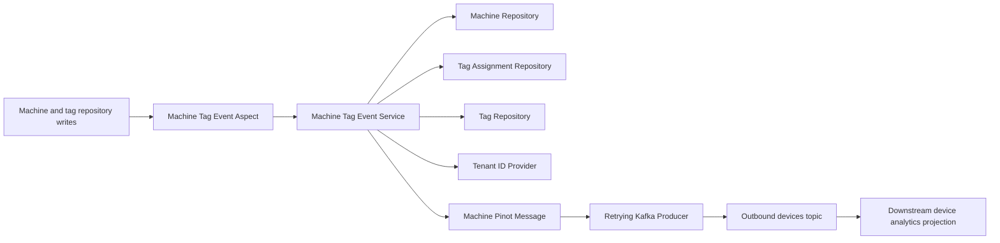
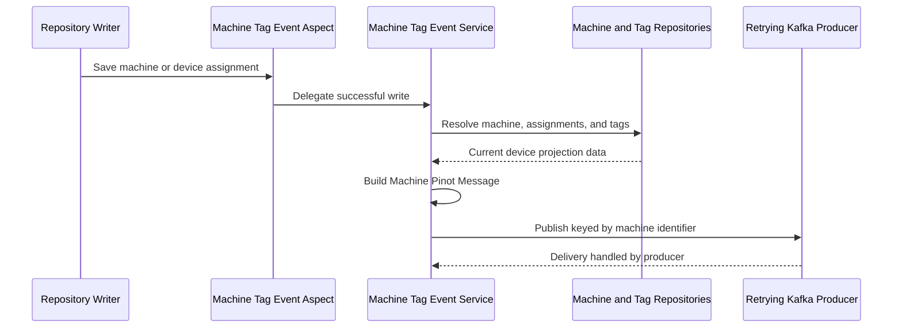
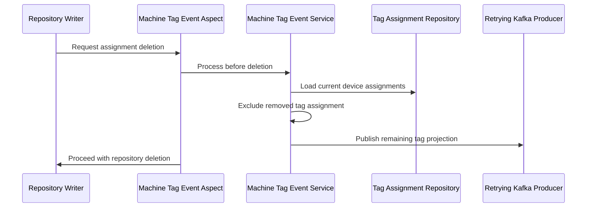
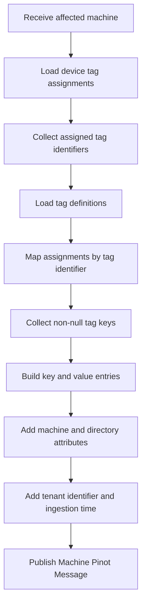

# Machine Tag Event Service

Machine Tag Event Service keeps the analytical representation of a managed machine synchronized when the machine itself, its device-tag assignments, or tag definitions change. It is implemented by `MachineTagEventServiceImpl` in the OpenFrame OSS Library artifact `com.openframe.oss:openframe-data-device-aspect`, version `7.0.11`, which this repository consumes at run time. The implementation is available in the [OpenFrame OSS Library source](https://github.com/flamingo-stack/openframe-oss-lib/blob/7a766f00e4f58b5d89db007b878ac8d6e0c344f4/openframe-data-device-aspect/src/main/java/com/openframe/data/service/impl/MachineTagEventServiceImpl.java).

The service does not persist device or tag data itself. Instead, it reads the current machine, tag assignments, and tags, constructs a complete `MachinePinotMessage`, and publishes that snapshot to the configured outbound device topic. This means a downstream analytics consumer can update its view from one machine-scoped message rather than reconstructing the state from separate mutation events.

## Scope and activation

The Spring service is enabled when `openframe.device.aspect.enabled` is `true`. Because its conditional configuration uses `matchIfMissing`, the feature is enabled unless the property is explicitly set to `false`.

The outbound topic is supplied by the required `openframe.oss-tenant.kafka.topics.outbound.devices-topic` property. Publication uses `OssTenantRetryingKafkaProducer`, and each message is keyed by the machine identifier. The tenant identifier is resolved at publication time through `TenantIdProvider`, preserving tenant context in the indexed event.

## Architecture

The companion Machine Tag Event Aspect observes repository writes and delegates event handling to this service. The aspect is the write interception boundary; Machine Tag Event Service is the projection builder and Kafka publisher.

### Responsibilities

| Component | Responsibility |
| --- | --- |
| Machine Tag Event Aspect | Intercepts supported repository save, bulk-save, and delete methods. It delegates after successful saves, and surrounds deletes so the pre-delete state remains readable. |
| Machine Tag Event Service | Resolves the affected machine and its complete tag state, builds a machine snapshot message, and publishes it with the machine identifier as the Kafka key. |
| Machine Repository | Resolves a machine by its machine identifier when a tag-related change identifies the device indirectly. |
| Tag Assignment Repository | Retrieves device-scoped assignments, including assignment-specific values, and locates all machines affected by a tag definition or deletion. |
| Tag Repository | Resolves tag definitions and their keys for assignment identifiers. |
| Tenant ID Provider | Supplies the tenant identifier included in every published message. |
| Retrying Kafka Producer | Delivers the snapshot to the configured outbound device topic. |

## Event sources and handling

The service implements the `MachineTagEventService` contract with eight operations. All public handlers catch and log exceptions, preventing an event-publication failure from escaping the handler. Bulk tag deletion also isolates errors for each affected machine, allowing remaining devices to be processed.

### Machine saves

`processMachineSave` and `processMachineSaveAll` publish one complete snapshot for every supplied `Machine`. Before building the message, the service resolves all device tag assignments and then loads their tags. A machine write therefore refreshes both machine attributes and the tag projection.

The aspect also watches field-scoped updates performed through `MachineWriter.update`. If the returned optional contains a `MachineWriteResult`, it sends the post-update machine document to the service. Empty update results produce no message because no document was written.

### Tag assignment saves

`processTagAssignmentSave` ignores assignments whose entity type is not `DEVICE`. For a device assignment, it loads the associated machine, obtains the full current tag collection for that machine, and republishes the complete snapshot.

`processTagAssignmentSaveAll` follows the same device-only rule but deduplicates by entity identifier. Multiple changed assignments for one device in the same bulk operation result in one publication for that device, using the current repository state.

### Tag definition saves

A tag definition can affect many machines. `processTagSave` locates every device assignment for the tag, loads each machine and its current tags, then publishes a refreshed snapshot per machine. The interface describes this as handling tag-key changes; the implementation republishes affected machines whenever it receives a saved tag with a non-null identifier.

For bulk tag saves, the aspect records identifiers of tags that existed before the repository operation. After a successful save, it delegates only for returned tags whose identifiers appeared in that recorded set. This avoids treating newly created tags as updates that need existing device projections refreshed.

### Tag assignment deletes

Deletion has a different ordering requirement. The aspect calls the delete handlers before executing the repository delete so the service can identify affected assignments and machines. It deliberately removes the target tag from its in-memory view before building and publishing the snapshot.

- `processTagAssignmentDelete` handles one device and one tag.
- `processTagAssignmentDeleteByTagId` resolves every device assigned to the tag and performs the same remaining-tag calculation for each device.

The Kafka messages therefore represent the post-delete tag state even though the database deletion occurs immediately after publication is prepared.

## Projection contents

The service constructs a `MachinePinotMessage` from a machine and its resolved tag state. The message includes the following data:

| Field group | Source and construction |
| --- | --- |
| Tenant and machine identity | Tenant identifier from `TenantIdProvider`, plus machine identifier and organization identifier from `Machine`. |
| Device attributes | Device type, status, telemetry connectivity, and operating-system type when present. |
| Tag keys | One entry per resolved tag with a non-null key. |
| Tag key values | One `key:value` entry for every value stored on the matching device tag assignment. |
| Directory attributes | Directory source enum names and the directory-user-link enum name. A missing directory-user link is emitted as `NONE`, rather than omitted. |
| Ingestion time | The current epoch time in milliseconds when the message is built. |

Assignment values are intentionally not taken from the tag definition. They are read from `TagAssignment`, allowing a common tag key to retain device-specific values. When duplicate assignments share a tag identifier, the first assignment encountered is used in the internal tag-to-assignment map.

## Data flow

The normal save path always emits the complete current projection for one affected machine.

The delete path computes a projected post-delete state from data still available before the repository operation completes.

## Message construction process

For deletion processing, the assignment and tag collections pass through an additional exclusion step before the map is built. This makes the emitted data equivalent to the desired state after the specified assignment disappears.

## Operational behavior and failure boundaries

- **Missing machine:** Assignment-driven and tag-driven paths log a warning or skip the device when the referenced machine cannot be found. No message is sent for that device.
- **No affected machines:** Tag deletion exits without publication when no device assignments are found.
- **Non-device assignment:** Save events for other entity types are ignored.
- **Empty tag set:** The message contains empty tag collections when a device has no remaining tags.
- **Repository or publishing errors:** Individual service handlers log failures. Machine save publication additionally protects its internal fetch-build-publish operation. Bulk deletion continues with other machines after a per-machine error.
- **Producer semantics:** The service delegates retry and delivery behavior to `OssTenantRetryingKafkaProducer`; it does not implement its own retry policy.

## Maintainer guidance

When modifying this service or its interception aspect, preserve these invariants:

1. Publish a full machine projection, not a tag delta, so downstream indexing can converge from one event.
2. Keep the Kafka message key equal to the machine identifier so records for a machine remain partition-key consistent.
3. Retain tenant lookup during message construction rather than deriving tenant context from the machine document.
4. Treat tag assignment values as device-scoped data and continue producing `key:value` entries from assignments.
5. Keep assignment-delete handling before the repository deletion and explicitly filter the removed tag from the projection inputs.
6. Preserve the `NONE` directory-user-link fallback, which allows analytics facets to count devices without a directory-user link.
7. Maintain device-only filtering for tag assignment events to avoid generating machine messages for unrelated taggable entities.

The service is library code assembled into this repository's running services. Changes should therefore be assessed alongside the outbound topic configuration, Kafka consumer schema compatibility, and the companion Machine Tag Event Aspect interception points.
