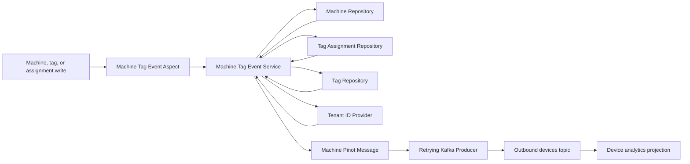
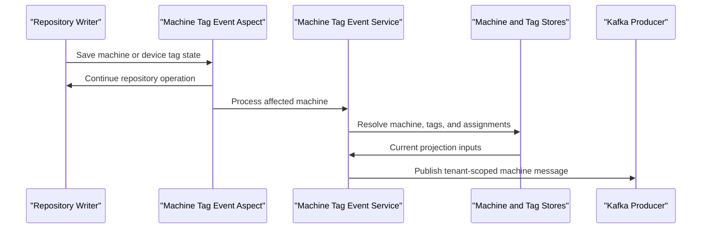

# Data Device Aspect

Data Device Aspect is a Spring component from the OpenFrame OSS Library artifact `com.openframe.oss:openframe-data-device-aspect` version `7.0.11`. The tenant services assemble it to keep the device projection synchronized after machine and device-tag persistence changes. It observes repository and machine-writer operations, reconstructs the affected machine's current searchable state, and publishes a tenant-scoped `MachinePinotMessage` to the configured outbound Kafka topic.

The module is enabled unless `openframe.device.aspect.enabled` is explicitly set to `false`. Its destination topic is configured through `openframe.oss-tenant.kafka.topics.outbound.devices-topic`.

## Architecture

The aspect is deliberately adjacent to data persistence rather than API handling. This makes a device's indexed representation converge after writes issued by any service that uses the intercepted repository methods or `MachineWriter.update`.

## Runtime Responsibilities

| Area | Responsibility |
|---|---|
| Change interception | Detects saves and selected deletes for machines, tags, and device tag assignments. |
| Projection reconstruction | Loads the machine, its device-scoped tag assignments, and tag definitions needed for the outbound document. |
| Tenant isolation | Reads the current tenant identifier before building every Kafka message. |
| Event publication | Publishes one message per affected machine, keyed by machine ID, through the retrying tenant Kafka producer. |
| Failure containment | Logs most observation and synchronization failures so an auxiliary projection failure does not replace the repository operation's outcome. |

## Component Flow

## Change Semantics

- **Machine saves:** a save or bulk save produces a rebuilt message for each machine. A successful `MachineWriter.update` contributes its post-update document only when the returned value is a `MachineWriteResult` inside a non-empty optional.
- **Tag assignment saves:** only assignments whose entity type is `DEVICE` are synchronized. Bulk saves deduplicate by machine ID to avoid redundant publications.
- **Tag assignment deletes:** the aspect runs before deletion so it can identify the affected machines and publish a message that intentionally excludes the assignment being removed.
- **Tag saves:** a persisted tag update causes the service to find every device assigned to that tag and republish each device, allowing tag-key changes to reach the projection.

## Projection Contents

Each `MachinePinotMessage` includes the tenant, machine and organization identifiers; device type, status, connectivity, and operating system; tag keys; tag key-value pairs; directory-source names; directory-user-link state; and an ingestion timestamp. A missing directory-user link is represented as `NONE`, preserving machines in the corresponding facet rather than omitting the field.

## Submodules

- [Machine Tag Event Aspect](data-device-aspect/machine_tag_event_aspect/machine_tag_event_aspect.md) details the repository and writer advice that detects machine and tag changes.
- [Machine Tag Event Service](data-device-aspect/machine_tag_event_service/machine_tag_event_service.md) details projection reconstruction, tag-delete handling, and Kafka publication.

## Source Components

The implementation is supplied by OpenFrame OSS Library, not by a source file in this repository:

- [Machine Tag Event Aspect](https://github.com/flamingo-stack/openframe-oss-lib/blob/7a766f00e4f58b5d89db007b878ac8d6e0c344f4/openframe-data-device-aspect/src/main/java/com/openframe/data/aspect/MachineTagEventAspect.java) provides Spring AOP advice around persistence operations.
- [Machine Tag Event Service](https://github.com/flamingo-stack/openframe-oss-lib/blob/7a766f00e4f58b5d89db007b878ac8d6e0c344f4/openframe-data-device-aspect/src/main/java/com/openframe/data/service/impl/MachineTagEventServiceImpl.java) resolves state and publishes the machine projection event.
