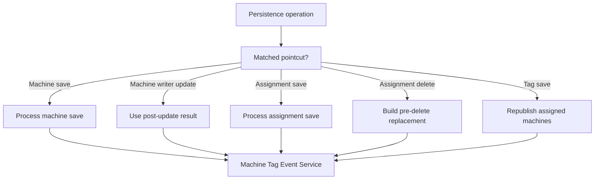

# Machine Tag Event Aspect

Machine Tag Event Aspect is the Spring AOP boundary for Data Device Aspect. It enables synchronization of the device analytics projection without requiring every persistence caller to invoke event-publishing code directly.

## Responsibilities

- Activates when `openframe.device.aspect.enabled` is `true` or absent.
- Observes `MachineRepository.save` and `saveAll` after they return, forwarding the submitted machine entities to `MachineTagEventService`.
- Observes `MachineWriter.update` after return. It emits only when the result is a non-empty optional containing `MachineWriteResult`, and uses the result's post-update `after()` machine state.
- Observes device tag-assignment saves after return. The service filters non-device assignments.
- Wraps tag-assignment deletion before proceeding, enabling a replacement projection that excludes the pending deletion.
- Wraps tag saves and bulk saves, invoking tag processing only after the repository operation succeeds.

## Advice Selection

## Error Behavior

The after-returning advice catches and logs failures from event processing. This preserves the completed repository operation when the downstream projection update fails. Around advice for tag saves logs and rethrows an exception occurring within the advised operation, so repository failure behavior remains visible to the original caller.

## Delete Timing

`deleteByEntityIdAndTagIdAndEntityType` and `deleteByTagId` are advised with `Around` rather than after-returning advice. Before the repository method proceeds, the service queries current assignments and prepares messages with the target tag removed. This ordering gives the service access to the association being deleted while publishing the intended post-delete representation.

## Source

The implementation is supplied by OpenFrame OSS Library: [MachineTagEventAspect.java](https://github.com/flamingo-stack/openframe-oss-lib/blob/7a766f00e4f58b5d89db007b878ac8d6e0c344f4/openframe-data-device-aspect/src/main/java/com/openframe/data/aspect/MachineTagEventAspect.java).
