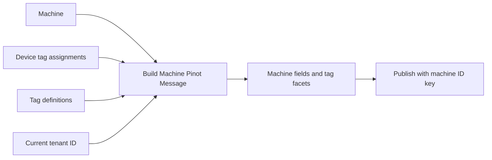

# Machine Tag Event Service

Machine Tag Event Service implements the synchronization work requested by the aspect. It rehydrates the machine's current tag context, translates it into a tenant-scoped `MachinePinotMessage`, and sends the result to the configured outbound devices Kafka topic through `OssTenantRetryingKafkaProducer`.

## Dependencies

| Dependency | Use |
|---|---|
| `MachineRepository` | Resolves an affected machine by machine ID. |
| `TagAssignmentRepository` | Finds device-scoped assignments, including machines affected by a tag. |
| `TagRepository` | Resolves tag definitions for a set of assignment tag IDs. |
| `TenantIdProvider` | Adds the active tenant identifier to every outbound message. |
| `OssTenantRetryingKafkaProducer` | Publishes messages, keyed by machine ID, to the configured topic. |

## Message Construction

The service adds a tag key for each tag with a non-null key. For an assignment with values, it adds a separate key-value entry for each value in the form `key:value`. When duplicate assignments use the same tag identifier, the first assignment retained by the map supplies its values.

The message also carries machine identity and organization, type, status, telemetry connectivity, operating system, directory source names, directory-user-link state, and an ingestion time. A missing directory-user link is encoded as `NONE`.

## Event Handling

### Machine Changes

For a machine save, the service loads all device tag assignments and related tags, then publishes a complete representation. Bulk processing performs the same operation per submitted machine.

### Assignment Changes

For a device assignment save, the service resolves the associated machine and its complete current tag set before publishing. During a bulk assignment save, it processes each device only once. Assignments for non-device entity types are ignored.

### Assignment Deletions

For a single deletion, the service loads the current assignments, removes the pending tag ID in memory, resolves the remaining tags, and publishes that reduced representation. For deletion by tag ID, it first finds all affected device IDs and repeats this process for each machine. This procedure is intentionally invoked before repository deletion.

### Tag Changes

When a persisted tag is saved, the service finds every device assigned to that tag and republishes each current machine representation. This propagates changes such as a tag-key rename to device-facing analytics data.

## Operational Characteristics

- Missing machines are logged and skipped rather than published.
- Per-machine errors during fan-out operations are logged, allowing other affected machines to continue.
- Repository lookup and publication errors are contained and logged by the service, making this projection synchronization best-effort relative to the original data write.
- The service is active under the same `openframe.device.aspect.enabled` property as the aspect.

## Source

The implementation is supplied by OpenFrame OSS Library: [MachineTagEventServiceImpl.java](https://github.com/flamingo-stack/openframe-oss-lib/blob/7a766f00e4f58b5d89db007b878ac8d6e0c344f4/openframe-data-device-aspect/src/main/java/com/openframe/data/service/impl/MachineTagEventServiceImpl.java).
