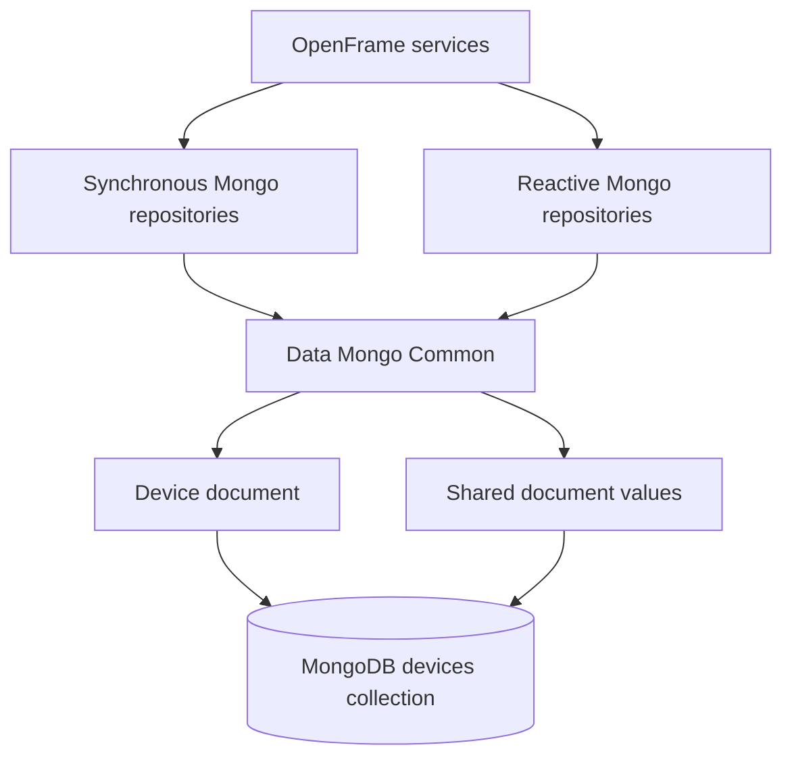
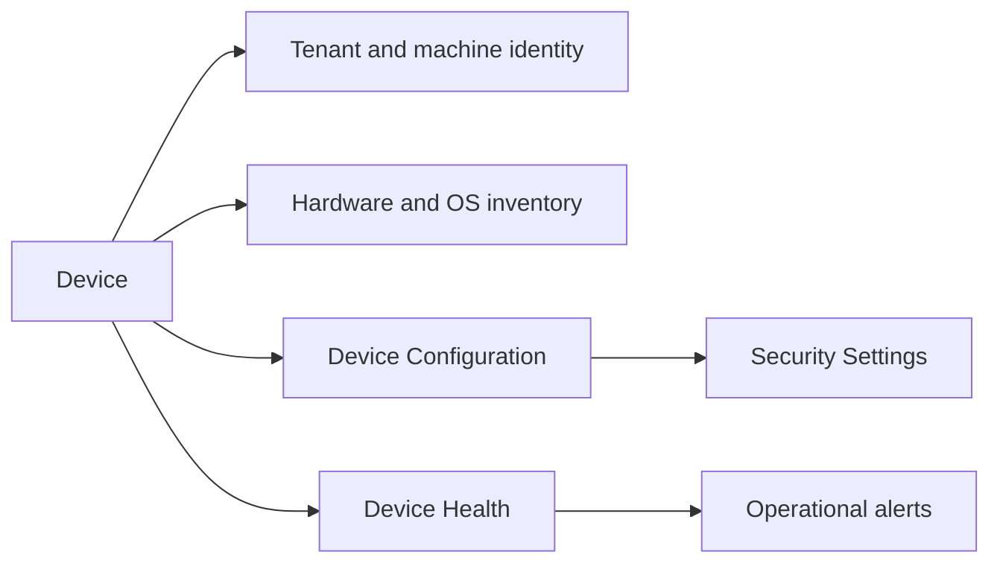

# Data Mongo Common

Data Mongo Common is the shared document-model artifact for MongoDB-backed OpenFrame services. It is supplied by the OpenFrame OSS Library as `com.openframe.oss:openframe-data-mongo-common` version `7.0.11`, which this tenant repository consumes. The module contains reusable Mongo document types, embedded value objects, enums, and cross-domain constants; it does **not** provide Mongo configuration, repositories, or query implementations.

Its primary persistent aggregate in the supplied components is `Device`, mapped to the `devices` collection. The remaining types define embedded device state or stable values that other document models and services can persist and exchange consistently.

## Responsibilities

- Define the tenant-scoped device document and its embedded health and configuration structure.
- Express device compliance, security, alert, and managed-tool state as reusable values.
- Provide shared values for installation, connector failures, notifications, onboarding, ticket activity, and tool-agent installation.
- Keep organization contact data as embedded documents rather than separate Mongo collections.

## Boundaries

Data Mongo Common is a model-only layer. `Device` carries Spring Data Mongo annotations, including the `devices` collection mapping and an index on `tenantId`; the module otherwise does not establish a database connection, create indexes, or run queries.

The neighboring Mongo modules apply this model at runtime:

- **Data Mongo Sync Repositories** supplies synchronous Mongo configuration, tenant isolation, indexes, and repository implementations.
- **Data Mongo Reactive** supplies reactive Mongo configuration and onboarding-related reactive repositories.
- **Data Mongo Repository Service** contains repository-specific extensions and the default tenant identifier provider.

## Detailed Submodules

- [Device Domain](data_mongo_common/device_domain/device_domain.md) documents the tenant-scoped device record, embedded configuration and health, security and compliance values, and required managed tools.
- [Organization Contact](data_mongo_common/organization_contact/organization_contact.md) documents embedded organization addresses and contact information.
- [Tool Agent Lifecycle](data_mongo_common/tool_agent_lifecycle/tool_agent_lifecycle.md) documents tool installation task status, asset source, target filename, and session context values.

## Architecture Overview

The library keeps common persisted vocabulary independent of persistence execution. Repository modules use the types to serialize Mongo documents, while service modules use the same enums and value objects to preserve compatible state names and nested-field layouts.

## Domain Model

### Device Inventory and Operational State

[`Device`](https://github.com/flamingo-stack/openframe-oss-lib/blob/7a766f00e4f58b5d89db007b878ac8d6e0c344f4/openframe-data-mongo-common/src/main/java/com/openframe/data/document/device/Device.java) is the root document in this module. It implements `TenantScoped`, stores a `tenantId`, and has an indexed tenant field for tenant-oriented access. Its `machineId` links the inventory record to the wider machine model. Hardware and operating-system attributes include serial number, model, operating-system version, type, status, and the latest check-in timestamp.

`Device` embeds [`DeviceConfiguration`](https://github.com/flamingo-stack/openframe-oss-lib/blob/7a766f00e4f58b5d89db007b878ac8d6e0c344f4/openframe-data-mongo-common/src/main/java/com/openframe/data/document/device/DeviceConfiguration.java) and [`DeviceHealth`](https://github.com/flamingo-stack/openframe-oss-lib/blob/7a766f00e4f58b5d89db007b878ac8d6e0c344f4/openframe-data-mongo-common/src/main/java/com/openframe/data/document/device/DeviceHealth.java). Configuration holds generic settings, installed software, network configuration, and embedded security settings. Health records CPU, memory, and disk utilization, active processes, and a list of operational alerts.

### Security, Compliance, and Managed Tools

The device package separates several state concerns:

- [`Alert`](https://github.com/flamingo-stack/openframe-oss-lib/blob/7a766f00e4f58b5d89db007b878ac8d6e0c344f4/openframe-data-mongo-common/src/main/java/com/openframe/data/document/device/Alert.java) represents an operational alert with identifier, severity, message, timestamp, and resolution flag.
- [`SecurityAlert`](https://github.com/flamingo-stack/openframe-oss-lib/blob/7a766f00e4f58b5d89db007b878ac8d6e0c344f4/openframe-data-mongo-common/src/main/java/com/openframe/data/document/device/SecurityAlert.java) adds security-specific detection, resolution time, and resolution details.
- [`SecuritySettings`](https://github.com/flamingo-stack/openframe-oss-lib/blob/7a766f00e4f58b5d89db007b878ac8d6e0c344f4/openframe-data-mongo-common/src/main/java/com/openframe/data/document/device/SecuritySettings.java) represents firewall and antivirus flags, encryption status, scan information, and policy values.
- [`ComplianceRequirement`](https://github.com/flamingo-stack/openframe-oss-lib/blob/7a766f00e4f58b5d89db007b878ac8d6e0c344f4/openframe-data-mongo-common/src/main/java/com/openframe/data/document/device/ComplianceRequirement.java) captures the standard, control, outcome, details, and time of an individual compliance check.
- [`ComplianceState`](https://github.com/flamingo-stack/openframe-oss-lib/blob/7a766f00e4f58b5d89db007b878ac8d6e0c344f4/openframe-data-mongo-common/src/main/java/com/openframe/data/document/device/ComplianceState.java) and [`SecurityState`](https://github.com/flamingo-stack/openframe-oss-lib/blob/7a766f00e4f58b5d89db007b878ac8d6e0c344f4/openframe-data-mongo-common/src/main/java/com/openframe/data/document/device/SecurityState.java) provide constrained summary states. Compliance also includes an in-remediation state.
- [`RequiredTools`](https://github.com/flamingo-stack/openframe-oss-lib/blob/7a766f00e4f58b5d89db007b878ac8d6e0c344f4/openframe-data-mongo-common/src/main/java/com/openframe/data/document/device/RequiredTools.java) defines Fleet MDM and MeshCentral as the required `ToolType` set before a device is counted as managed.

## Shared Vocabularies

| Area | Types and intent |
| --- | --- |
| Client configuration | [`InstallationType`](https://github.com/flamingo-stack/openframe-oss-lib/blob/7a766f00e4f58b5d89db007b878ac8d6e0c344f4/openframe-data-mongo-common/src/main/java/com/openframe/data/document/clientconfiguration/InstallationType.java) distinguishes standard, GUI application, and service installation forms. |
| Connector operation | [`ConnectorAlertType`](https://github.com/flamingo-stack/openframe-oss-lib/blob/7a766f00e4f58b5d89db007b878ac8d6e0c344f4/openframe-data-mongo-common/src/main/java/com/openframe/data/document/connector/ConnectorAlertType.java) distinguishes retry exhaustion from a non-recoverable failure. |
| Notifications | [`NotificationRetention`](https://github.com/flamingo-stack/openframe-oss-lib/blob/7a766f00e4f58b5d89db007b878ac8d6e0c344f4/openframe-data-mongo-common/src/main/java/com/openframe/data/document/notification/NotificationRetention.java) defines a 30-day history TTL constant for Mongo TTL indexes on notification and read-state creation times. |
| Onboarding | [`TenantOnboardingStep`](https://github.com/flamingo-stack/openframe-oss-lib/blob/7a766f00e4f58b5d89db007b878ac8d6e0c344f4/openframe-data-mongo-common/src/main/java/com/openframe/data/document/onboarding/TenantOnboardingStep.java) models tenant setup milestones; [`UserOnboardingStep`](https://github.com/flamingo-stack/openframe-oss-lib/blob/7a766f00e4f58b5d89db007b878ac8d6e0c344f4/openframe-data-mongo-common/src/main/java/com/openframe/data/document/onboarding/UserOnboardingStep.java) models an individual user journey from Mingo through device, ticket, scripting, monitoring, logging, incident, and knowledge-management activities. |
| Ticketing | [`TicketActivityState`](https://github.com/flamingo-stack/openframe-oss-lib/blob/7a766f00e4f58b5d89db007b878ac8d6e0c344f4/openframe-data-mongo-common/src/main/java/com/openframe/data/document/ticket/TicketActivityState.java) represents AI work, waiting for an external party, and idle activity. |
| Tool agents | [`IntegratedToolInstallationTaskStatus`](https://github.com/flamingo-stack/openframe-oss-lib/blob/7a766f00e4f58b5d89db007b878ac8d6e0c344f4/openframe-data-mongo-common/src/main/java/com/openframe/data/document/toolagent/IntegratedToolInstallationTaskStatus.java), [`SessionType`](https://github.com/flamingo-stack/openframe-oss-lib/blob/7a766f00e4f58b5d89db007b878ac8d6e0c344f4/openframe-data-mongo-common/src/main/java/com/openframe/data/document/toolagent/SessionType.java), [`ToolAgentAssetSource`](https://github.com/flamingo-stack/openframe-oss-lib/blob/7a766f00e4f58b5d89db007b878ac8d6e0c344f4/openframe-data-mongo-common/src/main/java/com/openframe/data/document/toolagent/ToolAgentAssetSource.java), and [`LocalFilenameConfiguration`](https://github.com/flamingo-stack/openframe-oss-lib/blob/7a766f00e4f58b5d89db007b878ac8d6e0c344f4/openframe-data-mongo-common/src/main/java/com/openframe/data/document/toolagent/LocalFilenameConfiguration.java) define installation lifecycle values, execution session context, asset origin, and operating-system-specific filenames. |

## Model Evolution Guidance

- Treat enum constants and field names as persisted contracts. Renaming or deleting one can make existing Mongo records unreadable or change behavior in dependent services.
- `DeviceConfiguration` uses open-ended maps and lists. Preserve their embedded shape when adding typed configuration fields, and do not place secrets in the generic settings map.
- `DeviceHealth` is a current-state snapshot. Alert timestamps and resolution fields provide lifecycle evidence; health metrics do not include their own observation timestamp in this type.
- The `tenantId` index on `Device` supports tenant-scoped access, but tenant enforcement is provided by the consuming Mongo configuration and repository layers.
- The notification retention value is intended for a Mongo TTL index rather than application-side deletion. TTL expiry is performed asynchronously by MongoDB.

## Source and Delivery Context

All types documented here originate from the OpenFrame OSS Library artifact pinned at version `7.0.11`. This repository assembles that library into its services; its shared application configuration points services at the MongoDB datasource. The module is therefore a common persistence contract across the OpenFrame service suite rather than an independently deployed service.
