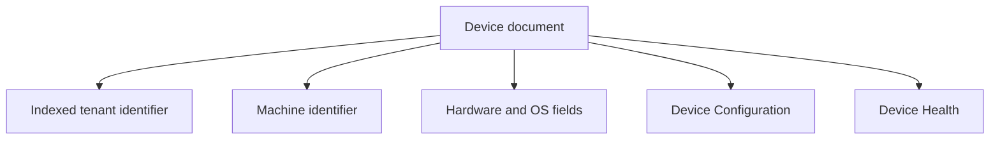
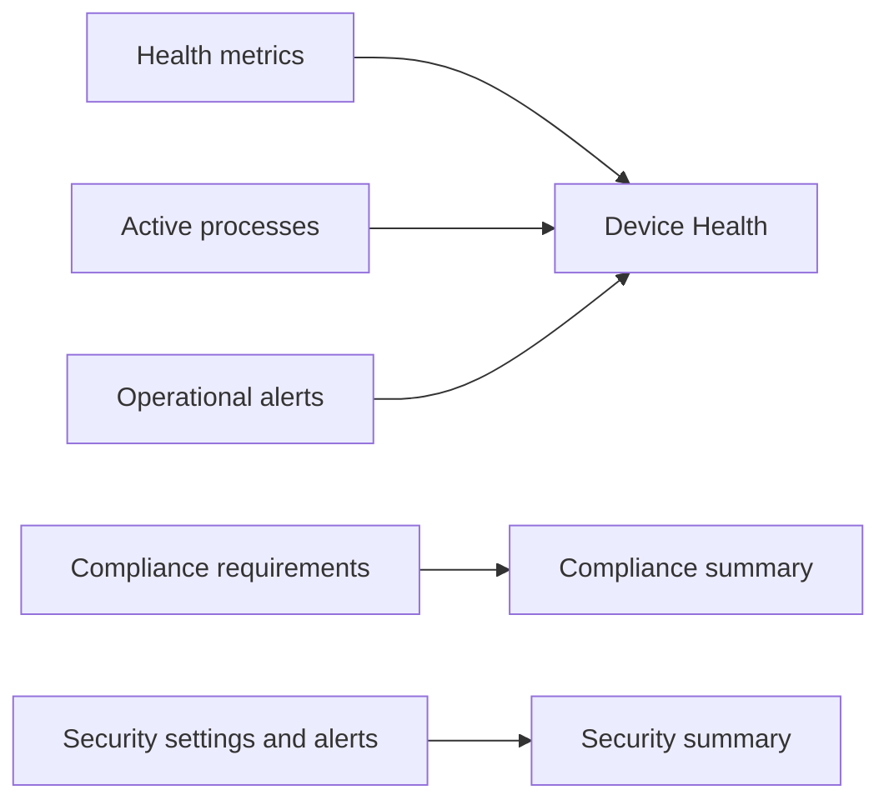

# Device Domain

The Device Domain portion of Data Mongo Common defines the tenant-scoped device inventory record and the nested values used to describe its configuration, operational health, security posture, compliance checks, and managed-tool prerequisite.

## Root Document

[`Device`](https://github.com/flamingo-stack/openframe-oss-lib/blob/7a766f00e4f58b5d89db007b878ac8d6e0c344f4/openframe-data-mongo-common/src/main/java/com/openframe/data/document/device/Device.java) is a Spring Data Mongo `devices` document. It has an identifier, an indexed `tenantId`, and a `machineId` that associates the device record with the broader machine model. The inventory attributes are serial number, model, operating-system version, string status, device type, and last check-in time.

The type implements `TenantScoped`; repository and configuration layers outside this artifact apply the tenant-isolation policy.

## Embedded Configuration

[`DeviceConfiguration`](https://github.com/flamingo-stack/openframe-oss-lib/blob/7a766f00e4f58b5d89db007b878ac8d6e0c344f4/openframe-data-mongo-common/src/main/java/com/openframe/data/document/device/DeviceConfiguration.java) is embedded below `Device`. It contains general settings, a software list, network configuration, and [`SecuritySettings`](https://github.com/flamingo-stack/openframe-oss-lib/blob/7a766f00e4f58b5d89db007b878ac8d6e0c344f4/openframe-data-mongo-common/src/main/java/com/openframe/data/document/device/SecuritySettings.java).

Security settings hold firewall and antivirus booleans, encryption and scan status, and a map of security policies. The maps are extensible persisted structures: clients should use stable key names and avoid sensitive data in general-purpose configuration maps.

## Health, Alerts, and Compliance

[`DeviceHealth`](https://github.com/flamingo-stack/openframe-oss-lib/blob/7a766f00e4f58b5d89db007b878ac8d6e0c344f4/openframe-data-mongo-common/src/main/java/com/openframe/data/document/device/DeviceHealth.java) provides CPU, memory, and disk-use values, active process names, and [`Alert`](https://github.com/flamingo-stack/openframe-oss-lib/blob/7a766f00e4f58b5d89db007b878ac8d6e0c344f4/openframe-data-mongo-common/src/main/java/com/openframe/data/document/device/Alert.java) entries. An operational alert has an identifier, severity, message, timestamp, and resolution flag.

[`SecurityAlert`](https://github.com/flamingo-stack/openframe-oss-lib/blob/7a766f00e4f58b5d89db007b878ac8d6e0c344f4/openframe-data-mongo-common/src/main/java/com/openframe/data/document/device/SecurityAlert.java) represents the related security lifecycle: detection time, resolution status and time, and a resolution description. [`ComplianceRequirement`](https://github.com/flamingo-stack/openframe-oss-lib/blob/7a766f00e4f58b5d89db007b878ac8d6e0c344f4/openframe-data-mongo-common/src/main/java/com/openframe/data/document/device/ComplianceRequirement.java) captures one standard-and-control check with its outcome, details, and last-check time.

`ComplianceState` permits compliant, non-compliant, in-remediation, and unknown values. `SecurityState` permits compliant, non-compliant, and unknown values. These are summary vocabularies, while the requirement and alert classes hold supporting detail.

## Managed-Device Requirement

[`RequiredTools`](https://github.com/flamingo-stack/openframe-oss-lib/blob/7a766f00e4f58b5d89db007b878ac8d6e0c344f4/openframe-data-mongo-common/src/main/java/com/openframe/data/document/device/RequiredTools.java) defines Fleet MDM and MeshCentral as the required tool types for a device to count as managed. It centralizes the prerequisite so lifecycle logic evaluates the same fixed set rather than duplicating it across services.

## Maintenance Notes

Keep `tenantId`, `machineId`, and embedded field names compatible with stored documents. Additive fields are safer than renames, and a change to either summary enum is a persisted-data migration concern.