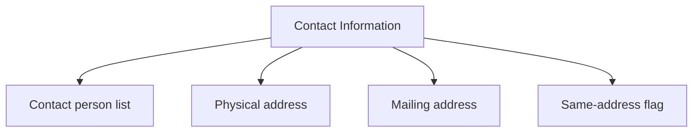

# Organization Contact

Organization Contact supplies reusable embedded values for organization contact information. The classes are not independent Mongo collections; they are designed to be nested in a containing organization document.

## Composition

[`ContactInformation`](https://github.com/flamingo-stack/openframe-oss-lib/blob/7a766f00e4f58b5d89db007b878ac8d6e0c344f4/openframe-data-mongo-common/src/main/java/com/openframe/data/document/organization/ContactInformation.java) aggregates a list of [`ContactPerson`](https://github.com/flamingo-stack/openframe-oss-lib/blob/7a766f00e4f58b5d89db007b878ac8d6e0c344f4/openframe-data-mongo-common/src/main/java/com/openframe/data/document/organization/ContactPerson.java) entries plus physical and mailing [`Address`](https://github.com/flamingo-stack/openframe-oss-lib/blob/7a766f00e4f58b5d89db007b878ac8d6e0c344f4/openframe-data-mongo-common/src/main/java/com/openframe/data/document/organization/Address.java) values. Builder defaults initialize the contact list as empty and the mailing-address equivalence flag as `false`.

## Value Objects

| Type | Persisted information |
| --- | --- |
| `Address` | Two street lines, city, state or province, postal code, and country. |
| `ContactPerson` | Full name, title, phone number, and email address. |
| `ContactInformation` | Contacts, physical address, mailing address, and whether the mailing address matches the physical address. |

The package uses Lombok data and builder annotations for its value objects. Consumers should treat address and contact values as part of their parent document lifecycle: create, update, validation, and authorization belong to the containing organization workflow.

## Persistence Considerations

Because these values are embedded, queries and updates target nested fields in the parent organization record. The equivalence flag is an explicit persisted value; clients should synchronize it with the address fields according to the owning application policy. The types do not validate postal formats, phone numbers, or email addresses themselves.