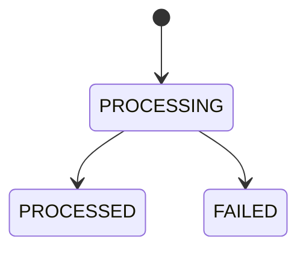
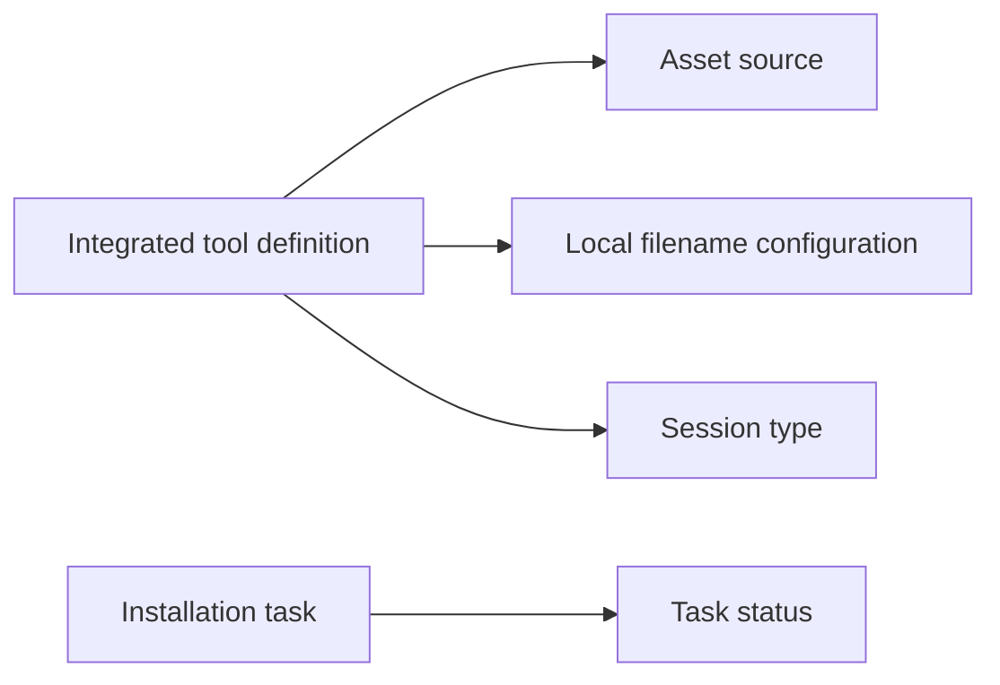

# Tool Agent Lifecycle

Tool Agent Lifecycle defines small persisted values used by integrated-tool installation and connection flows. It standardizes task progress, asset provenance, target filenames, and the execution session context across services that manage tool agents.

## Lifecycle Values

[`IntegratedToolInstallationTaskStatus`](https://github.com/flamingo-stack/openframe-oss-lib/blob/7a766f00e4f58b5d89db007b878ac8d6e0c344f4/openframe-data-mongo-common/src/main/java/com/openframe/data/document/toolagent/IntegratedToolInstallationTaskStatus.java) has three values:

- `PROCESSING` for work in progress.
- `PROCESSED` for a completed task.
- `FAILED` for a task that did not complete.

The enum does not encode retries or a failure cause. Systems needing those details must retain them in the owning task or event document.

## Asset and Execution Context

[`ToolAgentAssetSource`](https://github.com/flamingo-stack/openframe-oss-lib/blob/7a766f00e4f58b5d89db007b878ac8d6e0c344f4/openframe-data-mongo-common/src/main/java/com/openframe/data/document/toolagent/ToolAgentAssetSource.java) identifies whether an asset came from the tool API or GitHub. [`LocalFilenameConfiguration`](https://github.com/flamingo-stack/openframe-oss-lib/blob/7a766f00e4f58b5d89db007b878ac8d6e0c344f4/openframe-data-mongo-common/src/main/java/com/openframe/data/document/toolagent/LocalFilenameConfiguration.java) pairs a filename with an operating-system string, allowing a parent installation definition to express operating-system-specific local artifact names.

[`SessionType`](https://github.com/flamingo-stack/openframe-oss-lib/blob/7a766f00e4f58b5d89db007b878ac8d6e0c344f4/openframe-data-mongo-common/src/main/java/com/openframe/data/document/toolagent/SessionType.java) identifies the target execution context as service, console, or user.

## Compatibility Guidance

These enum names are persistence and messaging values. Additive values require consumers to tolerate unknown values where forward compatibility is needed. A rename or removal should be handled as a data migration. The module does not download assets or install tools; those operations belong to the consuming tool-agent and service modules.