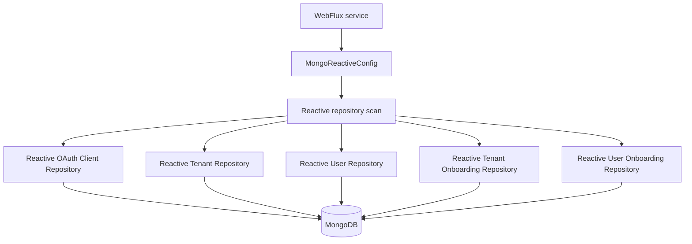
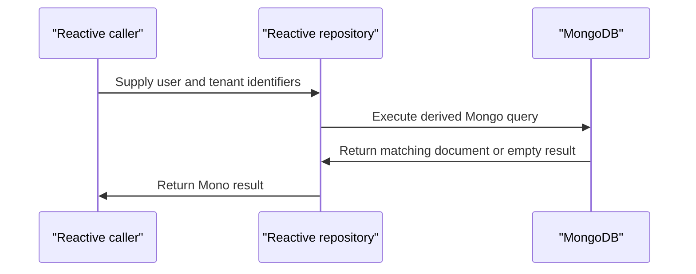

# Data Mongo Reactive

## Purpose

Data Mongo Reactive is the reactive MongoDB persistence adapter used by OpenFrame services that run on the WebFlux stack. It contributes Spring Data repository beans for OAuth clients, tenants, users, and onboarding-progress records. All repository operations return Reactor `Mono` values, allowing callers to compose database access without blocking a reactive request path.

The code is supplied by the OpenFrame OSS Library artifact `com.openframe.oss:openframe-data-mongo-reactive` at version `7.0.11`, which this repository assembles into its tenant runtime. The implementation source is maintained in the [OpenFrame OSS Library](https://github.com/flamingo-stack/openframe-oss-lib/tree/7a766f00e4f58b5d89db007b878ac8d6e0c344f4/openframe-data-mongo-reactive).

## Architecture Overview

`MongoReactiveConfig` enables discovery of repository interfaces under `com.openframe.data.reactive.repository`. Spring Data creates the concrete implementations at application startup. Each interface extends `ReactiveMongoRepository`, inheriting reactive CRUD operations for a document type and string identifier; selected repositories additionally expose domain lookup methods.

## Repository Contracts

| Area | Repository | Reactive domain operation | Stored document |
| --- | --- | --- | --- |
| OAuth client lookup | `ReactiveOAuthClientRepository` | `findByClientId` | `OAuthClient` |
| Tenant identity | `ReactiveTenantRepository` | `findByDomain`, `existsByDomain` | `Tenant` |
| User identity | `ReactiveUserRepository` | Email lookups and explicit tenant-scoped existence check | `User` |
| Tenant onboarding | `ReactiveTenantOnboardingProgressRepository` | `findByTenantId` | `TenantOnboardingProgress` |
| User onboarding | `ReactiveUserOnboardingProgressRepository` | `findByUserIdAndTenantId` | `UserOnboardingProgress` |

The repository layer does not define HTTP endpoints, business workflows, or MongoDB connection properties. It provides persistence contracts for higher-level WebFlux components. Document models are provided by the data-model libraries, while the blocking Mongo adapter provides parallel synchronous onboarding repositories.

## Explicit Tenant Scoping

The onboarding repositories document an important boundary: they are not tenant-aware. In a shared runtime where tenant aspects are bypassed, the caller must include the tenant identifier in each relevant query. The user onboarding lookup keys on both user and tenant identifiers; the tenant onboarding lookup keys directly on tenant identifier. `ReactiveUserRepository` follows the same defensive pattern through `existsByTenantIdAndId`.

## Reactive Programming Considerations

- A `Mono` may complete with one document, complete empty when no document matches, or signal an error. Callers should define their intended empty-result and error behavior as part of the reactive chain.
- Repository interfaces are declarative. Spring Data derives the documented query predicates from method names and supplies standard reactive CRUD methods through `ReactiveMongoRepository`.
- The tenant and user repositories also implement shared base repository contracts. This keeps domain lookup signatures aligned with other persistence adapters while substituting reactive result types.

## Submodules

- [Reactive Configuration](data-mongo-reactive/reactive_configuration/reactive_configuration.md) explains repository scanning and its configuration boundary.
- [Identity Repositories](data-mongo-reactive/identity_repositories/identity_repositories.md) details OAuth client, tenant, and user persistence contracts.
- [Onboarding Repositories](data-mongo-reactive/onboarding_repositories/onboarding_repositories.md) documents explicitly scoped tenant and user onboarding access.

## Source Files

- [MongoReactiveConfig](https://github.com/flamingo-stack/openframe-oss-lib/blob/7a766f00e4f58b5d89db007b878ac8d6e0c344f4/openframe-data-mongo-reactive/src/main/java/com/openframe/data/config/MongoReactiveConfig.java) activates reactive repository scanning.
- [ReactiveOAuthClientRepository](https://github.com/flamingo-stack/openframe-oss-lib/blob/7a766f00e4f58b5d89db007b878ac8d6e0c344f4/openframe-data-mongo-reactive/src/main/java/com/openframe/data/reactive/repository/oauth/ReactiveOAuthClientRepository.java) resolves OAuth clients by client identifier.
- [ReactiveTenantRepository](https://github.com/flamingo-stack/openframe-oss-lib/blob/7a766f00e4f58b5d89db007b878ac8d6e0c344f4/openframe-data-mongo-reactive/src/main/java/com/openframe/data/reactive/repository/tenant/ReactiveTenantRepository.java) resolves and tests tenant domains.
- [ReactiveUserRepository](https://github.com/flamingo-stack/openframe-oss-lib/blob/7a766f00e4f58b5d89db007b878ac8d6e0c344f4/openframe-data-mongo-reactive/src/main/java/com/openframe/data/reactive/repository/user/ReactiveUserRepository.java) provides reactive user identity queries.
- [ReactiveTenantOnboardingProgressRepository](https://github.com/flamingo-stack/openframe-oss-lib/blob/7a766f00e4f58b5d89db007b878ac8d6e0c344f4/openframe-data-mongo-reactive/src/main/java/com/openframe/data/reactive/repository/onboarding/ReactiveTenantOnboardingProgressRepository.java) retrieves tenant onboarding state.
- [ReactiveUserOnboardingProgressRepository](https://github.com/flamingo-stack/openframe-oss-lib/blob/7a766f00e4f58b5d89db007b878ac8d6e0c344f4/openframe-data-mongo-reactive/src/main/java/com/openframe/data/reactive/repository/onboarding/ReactiveUserOnboardingProgressRepository.java) retrieves tenant-scoped user onboarding state.
