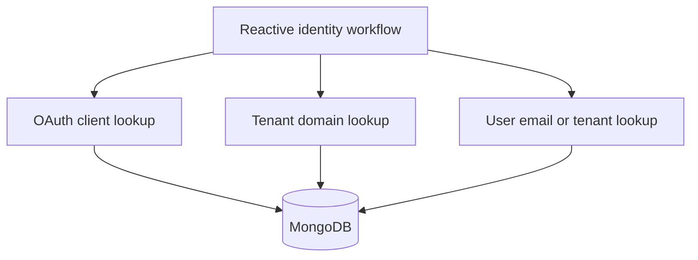

# Identity Repositories

## Responsibility

Identity Repositories provide non-blocking persistence access for OAuth client, tenant, and user documents. Every interface inherits reactive CRUD operations from Spring Data and adds lookup methods that express the identifiers used by identity workflows.

## Components

| Component | Contract | Purpose |
| --- | --- | --- |
| `ReactiveOAuthClientRepository` | `findByClientId` | Finds an `OAuthClient` from its client identifier. |
| `ReactiveTenantRepository` | `findByDomain`, `existsByDomain` | Resolves a `Tenant` by domain and checks domain availability. It also implements the shared tenant repository contract with `Mono` results. |
| `ReactiveUserRepository` | `findByEmail`, email existence checks, `existsByTenantIdAndId` | Resolves a `User`, tests email state, and verifies a user identifier within an explicitly supplied tenant. It also implements the shared user repository contract with `Mono` results. |

## Lookup Flow

## Tenant Isolation Note

The user repository's `existsByTenantIdAndId` method requires tenant-first scoping. It is appropriate when a shared runtime cannot rely on an implicit tenant aspect. Callers must supply the tenant identifier from a trusted request or execution context rather than treating a user identifier as globally sufficient.

## Sources

- [ReactiveOAuthClientRepository](https://github.com/flamingo-stack/openframe-oss-lib/blob/7a766f00e4f58b5d89db007b878ac8d6e0c344f4/openframe-data-mongo-reactive/src/main/java/com/openframe/data/reactive/repository/oauth/ReactiveOAuthClientRepository.java)
- [ReactiveTenantRepository](https://github.com/flamingo-stack/openframe-oss-lib/blob/7a766f00e4f58b5d89db007b878ac8d6e0c344f4/openframe-data-mongo-reactive/src/main/java/com/openframe/data/reactive/repository/tenant/ReactiveTenantRepository.java)
- [ReactiveUserRepository](https://github.com/flamingo-stack/openframe-oss-lib/blob/7a766f00e4f58b5d89db007b878ac8d6e0c344f4/openframe-data-mongo-reactive/src/main/java/com/openframe/data/reactive/repository/user/ReactiveUserRepository.java)
