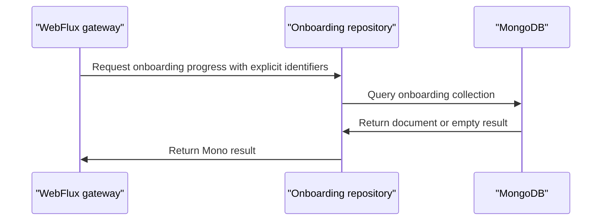

# Onboarding Repositories

## Responsibility

Onboarding Repositories expose reactive access to tenant and user onboarding-progress documents. They support WebFlux gateway use cases while mirroring the corresponding blocking repositories in the synchronous Mongo adapter.

## Core Components

| Component | Query | Result |
| --- | --- | --- |
| `ReactiveTenantOnboardingProgressRepository` | `findByTenantId` | The onboarding-progress document for one tenant. |
| `ReactiveUserOnboardingProgressRepository` | `findByUserIdAndTenantId` | The onboarding-progress document for a specific user within a specific tenant. |

Both components extend `ReactiveMongoRepository` and therefore include reactive CRUD operations in addition to their domain queries.

## Data Access Flow

## Explicit Scoping Requirement

These repositories are not tenant-aware. The shared runtime bypasses the tenant aspect, so callers must include the tenant identifier in every relevant access path. The user repository enforces this directly in its query signature. This is a persistence contract, not a replacement for authorization; the calling layer remains responsible for ensuring that the supplied identifiers are permitted.

## Relationship to Synchronous Persistence

The reactive interfaces mirror `TenantOnboardingProgressRepository` and `UserOnboardingProgressRepository` from the synchronous Mongo library. The reactive versions differ in execution model and return `Mono` rather than blocking values, allowing gateway code to retain a non-blocking request pipeline.

## Sources

- [ReactiveTenantOnboardingProgressRepository](https://github.com/flamingo-stack/openframe-oss-lib/blob/7a766f00e4f58b5d89db007b878ac8d6e0c344f4/openframe-data-mongo-reactive/src/main/java/com/openframe/data/reactive/repository/onboarding/ReactiveTenantOnboardingProgressRepository.java)
- [ReactiveUserOnboardingProgressRepository](https://github.com/flamingo-stack/openframe-oss-lib/blob/7a766f00e4f58b5d89db007b878ac8d6e0c344f4/openframe-data-mongo-reactive/src/main/java/com/openframe/data/reactive/repository/onboarding/ReactiveUserOnboardingProgressRepository.java)
