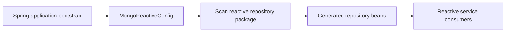

# Reactive Configuration

## Responsibility

Reactive Configuration activates Spring Data's reactive MongoDB repository infrastructure for Data Mongo Reactive. The module is deliberately small: its configuration class declares the repository package that Spring should scan and delegates repository implementation generation to Spring Data.

## Core Component

`MongoReactiveConfig` is a Spring `@Configuration` class annotated with `@EnableReactiveMongoRepositories`. Its scan base is `com.openframe.data.reactive.repository`, which encompasses the OAuth, onboarding, tenant, and user repository interfaces provided by this artifact.

## Operational Boundary

This configuration enables repository discovery only. MongoDB connectivity, document mappings, and business-level tenant authorization are supplied elsewhere in the application stack. Services consuming the generated beans must preserve non-blocking reactive execution and apply tenant context or explicit tenant predicates as required by their repository contract.

## Source

The implementation is part of the OpenFrame OSS Library: [MongoReactiveConfig](https://github.com/flamingo-stack/openframe-oss-lib/blob/7a766f00e4f58b5d89db007b878ac8d6e0c344f4/openframe-data-mongo-reactive/src/main/java/com/openframe/data/config/MongoReactiveConfig.java).
