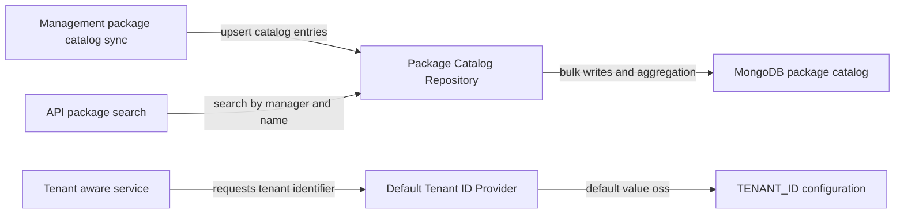
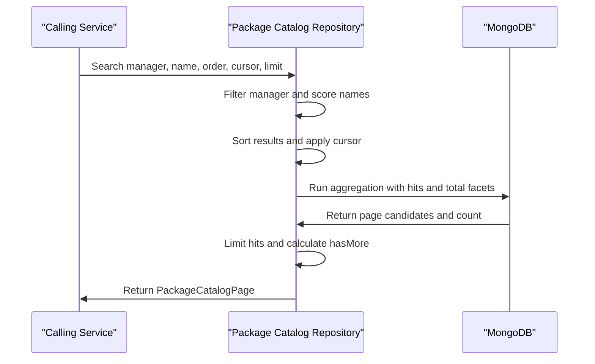
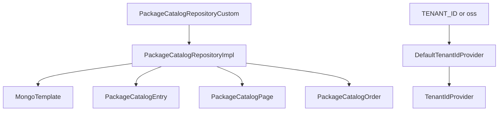

# Data Mongo Repository Service

Data Mongo Repository Service is a small shared persistence module from the OpenFrame OSS Library. In this tenant repository it supplies two runtime capabilities:

- package-catalog persistence and cursor-based name search through Spring Data MongoDB;
- a default tenant identity for deployments that do not provide a more specific `TenantIdProvider` bean.

The module is delivered by the `com.openframe.oss:openframe-data-mongo-common` library at version `7.0.11`. Its source is maintained in the OpenFrame OSS Library, while this repository assembles it into OpenFrame services.

## Architecture Overview



The repository implementation owns MongoDB query behavior, not HTTP endpoints or catalog ingestion. The management package-search components can populate the catalog, while API package-search components can query it. Mongo connection, conversion, indexing, tenant isolation, and retry configuration are provided by the separate Data Mongo Sync Repositories module; this module remains focused on reusable repository behavior and a tenant-provider fallback.

## Runtime Responsibilities

### Package Catalog Repository

[Package Catalog Repository Custom](https://github.com/flamingo-stack/openframe-oss-lib/blob/7a766f00e4f58b5d89db007b878ac8d6e0c344f4/openframe-data-mongo-common/src/main/java/com/openframe/data/repository/packagesearch/PackageCatalogRepositoryCustom.java) defines the persistence contract:

- `upsertAll` replaces or inserts catalog entries by document identifier in bulk.
- `searchByName` returns a `PackageCatalogPage` for one package-manager type, a name query, an ordering choice, an optional continuation cursor, and a page size.

[Package Catalog Repository Implementation](https://github.com/flamingo-stack/openframe-oss-lib/blob/7a766f00e4f58b5d89db007b878ac8d6e0c344f4/openframe-data-mongo-common/src/main/java/com/openframe/data/repository/packagesearch/PackageCatalogRepositoryImpl.java) implements that contract with `MongoTemplate`.

| Concern | Behavior |
|---|---|
| Ingestion | Builds an unordered Mongo bulk operation and performs an upsert-style replacement for every supplied `PackageCatalogEntry`. |
| Scope | Filters every search to the requested `PackageManagerType`. |
| Matching | Normalizes the query and package name to lowercase, then assigns relevance: exact match `3`, prefix match `2`, contained match `1`, and no match `0`. |
| Collation | Applies case-insensitive English collation to the aggregation. |
| Ordering | Sorts by relevance first. `MOST_POPULAR_FIRST` then sorts popularity descending and package identifier ascending; `BY_NAME` then sorts name and package identifier ascending. |
| Pagination | Uses keyset pagination, fetches one extra row to calculate `hasMore`, and counts all matching rows separately for `total`. |
| Invalid cursors | Logs a warning and treats an invalid cursor as a first-page request instead of failing the search. |

### Default Tenant ID Provider

[Default Tenant ID Provider](https://github.com/flamingo-stack/openframe-oss-lib/blob/7a766f00e4f58b5d89db007b878ac8d6e0c344f4/openframe-data-mongo-common/src/main/java/com/openframe/data/service/DefaultTenantIdProvider.java) is a Spring service that implements `TenantIdProvider`. It reads `TENANT_ID` and defaults to `oss` when the property is absent.

The bean is conditional: Spring creates it only when no other `TenantIdProvider` bean is available. A deployment can therefore supply tenant-resolution behavior without changing this shared module; the supplied provider takes precedence.

## Package Search Flow



### Search and Cursor Semantics

The aggregation first keeps entries belonging to the requested manager, derives a score from the supplied name query, removes non-matches, and applies the selected sort order. An empty name query is intentionally treated as a prefix of every name, allowing a caller to browse a complete manager catalog with the same pipeline.

The continuation cursor contains all fields required to continue a deterministic ordering:

```text
score|packageId|secondary
```

The secondary value is popularity for popularity ordering or name for name ordering. The cursor predicate returns entries that occur after the preceding score, secondary sort value, and package identifier. The package identifier is the tie-breaker, which prevents duplicates or omissions where entries have equal relevance and equal secondary values.

The implementation accepts names containing the separator because it splits the cursor only at the first two separators and treats the remaining tail as the secondary value. It rejects malformed cursors and falls back to the first page.

## Component Relationships



## Integration Boundaries

- **Library origin:** All three core components are supplied by `com.openframe.oss:openframe-data-mongo-common`, an upstream library dependency pinned at `7.0.11` by this repository.
- **Database boundary:** The repository expects a configured Spring `MongoTemplate`; it does not create client connectivity or schema indexes itself.
- **Catalog boundary:** `PackageCatalogEntry`, `PackageCatalogPage`, `PackageCatalogOrder`, and `PackageManagerType` are library types that form the repository query contract.
- **Tenant boundary:** The default provider is deliberately replaceable. Consumers that require request-, domain-, or security-context-derived tenant IDs must register their own `TenantIdProvider` bean.

## Operational Considerations

- Prefer `upsertAll` for batch catalog refreshes because it uses one unordered bulk operation rather than individual repository saves.
- Keep a cursor tied to the same manager, query, and ordering selection that produced it. The cursor encodes ordering fields but not those request parameters.
- Validate page limits at the caller boundary. The repository adds one to the requested limit when obtaining hits so it can determine whether another page exists.
- Treat `total` as the count before cursor pagination. It reports all entries matching the manager and query, rather than only the remaining entries.
- Configure `TENANT_ID` when the default `oss` identity is not appropriate, or provide a replacement `TenantIdProvider` for dynamic tenant selection.
