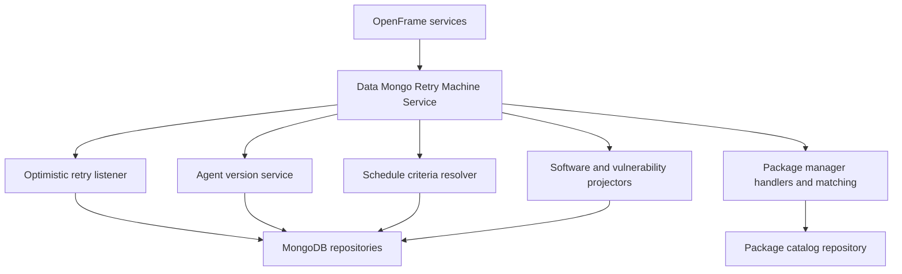
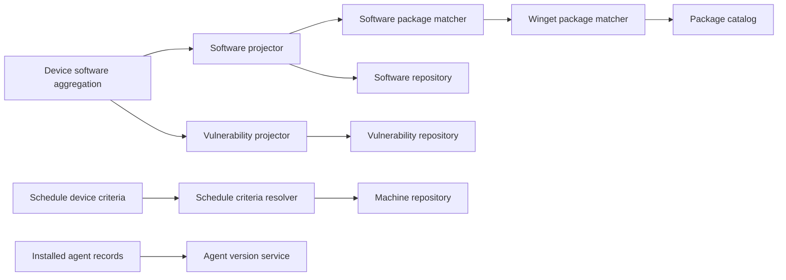

# Data Mongo Retry Machine Service

Data Mongo Retry Machine Service is the MongoDB-backed service layer supplied by the OpenFrame OSS Library artifact `com.openframe.oss:openframe-data-mongo-sync` at version `7.0.11`. In this tenant repository, it provides focused operational logic for safe persistence retries, client-version lookup, scheduled-device resolution, and RMM software inventory projection.

The module is library code executed by the OpenFrame services that assemble the Mongo sync artifact; it does not expose HTTP endpoints itself. Its dependencies are Mongo repositories and domain documents supplied by the same data layer. The tenant deployment provides MongoDB through the shared application configuration.

## Architecture Overview

## Responsibilities

- **Conflict-aware persistence:** `OptimisticLockingRetryListener` observes retry callbacks and logs only optimistic-locking or transient data-access failures. It identifies an exhausted relevant retry with the stable `OPTIMISTIC_LOCK_UPDATE_NOT_SAVED` marker, distinguishing a lost background update from unrelated failures.
- **Installed client versions:** `AgentVersionService` reads the current `openframe-client` version from installed-agent records rather than the machine's installation-time version. `AgentVersion` compares dotted numeric segments and ignores a nonnumeric suffix after a numeric portion.
- **Target-device selection:** `ScheduleCriteriaDeviceResolver` translates schedule criteria into repository filters for organization, device type, operating system, and optionally available package managers. Its platform scope is the intersection of requested and supported operating systems when both are present.
- **Software inventory projection:** `SoftwareProjector` builds a tenant-scoped software summary from device-level aggregation data. It refreshes package matching when identifying keys change or the previous match is more than one day old, chooses the latest semantic-style version, and removes the projection when no rollup remains.
- **Vulnerability projection:** `VulnerabilityProjector` creates or updates CVE summaries from aggregated affected titles, retains the first discovery time, and removes summaries that no longer have a rollup.
- **Package automation support:** Brew and Winget handlers validate package inputs and select install or update scripts. The Winget matcher correlates installed programs with catalog entries using package family names, product or upgrade codes, then normalized name and publisher, while refusing ambiguous matches.

## Component Relationships

## Detailed Submodules

- [Retry and Agent Version](data-mongo-retry-machine-service/retry-and-agent-version/retry-and-agent-version.md) documents retry classification and logging, installed-agent version retrieval, and dotted-version comparison.
- [Scheduled Device Resolution](data-mongo-retry-machine-service/scheduled-device-resolution/scheduled-device-resolution.md) documents schedule criteria, operating-system scoping, package-manager capability filtering, and in-memory machine matching.
- [Software and Vulnerability Projection](data-mongo-retry-machine-service/software-and-vulnerability-projection/software-and-vulnerability-projection.md) documents the aggregated read-model lifecycle, version selection, package-match refresh, and CVE summaries.
- [Package Management and Matching](data-mongo-retry-machine-service/package-management-and-matching/package-management-and-matching.md) documents Brew and Winget invocation arguments plus safe Winget catalog correlation.

## Source Code

The implementation is maintained in the OpenFrame OSS Library. The verified sources are:

- [Optimistic Locking Retry Listener](https://github.com/flamingo-stack/openframe-oss-lib/blob/7a766f00e4f58b5d89db007b878ac8d6e0c344f4/openframe-data-mongo-sync/src/main/java/com/openframe/data/retry/OptimisticLockingRetryListener.java)
- [Agent Version Service](https://github.com/flamingo-stack/openframe-oss-lib/blob/7a766f00e4f58b5d89db007b878ac8d6e0c344f4/openframe-data-mongo-sync/src/main/java/com/openframe/data/service/machine/AgentVersionService.java)
- [Schedule Criteria Device Resolver](https://github.com/flamingo-stack/openframe-oss-lib/blob/7a766f00e4f58b5d89db007b878ac8d6e0c344f4/openframe-data-mongo-sync/src/main/java/com/openframe/data/service/rmm/ScheduleCriteriaDeviceResolver.java)
- [Software Projector](https://github.com/flamingo-stack/openframe-oss-lib/blob/7a766f00e4f58b5d89db007b878ac8d6e0c344f4/openframe-data-mongo-sync/src/main/java/com/openframe/data/service/rmm/software/SoftwareProjector.java)
- [Vulnerability Projector](https://github.com/flamingo-stack/openframe-oss-lib/blob/7a766f00e4f58b5d89db007b878ac8d6e0c344f4/openframe-data-mongo-sync/src/main/java/com/openframe/data/service/rmm/software/VulnerabilityProjector.java)
