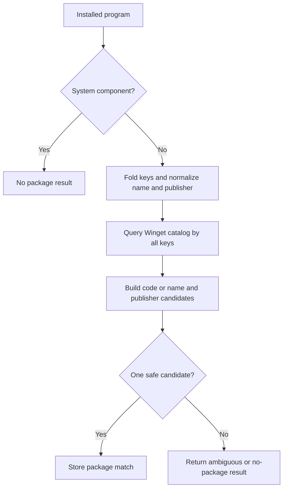

# Package Management and Matching

Package Management and Matching selects package-manager execution scripts and correlates installed software with catalog entries.

## Package Manager Handlers

`BrewPackageManagerHandler` and `WingetPackageManagerHandler` are available only when `openframe.rmm.software.enabled` is `true`.

Both select an install or update `SoftwareScriptCode` from the requested `SoftwareAction` and reject a blank package name with a bad-request exception. The Brew handler additionally requires a package type. It produces the package name alone for a formula and prefixes a cask package with `--cask`. The Winget handler identifies a package exactly with `--id`, the package name, and `-e`.

## Package Matching Contract

`PackageMatcher` is the manager-specific abstraction: implementations identify their `PackageManagerType` and return one `PackageMatch` per input program in input order.

`WingetPackageMatcher` uses one catalog lookup for all input programs. It excludes system components from lookup and returns a no-package outcome for them. For other programs, it folds product codes, upgrade codes, and package family names to lowercase and normalizes name and publisher through Winget-specific normalization.

The candidate selection order is:

1. Search with a name carrying architecture when present.
2. If that search has no candidates, search with the plain normalized name.
3. Prefer matches found through product code, upgrade code, or package family name.
4. Accept a name-and-publisher result only when it is unambiguous.

A single candidate is selected. With several candidates, exactly one strong key-based candidate is selected; otherwise the result is marked ambiguous rather than making an unsafe association.

## Source Files

- [Brew Package Manager Handler](https://github.com/flamingo-stack/openframe-oss-lib/blob/7a766f00e4f58b5d89db007b878ac8d6e0c344f4/openframe-data-mongo-sync/src/main/java/com/openframe/data/service/rmm/software/BrewPackageManagerHandler.java)
- [Winget Package Manager Handler](https://github.com/flamingo-stack/openframe-oss-lib/blob/7a766f00e4f58b5d89db007b878ac8d6e0c344f4/openframe-data-mongo-sync/src/main/java/com/openframe/data/service/rmm/software/WingetPackageManagerHandler.java)
- [Package Matcher](https://github.com/flamingo-stack/openframe-oss-lib/blob/7a766f00e4f58b5d89db007b878ac8d6e0c344f4/openframe-data-mongo-sync/src/main/java/com/openframe/data/service/rmm/software/matching/PackageMatcher.java)
- [Winget Package Matcher](https://github.com/flamingo-stack/openframe-oss-lib/blob/7a766f00e4f58b5d89db007b878ac8d6e0c344f4/openframe-data-mongo-sync/src/main/java/com/openframe/data/service/rmm/software/matching/WingetPackageMatcher.java)
