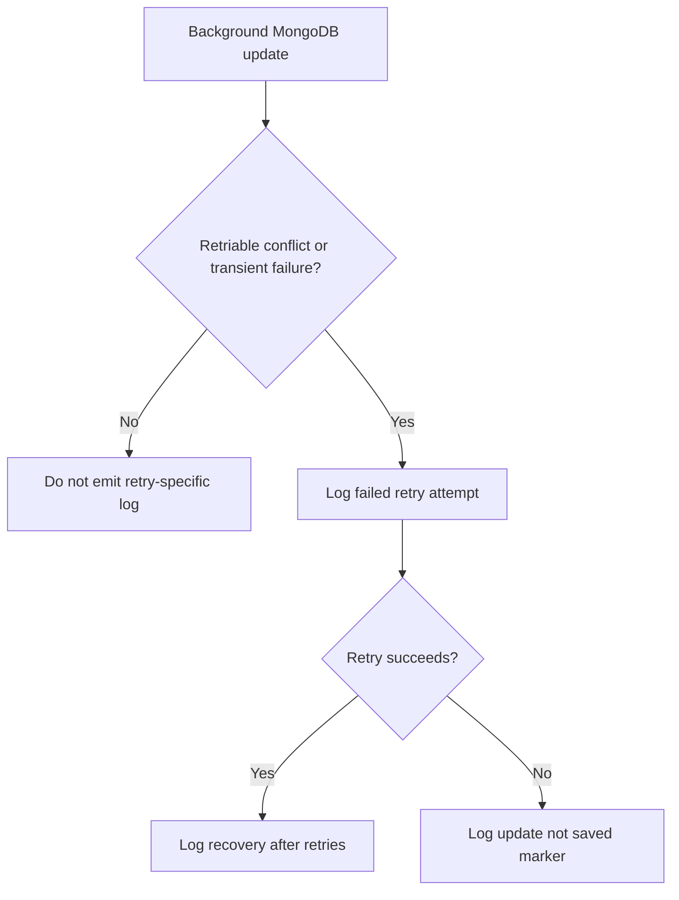

# Retry and Agent Version

Retry and Agent Version covers transient MongoDB update observability and the authoritative current version of an OpenFrame client agent.

## Optimistic Lock Retry Observation

`OptimisticLockingRetryListener` is a Spring `RetryListener` component named `optimisticLockingRetryListener`. It limits retry telemetry to two exception families:

- `OptimisticLockingFailureException`, representing a competing update detected through optimistic locking.
- `TransientDataAccessResourceException`, representing a transient data-resource failure.

On each relevant retry failure, it emits a warning with the retry count and retry-context method name. When the retry lifecycle closes after one or more attempts, it logs either successful recovery or an exhausted retry. Exhaustion includes the stable `OPTIMISTIC_LOCK_UPDATE_NOT_SAVED` marker, which allows alerting to focus on unsaved background updates. Exceptions outside the two targeted categories are deliberately not described as exhausted optimistic-lock retries.

## Current Agent Version Lookup

`AgentVersionService` queries `InstalledAgentRepository` with both the machine identifier and the fixed agent type `openframe-client`. It returns only nonblank reported versions. Batch lookup returns a map from machine identifier to version and keeps the first result if duplicate records occur.

`AgentVersion` implements the comparison used by version-gating callers:

- A blank actual version never satisfies a minimum version.
- A blank minimum version is always satisfied when an actual version exists.
- Dot-separated components are compared numerically, with missing components treated as zero.
- A component's suffix starting at its first nondigit is ignored, and an unparsable component becomes zero.

Consequently, `10.0` is newer than `9.0`, and `1.2.3-beta` compares using its numeric prefix.

## Source Files

- [Optimistic Locking Retry Listener](https://github.com/flamingo-stack/openframe-oss-lib/blob/7a766f00e4f58b5d89db007b878ac8d6e0c344f4/openframe-data-mongo-sync/src/main/java/com/openframe/data/retry/OptimisticLockingRetryListener.java)
- [Agent Version](https://github.com/flamingo-stack/openframe-oss-lib/blob/7a766f00e4f58b5d89db007b878ac8d6e0c344f4/openframe-data-mongo-sync/src/main/java/com/openframe/data/service/machine/AgentVersion.java)
- [Agent Version Service](https://github.com/flamingo-stack/openframe-oss-lib/blob/7a766f00e4f58b5d89db007b878ac8d6e0c344f4/openframe-data-mongo-sync/src/main/java/com/openframe/data/service/machine/AgentVersionService.java)
