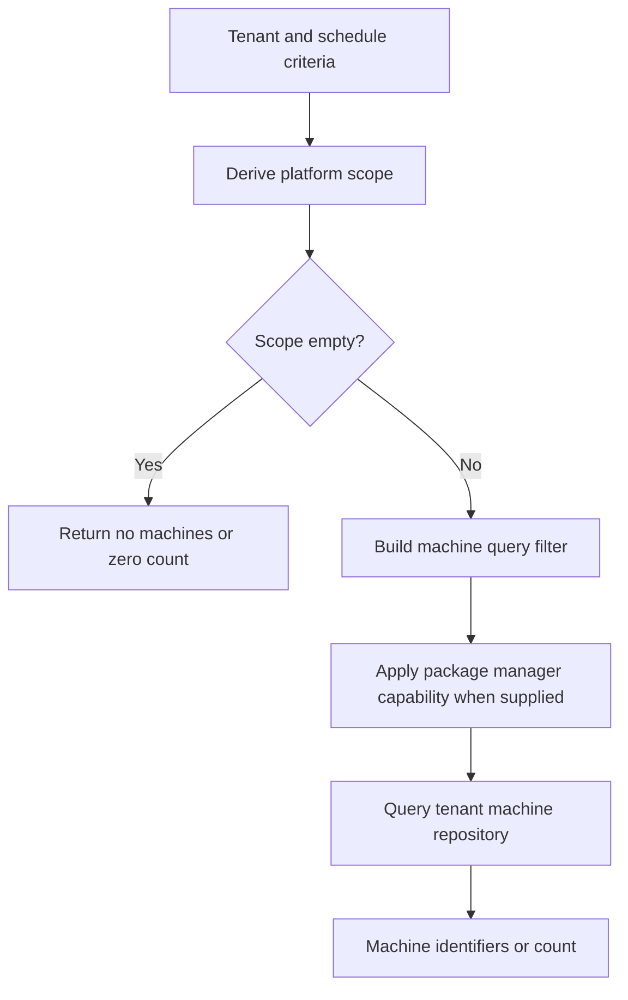

# Scheduled Device Resolution

Scheduled Device Resolution turns RMM schedule criteria into tenant-scoped machine queries and in-memory membership checks.

## Resolution Rules

`ScheduleCriteriaDeviceResolver` accepts a tenant identifier, optional `ScheduleDeviceCriteria`, and the operating systems supported by the caller. It derives a platform scope before querying `MachineRepository`.

- With neither requested nor supported operating systems, the scope is unrestricted.
- With only supported operating systems, those systems constrain the query.
- With only requested operating systems, requested systems constrain the query.
- With both inputs, their intersection constrains the query. An empty intersection immediately returns no machine identifiers and a count of zero.

The resolver builds `MachineQueryFilter` with nonempty organization identifiers and device types. For device types, it passes enum names to the repository filter. The overload used by package operations also passes a package-manager capability collection as `manageableByPackageManagers`.

## In-Memory Matching

The `matches` method evaluates a supplied machine with the same logical restrictions. It rejects null machines, unselected organizations, unselected device types, and operating systems outside the derived platform scope. It does not perform a repository query, which makes it suitable where a machine record is already available.

## Source File

- [Schedule Criteria Device Resolver](https://github.com/flamingo-stack/openframe-oss-lib/blob/7a766f00e4f58b5d89db007b878ac8d6e0c344f4/openframe-data-mongo-sync/src/main/java/com/openframe/data/service/rmm/ScheduleCriteriaDeviceResolver.java)
