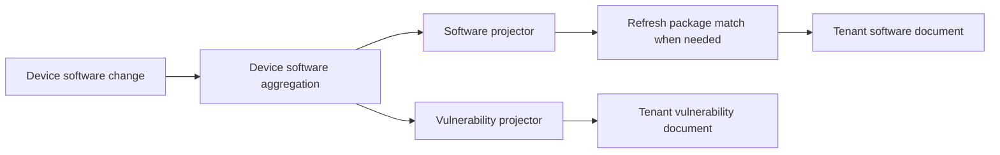

# Software and Vulnerability Projection

Software and Vulnerability Projection maintains tenant-level MongoDB read models from device software aggregation data.

## Software Projection

`SoftwareProjector.project` ignores a missing tenant or software-title identifier. For a valid key, it asks `DeviceSoftwareAggregationRepository` for a title rollup. If no rollup exists, it deletes the matching software document. Otherwise, it writes the rollup's name, source, vendor, identifiers, installer types, device count, CVE count, and timestamps to `SoftwareRepository`.

The projection derives an installed-program identity from the rollup. Package matching is recalculated only when identifying keys change or the persisted match is absent or older than one day. This avoids rematching every projected title on every event while allowing catalog changes to take effect within the match time-to-live.

The latest version is the numerically greatest version among rollup versions. The current version is selected first by the largest number of devices and then, where counts tie, by newer version. The older-version count is the number of distinct recorded versions minus one, never below zero.

## Vulnerability Projection

`VulnerabilityProjector.project` behaves similarly for a tenant and CVE identifier. It removes a vulnerability document when its CVE rollup is absent. A present rollup becomes an affected-software list containing each title's identifier, name, source, installed version, and affected-device count. The projection preserves `discoveredAt` once it has been assigned and refreshes `updatedAt` for each save.

## Source Files

- [Software Projector](https://github.com/flamingo-stack/openframe-oss-lib/blob/7a766f00e4f58b5d89db007b878ac8d6e0c344f4/openframe-data-mongo-sync/src/main/java/com/openframe/data/service/rmm/software/SoftwareProjector.java)
- [Vulnerability Projector](https://github.com/flamingo-stack/openframe-oss-lib/blob/7a766f00e4f58b5d89db007b878ac8d6e0c344f4/openframe-data-mongo-sync/src/main/java/com/openframe/data/service/rmm/software/VulnerabilityProjector.java)
