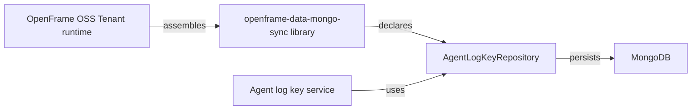
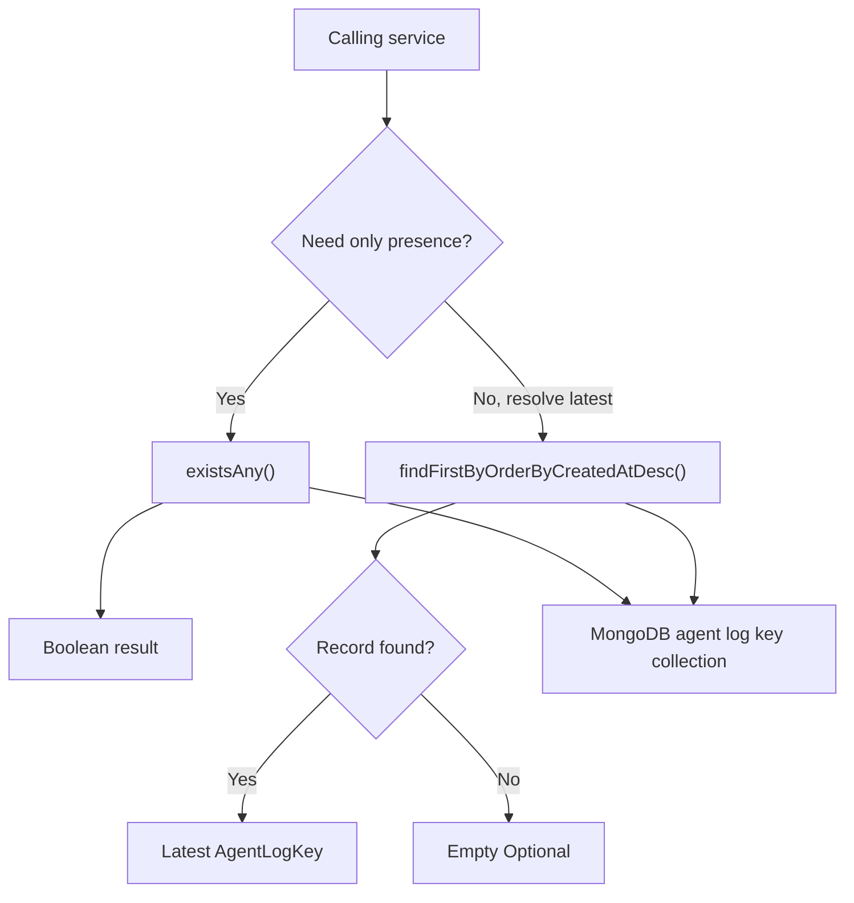
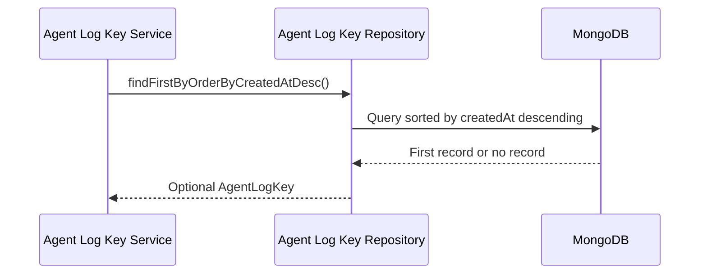

# Agent Repositories

Agent Repositories provides the MongoDB persistence boundary for agent log-key records. The module currently consists of `AgentLogKeyRepository`, a Spring Data repository supplied by the OpenFrame OSS Library artifact `com.openframe.oss:openframe-data-mongo-sync` version `7.0.11` and assembled by OpenFrame OSS Tenant at runtime.

The repository exposes the standard CRUD and query capabilities inherited from Spring Data's `MongoRepository`, plus two purpose-specific operations: retrieve the most recently created log-key record and determine whether any record exists. It does not generate, rotate, expose, or transmit log keys itself; those responsibilities belong to higher-level services.

## Source and System Position

The implementation is maintained in the OpenFrame OSS Library. The tenant repository consumes the library rather than defining this interface locally.

- Source: [AgentLogKeyRepository.java](https://github.com/flamingo-stack/openframe-oss-lib/blob/7a766f00e4f58b5d89db007b878ac8d6e0c344f4/openframe-data-mongo-sync/src/main/java/com/openframe/data/repository/agent/AgentLogKeyRepository.java)
- Package: `com.openframe.data.repository.agent`
- Managed document: `AgentLogKey`
- Identifier type: `String`
- Persistence technology: Spring Data MongoDB

The repository is annotated with `@Repository`, allowing Spring to detect it and create the MongoDB-backed implementation. Its `MongoRepository<AgentLogKey, String>` base type provides common operations such as saving, looking up by identifier, listing, and deleting `AgentLogKey` documents. No custom implementation class is required for the operations declared here.

## Repository Contract

| Operation | Contract | Result | Intended use |
|---|---|---|---|
| `findFirstByOrderByCreatedAtDesc()` | Derived Spring Data query that orders records by `createdAt` descending and selects the first record. | `Optional<AgentLogKey>` | Resolve the newest persisted log-key record while safely handling an empty collection. |
| `existsAny()` | Explicit Mongo query using an empty filter and `exists = true`. | `boolean` | Check whether the collection contains at least one record without retrieving a document. |
| Inherited `MongoRepository` operations | Generic persistence operations for `AgentLogKey` documents keyed by `String`. | Varies by method | Create, read, update, delete, and collection-level access where required by a service. |

### Query Semantics

`findFirstByOrderByCreatedAtDesc()` relies on the managed document's `createdAt` property. The returned `Optional` means callers must treat a missing record as a normal state rather than assuming a key has been initialized.

`existsAny()` uses the MongoDB empty-document filter, represented by `{}`, with an existence projection. It answers only whether at least one log-key record is present; it does not identify which record is current and does not return key material.

## Component Interaction

The repository is a narrow data-access component. It has no HTTP endpoint, scheduler, message listener, or standalone process. A higher-level agent log-key service owns business decisions and invokes this repository for persistence and lookup.

The organization-wide code graph records `AgentLogKeyService` in the OpenFrame OSS Library as a consumer of this repository. The graph also records a test import in `AgentLogKeyServiceTest`. These relationships establish that service-level behavior and verification are outside this module's interface definition.

## Data and Operational Boundaries

### Data ownership

- The repository manages `AgentLogKey` persistence through the configured Spring Data MongoDB infrastructure.
- The repository interface does not define document fields other than the `createdAt` property referenced by the derived query.
- The repository does not contain cryptographic generation, encryption, authorization, logging transport, or key-distribution policy.

### Failure handling

- An absent collection entry is represented by `Optional.empty()` from the latest-record query.
- Database connectivity, query execution, and mapping failures are surfaced through the Spring Data persistence layer to the caller.
- Callers should use `existsAny()` only for presence checks and should use the latest-record query when they require the selected record.

### Tenant integration

OpenFrame OSS Tenant deploys MongoDB as a shared data source and supplies the runtime configuration used by the Mongo persistence layer. Agent Repositories remains library code: application services activate and consume it through Spring's component and repository scanning.

## Maintenance Guidance

1. Preserve the `createdAt` ordering contract when changing the managed `AgentLogKey` document. Renaming or removing that property invalidates the derived query method.
2. Keep `findFirstByOrderByCreatedAtDesc()` returning `Optional`; callers depend on the empty-store case being representable without a null value.
3. Use a new query method when a use case needs filtering or a different selection rule. Do not reinterpret `existsAny()` as a current-key check.
4. Treat changes to this public repository interface as changes to the OpenFrame OSS Library artifact. The tenant service consumes the artifact at its pinned version and has no locally defined replacement.

## Verification Focus

Repository verification should cover an empty collection, a collection containing one record, and multiple records with different `createdAt` values. The essential assertions are that `existsAny()` reports collection presence and that the latest-record method selects the record with the greatest creation time. Service-level tests should separately validate the business behavior that follows each repository result.
