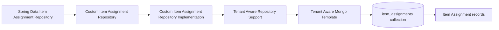
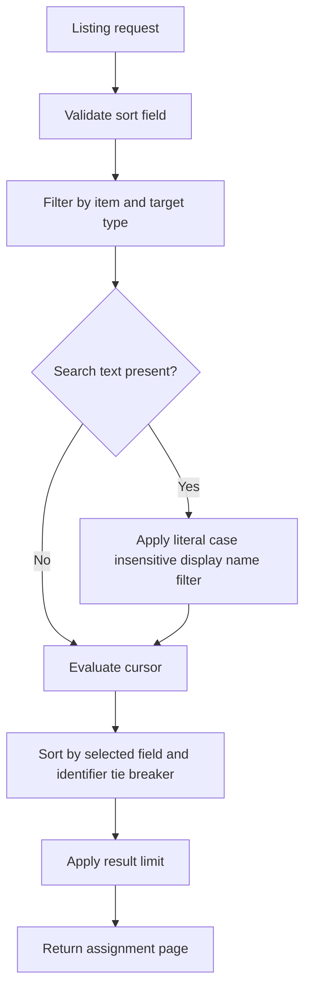
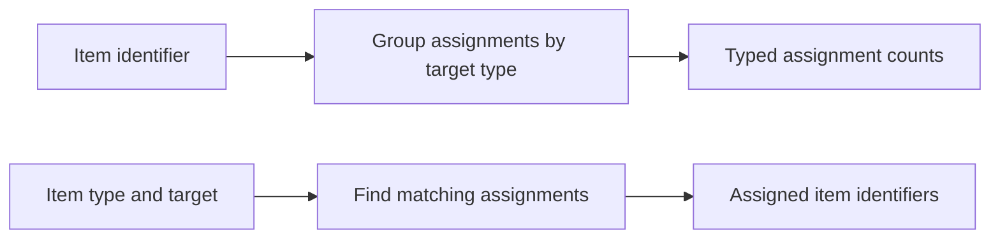

# Assignment Repositories

## Purpose

Assignment Repositories provides the custom MongoDB query operations behind `ItemAssignment` records. An assignment associates an item with a typed target and stores the target display name and creation time. The module supports three complementary access patterns:

- cursor-paginated assignment listings for one item and target type;
- assignment counts, including counts grouped by target type; and
- reverse lookup of item identifiers assigned to a specified target.

This implementation is supplied at runtime by the OpenFrame OSS Library artifact `com.openframe.oss:openframe-data-mongo-sync` version `7.0.11`. The tenant service consumes that artifact; the module source is maintained in the library repository.

## Architecture

`ItemAssignmentRepository` composes Spring Data MongoDB CRUD methods with this custom repository contract. The document is tenant-scoped and stored in the `item_assignments` collection. Its unique compound index covers `itemId`, `targetType`, and `targetId`, so an item cannot receive the same typed target more than once. A second index supports lookups by `targetType` and `targetId`.

The custom implementation extends `TenantAwareRepositorySupport` and is only created when `openframe.tenant-isolation.enabled` is `true`. The support base exposes a tenant-aware Mongo template and a `tenantCriteria()` helper. The grouped aggregation explicitly starts with that criterion. Other query methods use the tenant-aware template, which supplies the repository's tenant context.

## Components

| Component | Responsibility |
| --- | --- |
| `CustomItemAssignmentRepository` | Defines custom listing, counting, reverse-lookup, and sort-validation operations beyond standard Spring Data repository methods. |
| `CustomItemAssignmentRepositoryImpl` | Implements those operations with tenant-aware MongoDB queries and aggregation. |
| `ItemAssignmentRepository` | Integrates the custom contract with standard CRUD operations and derived lookup and deletion methods. |
| `ItemAssignment` | Tenant-scoped persisted document containing item, target, display name, and creation-time fields. |

### Custom Repository Contract

The contract separates query needs that are not expressible as simple derived repository methods:

- `findAssignmentsWithCursor` returns a bounded page after an optional cursor.
- `countAssignments` returns the total for the same item, target-type, and optional search scope as the listing.
- `countByItemIdGroupedByTargetType` produces target-type totals for an item.
- `findItemIdsByTarget` reverses the association from a typed target to assigned items of a requested item type.
- `isSortableField` and `getDefaultSortField` let callers validate their requested ordering before listing.

## Query Behavior

### Listing and Searching

A paged listing always filters on `itemId` and `targetType`. When `search` contains text, the implementation trims it, quotes it as a literal regular-expression fragment, and applies a case-insensitive match against `displayName`. Quoting prevents search text from being interpreted as a regular expression pattern.

The supported public sort fields are `createdAt` and `displayName`; `createdAt` is the default. The requested direction is descending only when it equals `DESC` without regard to case. Any other value yields ascending order. For non-identifier sorting, `_id` is appended as a tie-breaker in the same direction, making ordering deterministic when several assignments share the primary sort value.

### Cursor Semantics

The cursor is expected to be a MongoDB object identifier. For an identifier-only sort, the implementation selects records with an identifier before or after the cursor according to the sort direction.

For `createdAt` or `displayName` ordering, it loads the cursor document and applies a two-part continuation predicate:

1. include records whose primary sort value is beyond the cursor value; or
2. where the primary values are equal, include records whose identifier is beyond the cursor identifier.

This matches the primary ordering plus identifier tie-breaker used by the query. An invalid cursor, a missing cursor document, or an unavailable cursor sort value is handled defensively: the implementation logs a warning where applicable and falls back to an identifier comparison rather than failing the request.

### Counts and Reverse Lookup

`countAssignments` reuses the listing filter construction, ensuring that a displayed search page and its total use equivalent item, target-type, and search conditions.

`countByItemIdGroupedByTargetType` is a MongoDB aggregation that first scopes to the current tenant and item, then groups by `targetType`. Its results are placed in an `EnumMap`. Values not recognized by `AssignmentTargetType` are ignored after a warning, keeping unknown stored values from failing the whole count operation.

`findItemIdsByTarget` filters by `itemType`, `targetType`, and `targetId`, selects only `itemId`, and returns the resulting identifiers. This is the reverse association used when a caller begins with a target rather than an item.

## Data and Tenant Boundaries

An `ItemAssignment` contains:

| Field | Role |
| --- | --- |
| `tenantId` | Tenant ownership for isolation. |
| `itemId` and `itemType` | Identify the assignable source item and its type. |
| `targetId` and `targetType` | Identify the recipient target and its type. |
| `displayName` | User-facing target text used by search and sorting. |
| `createdAt` | Audited creation time and default ordering field. |

Maintainers should preserve tenant-aware query behavior when adding custom operations. In particular, aggregation pipelines must begin with `tenantCriteria()`. For ordinary reads, use the injected tenant-aware template rather than bypassing it with an unscoped MongoDB client. New pagination sort fields must also be added consistently to the allowed-sort list and the cursor value resolver; otherwise cursor pagination falls back to identifier-only continuation.

## Integration Notes

The repository implementation is conditional on tenant isolation being enabled. Applications that require these custom methods must enable `openframe.tenant-isolation.enabled` and register the tenant-aware MongoDB infrastructure from the data module.

Standard `ItemAssignmentRepository` methods complement the custom methods with exact assignment lookup and deletion by item, target type, and target identifier. The custom module does not create or remove assignments itself; it reads, counts, and locates persisted association records.

## Source References

- [Custom Item Assignment Repository](https://github.com/flamingo-stack/openframe-oss-lib/blob/7a766f00e4f58b5d89db007b878ac8d6e0c344f4/openframe-data-mongo-sync/src/main/java/com/openframe/data/repository/assignment/CustomItemAssignmentRepository.java)
- [Custom Item Assignment Repository Implementation](https://github.com/flamingo-stack/openframe-oss-lib/blob/7a766f00e4f58b5d89db007b878ac8d6e0c344f4/openframe-data-mongo-sync/src/main/java/com/openframe/data/repository/assignment/CustomItemAssignmentRepositoryImpl.java)
