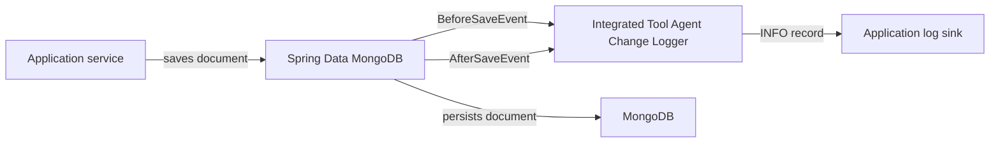
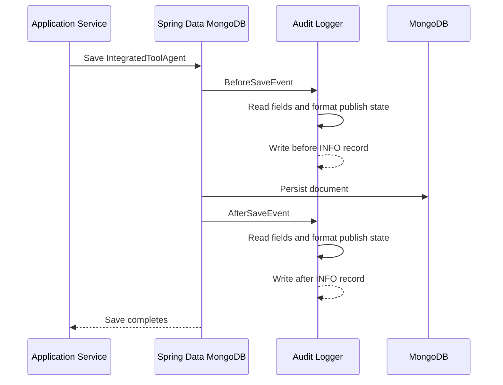

# Audit Logging

Audit Logging records lifecycle diagnostics whenever an `IntegratedToolAgent` MongoDB document is saved. It is implemented by `IntegratedToolAgentChangeLogger` in the **OpenFrame OSS Library** artifact `com.openframe.oss:openframe-data-mongo-sync` (version `7.0.11`), which this service assembles at runtime. The component writes structured, operator-facing `INFO` records before and after each save; it does not create a separate audit collection or expose an API endpoint.

[View the source in OpenFrame OSS Library](https://github.com/flamingo-stack/openframe-oss-lib/blob/7a766f00e4f58b5d89db007b878ac8d6e0c344f4/openframe-data-mongo-sync/src/main/java/com/openframe/data/audit/IntegratedToolAgentChangeLogger.java)

## Purpose and Scope

Integrated tool-agent configuration controls managed tools associated with the platform. This module makes save activity observable by logging the document identity, optimistic-locking document version, agent version, release flag, and publication status at two MongoDB lifecycle phases:

- **Before save**: confirms the state Spring Data MongoDB received immediately before persistence.
- **After save**: confirms that the save callback completed and reports the same source object state.

The logger is intentionally diagnostic rather than authoritative audit storage. A log line shows that the application reached a callback; it does not, by itself, prove downstream publication or describe every database-side transformation.

## Architecture

`IntegratedToolAgentChangeLogger` is a Spring `@Component` extending `AbstractMongoEventListener<IntegratedToolAgent>`. Spring Data MongoDB invokes its typed callbacks only for `IntegratedToolAgent` save events. Lombok's `@Slf4j` provides the logger used to emit the records.



The module belongs to the Mongo synchronous-data layer. It observes persistence activity without owning the save operation, and it relies on the `IntegratedToolAgent` model and its `PublishState` value supplied by the same library's data model.

## Component Responsibilities

| Component | Responsibility |
|---|---|
| `IntegratedToolAgentChangeLogger` | Registers MongoDB save callbacks and emits a normalized summary for each phase. |
| `onBeforeSave` | Extracts the event source and logs it with the `before` phase. |
| `onAfterSave` | Extracts the event source and logs it with the `after` phase. |
| `log` | Selects the fields relevant to an operator, formats publication state, and produces one `INFO` record. |
| `formatPublishState` | Converts a nullable `PublishState` into a compact stable diagnostic value. |

## Logged Data Contract

Each record has the message shape below. Values are taken from the `IntegratedToolAgent` event source.

```text
save-{phase} id={id} v={documentVersion} agentVersion={version} release={releaseVersion} publish={publishState}
```

| Field | Source | Meaning |
|---|---|---|
| `phase` | Callback phase | `before` or `after`. |
| `id` | `agent.getId()` | Identifier of the integrated tool-agent document. |
| `v` | `agent.getDocumentVersion()` | Document version reported by the model. |
| `agentVersion` | `agent.getVersion()` | Configured agent version. |
| `release` | `agent.isReleaseVersion()` | Whether the entry is marked as a release version. |
| `publish` | `agent.getPublishState()` | Human-readable publication state described below. |

### Publication State Formatting

The formatter does not serialize the raw object. It emits one of the following values:

| Condition | Logged value |
|---|---|
| No `PublishState` is present | `none` |
| State reports published | `published` |
| State is not published and attempt count is zero | `pending` |
| State is not published and attempt count is greater than zero | `pending(attempts=N)` |

This representation distinguishes an absent state from pending publication and surfaces retries without logging the full persistence object.

## Save Flow



## Operational Use

Use paired `before` and `after` lines to follow a single tool-agent save attempt by document ID. The `v`, `agentVersion`, `release`, and `publish` fields help compare the state passed to the persistence layer across the two callbacks.

When troubleshooting publication behavior:

1. Filter application logs for `save-before` or `save-after` and the document ID.
2. Inspect `publish` to distinguish `none`, `published`, and pending states.
3. For `pending(attempts=N)`, use the attempt count as a diagnostic signal that publication has already been retried.
4. Correlate with application logs from the service that initiated the update; this listener has no retry, mutation, or recovery logic.

## Maintenance Considerations

- Keep the listener typed to `IntegratedToolAgent` so unrelated MongoDB documents do not produce these records.
- Preserve null handling in publication-state formatting. The model permits the state to be absent, and logging must not make saves fail in that case.
- Treat the log schema as operationally consumed output. If fields or wording change, update log queries, dashboards, and runbooks that rely on the current keys.
- Avoid placing sensitive configuration or credentials in this logger. Its current output is deliberately limited to identifiers, versions, a boolean release marker, and publication progress.
- Because both callbacks log the event source, do not infer that the second line represents a fresh database read or that it contains database-generated changes not reflected in the source object.
