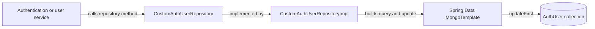
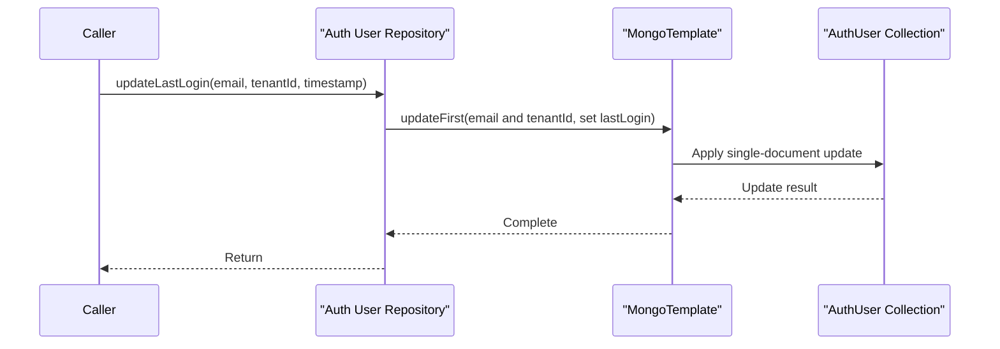
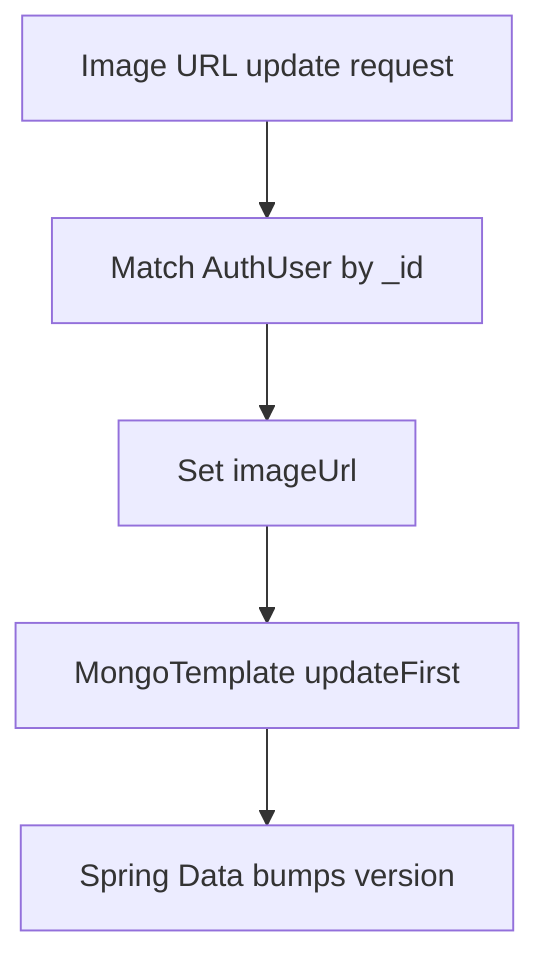
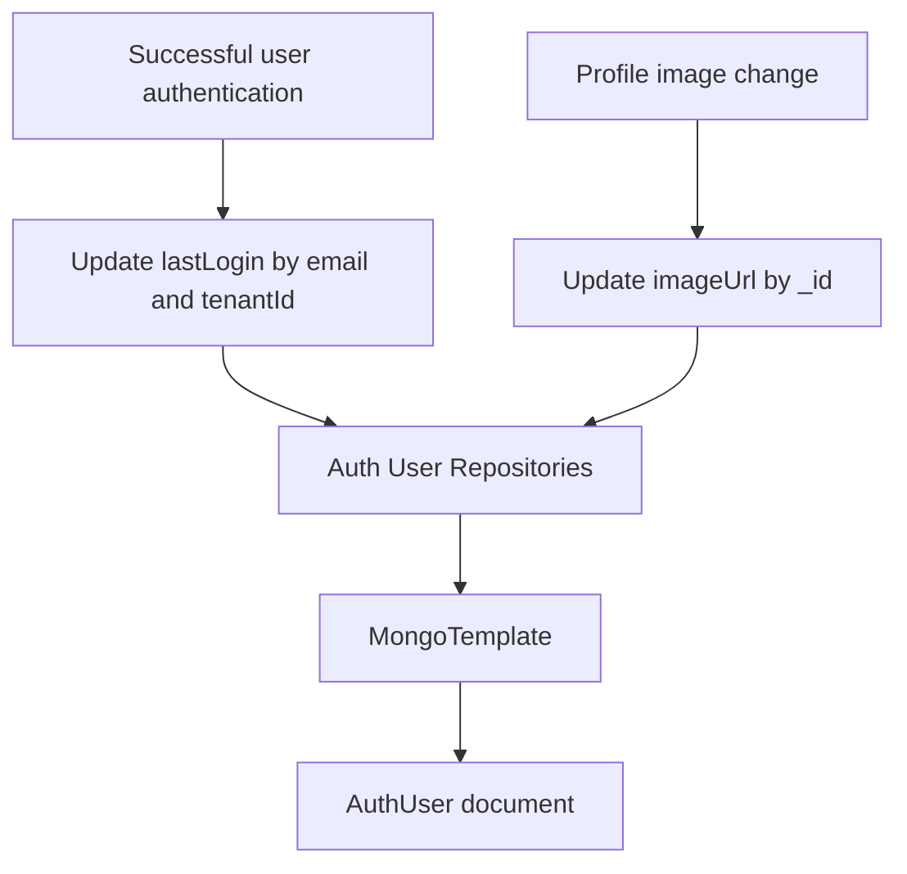

# Auth User Repositories

Auth User Repositories provides narrowly scoped MongoDB updates for authentication-user records. It is supplied at runtime by the OpenFrame OSS Library artifact `com.openframe.oss:openframe-data-mongo-sync` version `7.0.11`, which this repository consumes. The module exposes two write operations without loading and saving a full user document:

- record an authentication event by setting a user's last-login timestamp within a tenant;
- replace a user's profile image URL by user identifier.

The module is intentionally a custom repository fragment rather than a general user repository. Its operations are limited to fields that are updated independently from broader user-profile edits, reducing unnecessary document reads and avoiding selected optimistic-lock conflicts.

## Scope and Boundaries

The public contract is [`CustomAuthUserRepository`](https://github.com/flamingo-stack/openframe-oss-lib/blob/7a766f00e4f58b5d89db007b878ac8d6e0c344f4/openframe-data-mongo-sync/src/main/java/com/openframe/data/repository/auth/CustomAuthUserRepository.java). [`CustomAuthUserRepositoryImpl`](https://github.com/flamingo-stack/openframe-oss-lib/blob/7a766f00e4f58b5d89db007b878ac8d6e0c344f4/openframe-data-mongo-sync/src/main/java/com/openframe/data/repository/auth/CustomAuthUserRepositoryImpl.java) implements that contract using Spring Data `MongoTemplate` and targets the `AuthUser` collection mapping.

It does not authenticate users, create users, validate supplied values, or return a not-found result. Those responsibilities remain with the authentication, authorization, and user-management layers. The repository performs an `updateFirst` operation and its `void` API deliberately does not expose MongoDB's matched or modified counts. Therefore, callers that require existence checks or business-level validation must perform them outside this module.

## Architecture

The implementation is part of the synchronous Mongo data layer. It composes a query from stable document field names, creates a field-level `Update`, and delegates the atomic single-document mutation to `MongoTemplate`. Because neither operation first materializes an `AuthUser` object, the module avoids a read-modify-save cycle.

## Core Components

| Component | Responsibility |
| --- | --- |
| `CustomAuthUserRepository` | Defines the two persistence operations: `updateLastLogin` and `updateImageUrl`. |
| `CustomAuthUserRepositoryImpl` | Creates MongoDB criteria and update expressions, then applies them to the `AuthUser` document mapping through `MongoTemplate`. |
| `MongoTemplate` | Spring Data gateway that executes the single-document update. |
| `AuthUser` | The mapped document type used to resolve the Mongo collection for both writes. |

## Update Operations

### Last Login Update

`updateLastLogin(String email, String tenantId, Instant lastLogin)` identifies a document by the combination of `email` and `tenantId`. It sets the `lastLogin` field to the supplied `Instant`.

The update also applies an increment of zero to `version`. The implementation comment identifies the reason: this prevents Spring from adding its normal version increment, so recording a login does not conflict with a concurrent edit of the user. In other words, a successful last-login write changes `lastLogin` while intentionally leaving the optimistic-lock version unchanged.

The lookup is tenant-aware. The same email address in distinct tenant records is disambiguated by `tenantId`; callers must provide both values exactly as stored.

### Profile Image URL Update

`updateImageUrl(String userId, String imageUrl)` selects a document by its `_id` and sets `imageUrl` directly.

This is also a field-level write. The implementation explicitly avoids a read-and-save operation, which means the image update itself cannot fail due to a version conflict created between a read and a later save. Unlike the last-login operation, it does not suppress Spring Data version handling; the implementation comment states that Spring still bumps the version for this mutation.

## Concurrency Semantics

The two methods have distinct versioning behavior, which is important when changing or extending the module:

| Operation | Selection key | Updated field | Version behavior |
| --- | --- | --- | --- |
| `updateLastLogin` | `email` and `tenantId` | `lastLogin` | Uses a zero increment to avoid Spring Data's normal version increment. |
| `updateImageUrl` | `_id` | `imageUrl` | Relies on the field-level update, with Spring Data still bumping the version. |

Both operations use one `updateFirst` request. They are atomic at the individual MongoDB document-update level, but the module does not coordinate multi-document workflows or provide retries. It also does not use an upsert, so an unmatched selector leaves the collection unchanged without an error from this interface.

## Data and Integration Flow

Within the broader platform, authorization and user workflows own the decision to call these updates. This repository is the persistence boundary for the two targeted mutations only. Neighboring Mongo repository modules handle other domains, such as invitations and general user queries, rather than duplicating those concerns here.

## Maintenance Notes

- Preserve the composite `email` and `tenantId` filter for login updates. Weakening it to an email-only query could update a user record in the wrong tenant.
- Preserve the zero increment in the last-login update unless the concurrency contract is deliberately changed. Replacing it with a normal save or version increment can introduce conflicts with profile edits.
- Do not assume that a completed `void` method means that a document was matched. `updateFirst` can complete successfully with no matching `AuthUser` record.
- Keep profile-image updates as field-level writes when their conflict-avoidance behavior is required.
- Validate email format, tenant authorization, image URL policy, and user existence in the service layer. This module intentionally does not implement those policies.

## Source Files

- [`CustomAuthUserRepository.java`](https://github.com/flamingo-stack/openframe-oss-lib/blob/7a766f00e4f58b5d89db007b878ac8d6e0c344f4/openframe-data-mongo-sync/src/main/java/com/openframe/data/repository/auth/CustomAuthUserRepository.java)
- [`CustomAuthUserRepositoryImpl.java`](https://github.com/flamingo-stack/openframe-oss-lib/blob/7a766f00e4f58b5d89db007b878ac8d6e0c344f4/openframe-data-mongo-sync/src/main/java/com/openframe/data/repository/auth/CustomAuthUserRepositoryImpl.java)
