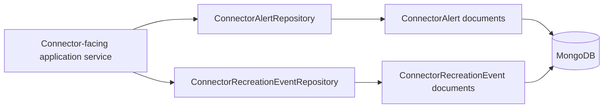
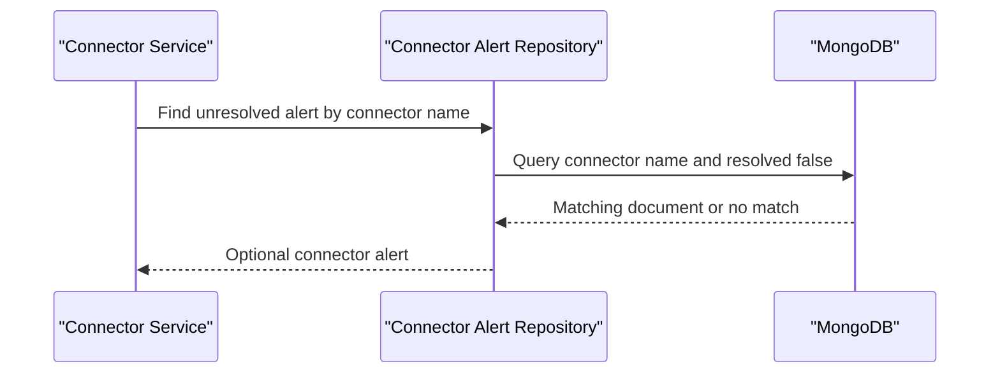
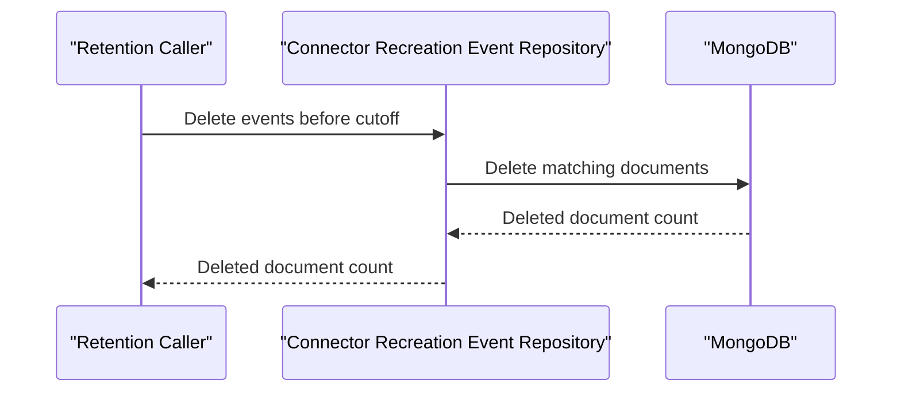

# Connector Repositories

Connector Repositories provide the MongoDB persistence boundary for connector operational state. They are supplied by the OpenFrame OSS Library artifact `com.openframe.oss:openframe-data-mongo-sync` version `7.0.11`, which this service repository consumes. The module exposes two Spring Data repositories: one for unresolved connector alerts and one for time-bounded connector recreation events.

The interfaces deliberately contain no application workflow logic. Spring Data derives the declared queries from their method names, while `MongoRepository` supplies standard document lifecycle operations such as save, lookup by identifier, and deletion.

## Architecture Overview

Both repositories are Spring beans because they are annotated with `@Repository`. Their document types and persistence mapping are defined outside this module by the OpenFrame OSS Library; this module should be treated as the query-level API over those mapped collections.

## Components

### Connector Alert Repository

[`ConnectorAlertRepository`](https://github.com/flamingo-stack/openframe-oss-lib/blob/7a766f00e4f58b5d89db007b878ac8d6e0c344f4/openframe-data-mongo-sync/src/main/java/com/openframe/data/repository/connector/ConnectorAlertRepository.java) extends `MongoRepository<ConnectorAlert, String>`. In addition to the inherited CRUD contract, it provides:

- `findByConnectorNameAndResolvedFalse(String connectorName)`: returns the unresolved alert for a named connector as an `Optional`. The optional result models the possibility that no unresolved alert exists.
- `findByResolvedFalse()`: returns every unresolved alert as a `List`, supporting a sweep or review of currently open connector conditions.

The repository expresses alert state through the `resolved` field. It does not itself create, resolve, deduplicate, or notify about alerts; callers own those policies and use the repository to retrieve or persist the resulting document state.

### Connector Recreation Event Repository

[`ConnectorRecreationEventRepository`](https://github.com/flamingo-stack/openframe-oss-lib/blob/7a766f00e4f58b5d89db007b878ac8d6e0c344f4/openframe-data-mongo-sync/src/main/java/com/openframe/data/repository/connector/ConnectorRecreationEventRepository.java) extends `MongoRepository<ConnectorRecreationEvent, String>` and records access patterns for recreation events:

- `countByBaseNameAndCreatedAtAfter(String baseName, Instant cutoff)`: counts events for one connector base name newer than an exclusive time boundary. A caller can use this bounded count when applying recreation-rate or retry policy.
- `deleteByCreatedAtBefore(Instant cutoff)`: removes events older than an exclusive time boundary and returns the number deleted. This supports retention cleanup without loading the documents first.

The repository does not decide the cutoff, schedule cleanup, or interpret a count as a failure threshold. Those responsibilities remain with its calling service.

## Operational Data Flows

### Unresolved Alert Lookup

### Recreation Event Retention

## Integration Boundaries

- **Storage:** The interfaces rely on Spring Data MongoDB and operate on `ConnectorAlert` and `ConnectorRecreationEvent` documents.
- **Time semantics:** Both recreation-event methods accept an `Instant`; the repository names specify `After` and `Before`, so callers must choose a cutoff consistent with their retention or observation window.
- **Scope:** No tenant field, index definition, transaction behavior, ordering, or pagination is declared in these interfaces. Any guarantees in those areas must come from document mappings, MongoDB configuration, or higher-level services rather than this module.

## Maintenance Notes

Keep derived query method names aligned with actual document property names. Changing a method name changes the generated query contract. Before adding an application-specific query, prefer confirming whether the inherited `MongoRepository` operation meets the need; add derived methods only when the repository boundary needs a stable, reusable lookup.
