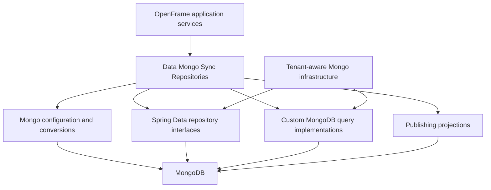
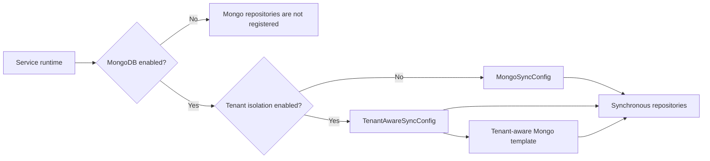

# Data Mongo Sync Repositories

**Data Mongo Sync Repositories** provides the synchronous MongoDB persistence layer used by OpenFrame services. It is supplied by the `com.openframe.oss:openframe-data-mongo-sync` dependency at version `7.0.11` and is assembled by OpenFrame OSS Tenant at runtime.

The module contains Spring Data repository interfaces and custom `MongoTemplate` implementations for platform domains including devices, users, organizations, tickets, notifications, deliveries, RMM scripts, software inventory, onboarding, and tool management. It also provides MongoDB configuration, indexes, conversion rules, tenant-aware repository support, retry enablement, and publishing projections that maintain denormalized data.

## Architecture

The module uses two repository modes:

## Responsibilities

- Configure synchronous Spring Data MongoDB access, mapping, auditing, conversions, indexes, and retry support.
- Register repository interfaces for application data such as tickets, devices, organizations, users, deliveries, notifications, and RMM records.
- Provide custom MongoDB queries, aggregations, cursor pagination, counts, and targeted updates where derived repository methods are insufficient.
- Apply tenant-aware access patterns when tenant isolation is enabled.
- Maintain denormalized copies of machine, organization, ticket, and user data through publishing projections.
- Support concurrency-sensitive operations, including guarded delivery transitions, optimistic-lock-safe updates, and atomic sequence allocation.

## Repository Areas

| Area | Primary responsibility |
|---|---|
| Mongo configuration | Registers conversions, Mongo infrastructure, repository scanning, tenant selection, index initialization, and Spring Retry support. |
| Audit logging | Logs save lifecycle details for integrated tool-agent documents. |
| Agent and authentication | Persists agent log keys, authentication-user updates, OAuth tokens, onboarding progress, and email blocklists. |
| Devices and assignments | Queries machines, device assignments, tags, delivery state, push registrations, and connector operational data. |
| Organizations, users, and invitations | Supports filtered listings, keyset pagination, counts, and denormalized publishing updates. |
| Tickets and time tracking | Provides tenant-aware ticket and time-entry queries, reporting aggregates, mutation helpers, and projections. |
| Notifications | Stores recipient read state, notification settings, and inbox query results. |
| RMM and software | Supports scripts, schedules, execution history, package policies, software inventory, vulnerability rollups, and software-action summaries. |
| Knowledge base and integrated tools | Provides listing, search, filtering, pagination, and catalog query behavior. |
| Publishing projections | Synchronizes ticket-facing copies of machine, organization, and user data, plus time-entry copies of ticket titles. |

## Core Components Documentation

The following component guides document the major areas of Data Mongo Sync Repositories:

### Foundation

- **Mongo Config** — synchronous MongoDB configuration, custom conversions, tenant-aware repository selection, index lifecycle, and retry support.
- **Audit Logging** — `IntegratedToolAgentChangeLogger` save-event diagnostics.
- **Sequence Repositories** — shared or tenant-scoped atomic MongoDB counters.

### Platform Repository Domains

- **Agent Repositories** — agent log-key persistence and latest-key lookup.
- **Assignment Repositories** — item assignment listing, counts, reverse lookup, and cursor paging.
- **Auth User Repositories** — targeted authentication-user updates for last login and profile images.
- **Connector Repositories** — unresolved connector alerts and connector recreation-event retention.
- **Email Blocklist Repositories** — blocked address and domain persistence with policy-source adapters.
- **Event Repositories** — external application-event persistence and event lookup.
- **Feature Flags Repositories** — tenant-local frontend feature-flag overrides.
- **Oauth Repositories** — access-token and refresh-token record lookup.
- **Onboarding Repositories** — tenant and user onboarding-progress records.
- **Push Device Repositories** — tenant-aware mobile push-token registration and reassignment.

### Device, Delivery, and Tooling Domains

- **Delivery Repositories** — device-targeted delivery rows, payloads, rollout state, guarded transitions, and atomic sequencing.
- **Machine Device Repositories** — tenant-scoped machine inventory, filters, facets, cursor paging, and maintenance updates.
- **Machine Device Publishing** — ticket projections driven by machine name and organization changes.
- **Integrated Tool Repositories** — integrated-tool filtering, search, stable sorting, and facet values.
- **Software Repositories** — software-title pages, device software rollups, and vulnerability aggregation.

### Business Data Domains

- **Knowledgebase Repositories** — folder and article search, hierarchy filtering, collation-aware ordering, and typed cursors.
- **Notification Repositories** — inbox state, notification content lookup, read-state fan-out, and user notification settings.
- **Organization Repositories** — filtered organization queries, counts, and keyset pagination.
- **Organization Publishing** — ticket organization-name projection and reconciliation.
- **Ticket Repositories** — ticket filters, activity rules, cursor pagination, statistics, and targeted updates.
- **Ticket Publishing** — ticket-title projection into time entries.
- **Timetracking Repositories** — time-entry pages, completed-work reporting, and ticket duration totals.
- **User Invitation Repositories** — open-invitation filtering, counting, and cursor pagination.
- **User Repositories** — user filtering, search, counts, email paging, and creation-time keysets.
- **User Publishing** — ticket assignee and resolver name projection with tenant-scoped reconciliation.

### RMM Policy and Script Domains

- **Rmm Policy And Script Repositories** — tenant-scoped RMM persistence for scripts, schedules, execution histories, package policies, and software actions.
- **Script Catalog Repositories** — script filtering, search, facets, and pagination.
- **Script Schedule Repositories** — schedule queries, device counts, trigger-aware ordering, and facets.
- **Script Execution Repositories** — per-device execution records, history, facets, and terminal-state rollups.
- **Schedule Run Repositories** — scheduled-run headers, response aggregation, filters, and paging.
- **Package Auto Update Policy Repositories** — bulk policy enablement and software-linked disablement.
- **Software Action Aggregation Repository** — software-action history and operational status aggregation.

## Integration Boundaries

Data Mongo Sync Repositories is a data-access module. It does not expose HTTP routes, own application workflows, or operate as an independently deployed service. API, authorization, client, management, and stream services consume its repositories through Spring dependency injection.

MongoDB is configured as a platform datasource by OpenFrame OSS Tenant. The module determines how domain documents are mapped, queried, isolated, indexed, and updated once a service activates the synchronous MongoDB data dependency.